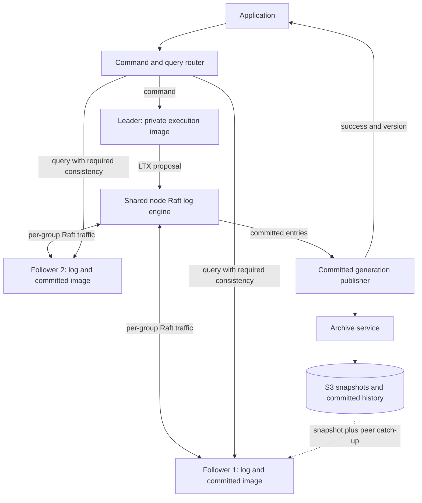

# Cellar multi-Raft technical design

Status: proposed implementation contract. Baseline and source hashes are in
[baseline.json](baseline.json); execution order is in
[implementation-plan.md](implementation-plan.md).

## 1 Scope and architectural decision

Introduce an opt-in Raft namespace. Every cell in that namespace has an independent
group with three voters and optional learners. Replicas persist a Raft log whose
normal data entries contain LTX page changes. Only the leader executes commands;
all serving replicas apply committed history to read-only SQLite generations.
S3 stores committed snapshots, archive segments and recovery manifests.

`Fleet` names the current mode, which uses lease-based ownership, follower
durability proofs and an object-store fallback. Its replicated write path
acknowledges writes after all installed durability followers fsync, before S3
upload. `FleetShipper::ship_batch` and `log_tier::ack_fleet_allowed` implement that
rule. Its bucket fallback and owner CAS are correct for that protocol. Raft mode
replaces those decisions with quorum consensus; changing the follower count alone
would not implement consensus.

First release supports bounded, fully materialized databases, one outstanding
data proposal per cell, three voters across three configured failure domains,
automatic repair, read learners, and the query modes below. Development fixtures
may place all members on one machine but cannot claim zone resilience.

Use three voters because a majority of two can continue after one voter fails.
A two-voter group needs both votes and cannot continue writes after either fails.
S3 and read learners do not vote or substitute for a missing majority.

The performance hypothesis is lower tail latency when one follower is slow and
faster failover through elections, plus additional query capacity on replicas.
Healthy-write speedup is not guaranteed: persistent logs, digest computation and
committed-image publication add work. Adding nodes distributes cells; a single
hot cell still has one leader and one outstanding data proposal in this release.

Excluded from the first release: live conversion of Fleet cells, multiple cells
per group, automatic hot-cell splitting, arbitrary native mutable handlers,
cross-cell transactions, timestamp-wide snapshots, clock-lease reads, general
multi-region writes, and S3-only activation of an existing group without quorum.

## 2 Source ownership

| Existing component | Change |
| --- | --- |
| `crates/cellar-logic/types.rs`, `output_gate.rs`, `cell.rs`, `routing.rs` | Typed Raft authority, proof settlement and mode-aware activation/routing |
| `crates/cellar/actor/effects.rs`, `production.rs`, `output_proofs.rs` | Execute consensus effects and return versioned observations |
| `crates/cellar/durability/replication/backend.rs` | Reuse exact WAL capture mechanics; do not credit old fleet/bucket tickets for Raft cells |
| `crates/cellar/durability/log/mod.rs` | Fleet node-log ownership remains isolated; no Raft quorum policy hidden in this shipper |
| `crates/cellar-ltx/src/db.rs`, `ltx.rs`, `host.rs` | Add bounded capture/apply/checksum/image mechanics through injected filesystem services |
| `crates/cellar/storage/sqlite/mod.rs` | Private execution opener and separate committed query opener |
| `crates/cellar/runtime/invocation/gates.rs`, `runtime/workers/native/mod.rs` | Enforce command/query capabilities and activation fencing |
| `crates/cellar/node/embedded.rs`, `fleet/ownership.rs`, `fleet/peer/auth.rs` | Mode configuration, lifecycle ownership, directory records and authenticated transport |
| `crates/cellar/application/cells.rs`, `sdk.rs` | Explicit command/query facade and portable version tokens |

Add private `crates/cellar/durability/raft/mod.rs` and focused children for
runtime, storage, transport, apply, archive, snapshot and membership. Map it from
`lib.rs` with `#[path]`, preserving existing public paths. Add dependency-free
decision types in `crates/cellar-logic/consensus.rs`. The consensus adapter owns
`RawNode`; no raft crate, I/O or async work enters `cellar-logic`.

The adapter may mutate its consensus-machine state. It cannot directly admit a
business invocation, publish query readiness or release outputs: it reports
observations through the serial actor/core, carrying the full operation identity.

## 3 Identity and authority

Persist these distinct identities; do not reuse numeric epochs for several roles:

| Identity | Meaning |
| --- | --- |
| `ClusterId`, `NamespaceId`, `CellId` | Authorized routing and tenant scope |
| `GroupId` | Stable group identifier, never reused |
| `IncarnationId` | New history after explicit disaster restore; never inferred from a term |
| `MemberId` | Stable voter/learner identity within the incarnation |
| `NodeId`, `DiskLineage`, `ProcessGeneration` | Physical placement and process/disk ownership |
| `Term`, `LogIndex` | Raft leadership generation and ordered entry position |
| `ActivationGeneration`, `OperationId` | In-process command and callback fencing |
| `LtxEpoch`, `Txid`, `Checksum` | Physical database lineage and page-chain position |
| `ImageDigest` | Mandatory SHA-256 binding of the complete physical state at a committed cut |

Persistently map `(GroupId, IncarnationId)` to the log engine's numeric group
key. Allocate keys monotonically in the same engine; never hash into a key with
unhandled collisions. On disk loss, join with a new member identity through the
surviving group. An empty disk must not resume an old voter identity and vote
again without its persisted term/vote history.

A command activation is valid only for the observed leader term, process and
activation generation. Before admission, the leader must establish commitment
in its current term and apply through its startup barrier. Loss of leadership
closes admission, invalidates retained capabilities and cancels pending private
execution. A committed result can be recovered by its receipt even if a local
callback was fenced. A timeout after proposal submission is ambiguous.

Raft term is not an independently enforceable fence at an arbitrary external
API. External effects use committed intents and destination idempotency/receipts.

### Namespace mode and group birth

An immutable namespace root selects `Fleet` or `Raft`, schema/protocol digest,
cluster identity and storage prefix. The application identity also binds required
command names/contract digests; query contracts are checked independently at
serving. Both code paths refuse a conflicting mode.
Use conditional object-store creation for the initial root and per-cell birth
record. Raft data lives under a disjoint `raft/<cluster>/<namespace>/` prefix;
Fleet takeover, GC and lease renewal must never operate on it.

The birth record fixes group/incarnation, initial member IDs, placement and an
initial empty-state digest. Simultaneous creators converge on the same record;
they do not mint separate groups for one cell. Only named members may initialize
that configuration. Each persists the birth identity before participating. Lost
creation responses are resolved by reading that record. Retry an incomplete
birth with the same identity; never replace it merely because a lease expired.

Initial voting also requires a permanent, conditionally created per-member
bootstrap claim binding MemberId, DiskLineage and the birth digest. First sync
the local initial state, then establish/read back that claim, then permit voting.
If a claim already exists but its matching local stable state is missing, refuse
blank initialization under that identity. A failed or ambiguous claim cannot be
worked around by changing directories. This prevents a retry of initial creation
from resetting a voter's term/vote history. A stranded initial configuration
without quorum needs explicit new-history recovery, just like an established one.

Once initialized, only committed Raft configuration changes alter membership.
Directory objects contain discovery hints and desired placement, not a second
write authority. A stopped member remains a member until the group removes it.
Birth records and deletion tombstones are retained to prevent identity reuse.

## 4 Safety invariants

| ID | Required invariant |
| --- | --- |
| I01 | A successful command is covered by a committed entry and the requested durability mode |
| I02 | Queries and effects never observe private uncommitted execution state |
| I03 | Stable entries and votes precede all persistence-dependent responses |
| I04 | A published SQLite generation and its applied position are crash-consistent |
| I05 | Applied history is a contiguous prefix of the group's committed history |
| I06 | A group has one authority protocol; S3 cannot override quorum loss |
| I07 | Stale process, term, activation, request or snapshot completions cannot release current work |
| I08 | Minimum-version reads verify identity and coverage; linearizable reads use a fresh barrier |
| I09 | Archive heads describe complete recoverable committed prefixes and never regress |
| I10 | Compaction preserves a durable snapshot and all required recovery/retention references |
| I11 | Membership changes preserve Raft configuration rules, including joint states |
| I12 | Receipts, business changes and outbox intents share the replicated transaction |
| I13 | Resource exhaustion returns a typed refusal or backpressure, never a weaker proof |
| I14 | Shutdown joins owned tasks and reports unfinished work without fabricating durability |
| I15 | Restored/new incarnations never satisfy tokens or messages from unrelated histories |
| I16 | Fleet behavior is unchanged when Raft mode is absent |

## 5 Log and persistence contract

Select `raft = "=0.7.0"` with its rust-protobuf codec and
`raft-engine = "=0.4.2"` as the initial integration versions. Declare direct
dependencies centrally, use the repository lockfile, and adapt logging through
the host. MR-02 must verify codec compatibility, license/toolchain compatibility,
filesystem injection, sync semantics and error behavior before proceeding.
An incompatibility requires a documented dependency decision; `MemStorage` is
only a test fixture and is never a production fallback.

The [storage integration record](storage-integration.md) specifies the attributed
filesystem/protobuf adaptations and direct dependency paths used for SDK source
consumers. An explicit host-seeded election RNG constructor retains the upstream
election algorithm while making its randomness belong to the execution domain.

One node-wide engine stores entries and per-group metadata. The storage adapter
implements raft-rs `Storage`, including term lookup at the compacted boundary,
conflict truncation, snapshot availability and restart state. Entries can contain
uncommitted suffixes; archive and apply paths cannot consume them as committed.

The initial adapter owns the engine on one execution-domain blocking worker and
publishes bounded group caches only after sync. RawNode's synchronous Storage
lookups read those caches without filesystem I/O. Cached log bytes remain backed
by the engine; cache exhaustion refuses additional writes until snapshot
compaction reclaims space. Storage limits and scale qualification remain separate.

`CellUpdateV1` contains cell/group/incarnation identity, application/schema digest,
base LTX position and image digest, resulting position and image digest, proposal
ID and an ordered sequence of complete LTX files. Receipt/result and outbox rows
are inside those bytes. Normal
Raft entries also carry term/index; configuration and no-op entries have no data
delta. Never derive a Raft index from TXID or the existing output ticket counter.

The marker-1 Cellar envelope starts with ASCII `CLRF`, big-endian u32 marker 1,
big-endian u32 header length and big-endian u64 payload length. A bounded UTF-8
JSON header follows, then concatenated raw LTX files and a SHA-256 digest of the
entire preceding frame, including its prefix. The required protocol digest is
SHA-256 of UTF-8 `cellar-raft-ltx-1`. A bounded file table records offsets,
lengths, TXID ranges, page counts and decoded page bytes;
entries partition the payload exactly and form one contiguous ordered chain.
Use decimal strings for 64-bit fields in the JSON header; reject duplicate keys,
unknown required protocol digests, excessive lengths and trailing bytes. The
transport authenticates the complete envelope. LTX CRC checks detect corruption
but do not authenticate peers. Keep upstream LTX bytes unchanged.

Initial defaults bound the header at 64 KiB, encoded payload at 16 MiB, file
count at 64, decoded page bytes at 64 MiB and decoded page count at 131,072.
The envelope enforces declarations; the physical LTX decoder independently
counts actual decoded bytes/pages and verifies those declarations before apply.
Untrusted declarations cannot authorize unbounded decompression. Limits may be
lowered; the codec rejects zero limits and limits above its hard allocation caps.

The current `Db` L0 writer sets `HEADER_FLAG_NO_CHECKSUM` and writes zero database
pre/post checksums; `seed_continuation` also emits a zero-page local marker. Those
values are not evidence of database equivalence. Preserve the LTX format and add
mandatory base/result image digests to the Raft envelope. Define the digest input
as big-endian u32 page size and big-endian u32 committed page count followed by
ascending big-endian u32 page-number/page-byte pairs, excluding SQLite's lock
page and bytes beyond the committed size. The leader computes the result from the frozen SQLite
state including its WAL overlay; each applier independently recomputes it. Verify
LTX's own database checksums additionally when present, and always verify file
integrity. A zero checksum must never disable envelope image verification.

For the first release, one proposal contains one complete business transaction
and its bounded ordered capture cut. Capture can produce several LTX files because
SQLite/control-table checkpoint work can also write. Include every intervening
control write in the proposed sequence and publish its terminal state atomically.
The proposal boundary is not inferred from a single file or TXID increment.
Oversized commands fail before proposal admission after private capture; they
cannot be split into independently visible partial entries. Explicit chunked
transactions would need a separate atomic assembly protocol.

### Ready processing

Start with one outstanding `Ready` per group and asynchronous disk work across
different groups. A group pauses mutating `RawNode` calls while its `Ready` is
outstanding; other groups continue. Batch independent groups' persistence work
in the shared engine without losing per-group order.

1. Collect entries, HardState and any incoming snapshot. Stage and validate the
   snapshot image before its install can be acknowledged.
2. Persist log/configuration/snapshot metadata and required term/vote changes.
   The first implementation conservatively syncs the batch before advancing.
3. Send persistence-dependent messages only after that completion. Sending all
   messages after persistence is a valid conservative first implementation.
4. Use `advance_append` after persistence and process `LightReady`, including its
   commit-index update. Persist commit advancement before publishing a later
   applied state. Do not lose these updates by handling only the original Ready.
5. Feed committed entries into the ordered apply queue, including no-ops and
   configuration changes. Apply configuration changes through raft-rs and
   persist resulting ConfState with the recovery metadata.
6. Call `advance_apply_to` only for the completed applied prefix. Query publication
   and output settlement separately report their exact covered position.

Do not run blocking disk I/O in the actor or consensus scheduling loop. Every
completion carries group/incarnation, disk/process identity and sequence. An
engine sync failure quarantines affected storage and closes proof admission;
it cannot be converted into a successful flush. Advanced asynchronous Ready
pipelining is a later optimization with separate ordering tests.

## 6 Command execution and speculative state

The current SQLite commit occurs before LTX capture. Replicating those bytes
afterward requires explicit separation between private execution and public state.

First implementation uses two paths per active leader: a private writable image
and committed immutable generations. No query or external-effect worker opens
the private image. Commands use the restricted contract in
[application-contract.md](application-contract.md), not arbitrary existing RPC
handlers. One command is one local transaction, including its durable receipt.

1. Pin the current committed base and verify leader readiness. Acquire the cell's
   single command slot. If the private image does not exactly match that base,
   rebuild it from the committed generation.
2. Check `(client_id, command_id)` and request digest. Return an existing committed
   receipt for a duplicate; reject the same identity with a different digest.
3. Execute the command in one transaction. Record encoded result and any outbox
   intent. Commit privately, capture the complete LTX cut and frozen result image
   digest, and freeze further execution until proposal outcome is resolved.
4. Verify the proposal's base equals the latest accepted data prefix, then submit
   it. If it is rejected before submission, discard/rebuild the working image.
5. On commit, apply the exact LTX bytes to the committed state, publish the
   generation, and bind the receipt to the applied Raft position. Do not apply
   the same bytes a second time to an already-advanced private image.
6. Settle through the core output gate after committed publication, plus archive
   proof for an S3-durable request. Release the command slot and reuse the private
   image only if its verified state still matches the committed head.

If leadership changes or a crash interrupts any step, rebuild private state from
the authoritative committed prefix. Never continue from a surviving SQLite file
solely because it contains a larger TXID. An uncertain proposal may eventually
commit; retain the same command ID on retry and consult the replicated receipt.
Never propose a second command based on an uncertain, possibly rejected delta.

Schema initialization is a leader-generated first update based on a canonical
empty cell image. Followers apply that update without running constructors.
Schema migration is an explicit replicated command with deployment compatibility
checks. No-op business commands still persist their receipt when a durable result
is promised; Raft no-op entries remain separate protocol entries.

The Raft capture adapter exclusively owns maintenance of its private image.
Ordinary Fleet `LtxRepl` upload/checkpoint loops cannot run against that path.
Seed capture cursors from the verified committed LTX position on reopen; local
zero-page continuation markers are capture bookkeeping, not replicated data or
archive proof. Any schema/control write made while opening the private database
must be included in the next proposed cut. Never let maintenance change the
working base while a proposal is pending.

## 7 Applying LTX and publishing SQLite state

Add a physical apply primitive to `cellar-ltx`: validate page size, complete TXID
coverage, mandatory envelope image digests, optional LTX database checksums,
page indices, database growth/truncation,
and image length. Existing decode/restore code is not sufficient evidence that
incremental apply is safe. Reject malformed, missing, duplicate-conflicting or
wrong-base updates; do not skip a broken entry and advance the index.

The correctness-first publisher creates a new immutable generation for each
applied data cut. Copy the last generation (reflink optional, byte-copy fallback),
apply pages to the new file while no SQLite connection has it open, verify it,
sync the image, rename to a unique final name and sync the directory. Never patch
a file that an `immutable=1` SQLite reader can reference.

Then persist an engine apply marker naming that image, its digest, group identity,
Raft index/term, LTX position and ConfState as needed. Only after its sync may the
actor publish the image or acknowledge the command. A crash before the marker
leaves an orphan image; a crash after it finds a fully durable image. Retain the
previous valid generation and required log until the new marker is durable.
No-op/config entries can advance metadata while referencing the same image.

The image publication cost may dominate writes for larger cells. First release
enforces a configured materialized-size ceiling and measures this cost. It does
not claim that full-image copying achieves the later scaling targets. Page
versioning, redo-based application or a VFS overlay requires MR-16's design gate.

Readers pin the generation for the entire query. Evict only unreferenced images;
long queries consume the configured retention budget. Applied progress can run
ahead of query publication only if both positions are separately tracked and
minimum-version/ReadIndex checks use the actual pinned queryable position.

## 8 Reads and version tokens

Expose `Stale`, `AtLeast(version)` and `Linearizable`. Every successful result
returns its served version. Each query is side-effect-free and uses a single
committed image for its entire lifetime.

| Mode | Admission and execution |
| --- | --- |
| Stale | Pin any valid committed generation allowed by the disconnected-read policy |
| AtLeast | Validate token scope/incarnation; wait for a queryable generation at or beyond its committed index |
| Linearizable | Obtain a fresh safe ReadIndex barrier through the leader, await local query publication through that index, then pin and execute |

For linearizable reads, correlate a unique request context with the original
invocation and deadline. Use `ReadOnlyOption::Safe`, `check_quorum` and pre-vote.
Never substitute local `commit_index`, wall-clock freshness, or a cached leader
lease. A missing quorum returns unavailable/timeout, without downgrading to stale.
The leader must have established current-term commitment before completing the
read barrier. Batch compatible pending read barriers without reusing one from
before a new request's invocation.

Tokens authenticate namespace/cell/group/incarnation, committed log index and
entry term or checkpoint binding. A normal leadership change preserves token
meaning. A disaster-created incarnation rejects old tokens; no numeric index
comparison crosses incarnations. Key rotation retains verification keys for the
documented token lifetime. Authorization is checked independently of the token.

Distribute new verification keys before switching signers. A bounded conditional
namespace registry records public keys and final verification deadlines; restart
refuses to remove or change a still-live verifier. Retain keys until all tokens
they can issue have expired. The registry verifies configuration retention and
cannot introduce a trust root absent from the server's explicit configuration.
Keep private signing material outside the object store. Reconcile an ambiguous
registry update by exact reads before serving with the changed key set.

The default stale-read policy rejects a replica after its source-observation
deadline. An explicit disconnected historical-read policy may permit a valid
snapshot, but conveys no time bound. Time-bounded staleness is unsupported.
Route by advertised queryable position as a hint and verify again at the server.
Use bounded retry and one optional leader fallback under the same consistency
mode and original deadline.

## 9 Durability and S3 archive

`Quorum` success requires Raft commit and durable local state publication.
`S3` success additionally requires a recoverable archive cut covering that command.
The namespace defines the minimum permitted durability; requests may strengthen
it. Durability choice is persisted with the command receipt, so retry cannot
silently weaken it. Returning a stored result with stronger requested durability
waits for the stronger proof.

Quorum mode protects acknowledged writes while the deployment preserves the
required replica disks. Complete loss of those disks can lose the unarchived
tail. S3 mode covers successful writes in the archive, including dependencies
such as immutable Blob objects referenced by the state. Neither mode guarantees
availability without Raft quorum. S3 outage in Quorum mode consumes bounded local
retention until admission is backpressured; S3-mode writes can time out ambiguously
after consensus commit.

Track separate contiguous positions: `persisted`, `committed`, `applied`,
`queryable`, `archived`. Always `queryable <= applied <= committed`; archived is
an independently verified committed prefix and may advance differently from a
particular follower's applied progress. Never combine unrelated maxima into proof.

Archive immutable objects under group/incarnation-scoped keys including range
and content digest. Node-wide bundles may combine several groups, with indexed
ranges and end-to-end checksums. An archive manifest names a full snapshot plus
an ordered covering tail, entry term/index metadata, LTX mappings, configuration
history needed for reconstruction, schema digest and referenced object dependencies.

Upload all referenced objects, validate completion and only then conditionally
advance the manifest head. On an ambiguous PUT/CAS result, read and validate the
exact object/manifest. A delayed worker may publish an older valid committed cut
only if it does not regress or conflict with the head; it cannot publish private
or merely persisted entries. Every worker input is an immutable core-accepted
committed receipt, not a mutable DB position sampled later.

Archive proof can jump over already-compacted data only via a complete snapshot
covering that cut. Normal Raft compaction and archive retention are separate:
delete a local prefix only when a durable Raft snapshot replaces it, and retain
either the necessary archive tail or a pinned image that can establish the
required S3 recovery cut. Disk pressure never silently discards the only copy
of an acknowledged unarchived update.

## 10 Snapshots and recovery

S3 recovery is organized by cell/group history, rather than by physical node.
A replacement node restores the cells assigned to it from verified snapshots
and committed archive tails, then catches up with their live groups. It need
not reproduce the failed node's placement. Process identity, old votes and
leadership are not restored from a cell archive; a replacement with lost storage
joins under a fresh member identity through the surviving group's protocol.

A Raft snapshot contains group/incarnation, included index/term, ConfState,
application/schema digest, LTX position and checksums, immutable database image
digest/length, and any receipt/outbox/dependency metadata not inside the image.
A SQLite file or LTX snapshot alone is not a complete Raft snapshot.

Snapshot transfer uses bounded chunks with end-to-end verification. Receive into
a private temporary generation; sync/rename the completed image, then atomically
persist the install marker, log boundary, HardState/ConfState and applied marker
in the engine. Only then acknowledge installation and make the group queryable.
Restart selects the engine marker, removes unreferenced temporary state and never
combines a new image with old membership metadata. Retained readers of the old
generation finish safely.

On normal restart, exclusively lock the node directory, verify disk lineage,
recover the log engine, validate image markers and replay committed entries after
the latest usable snapshot. Preserve uncommitted entries for Raft reconciliation;
they do not authorize commands or reads. Reject corruption rather than guessing
`commit = max(commit, applied)` to hide missing persistence.

On leader failure, the surviving majority elects a leader. It establishes a
current-term commit barrier, reconstructs committed execution state and resumes
commands. A follower with a durable log but slow apply may vote, but cannot serve
advanced reads or admit leader commands until its state is ready.

Loss of local storage creates a new member identity. The controller asks a
surviving leader to add it as a learner, installs a snapshot and catches up before
promotion. S3 may supply snapshot bytes, but the live group authorizes membership
and the accepted position. If no majority survives, normal service remains closed.

Disaster restore is an explicit operator operation into a new namespace, new
groups/incarnations and a new external routing generation. It never overwrites
the immutable birth records of the source namespace. Before routing writes, fence the old deployment
through infrastructure credentials/network isolation or verified shutdown; S3
metadata alone cannot stop an old reachable quorum. Restore a verified archive,
report its recovery point and possible missing Quorum acknowledgements, create
new members, reject old tokens, and retain the old history for reconciliation.

The operator supplies a manifest for the selected recovery set. Per-cell archive
heads do not imply a globally consistent point across cells. For coordinated
application recovery, use a quiesced export or an application reconciliation
procedure; the v1 restore tool must report this limitation and never invent a
fleet-wide transaction boundary.

## 11 Placement and membership

Use deterministic placement candidates from current healthy capacity within
namespace/pool and failure-domain constraints. A partitioned controller proposes
changes; group consensus decides them. Bind each request to desired-plan version
and expected current configuration, rechecking after every asynchronous step.
Multiple controllers may retry the same desired plan without creating duplicate
members or replacing a live configuration from a stale directory record.

For repair: add one learner, transfer/catch up within lag and snapshot budgets,
promote through `ConfChangeV2`, then remove the obsolete member using the required
configuration transitions. Respect both majorities during joint consensus and
finish leaving joint state before treating removed nodes as disposable. Limit
one active membership transition per group. No quorum means no forced removal.

Move leadership away from overloaded/draining nodes only to eligible caught-up
voters. Read learners have separate query/apply budgets and do not enlarge the
write quorum. Balance leaders and bytes as well as replica counts. Keep spare
capacity for losing the largest qualified failure domain.

## 12 Runtime budgets and security

Each node owns one lifecycle-bound multi-Raft service. It partitions groups across
bounded event loops, shared disk/apply pools and pooled authenticated transport.
Control messages have reserved capacity so snapshot transfers and user queries
cannot starve votes and heartbeats. Bound bytes, not just message counts.

Use independent control, LTX and query listeners/connections with separate byte
and item admission. A query awaiting LTX catch-up must not occupy the connection
needed for that replication. Query frames use distinct MAC domains, TLS exporter
labels and marker-1 framing. Bind replies to their exact request and payload;
force local destination execution so routing cannot recurse between replicas.
Deduct queue/handshake time from a forwarded timeout and independently retain
the invocation deadline at the origin. Closing a query connection cancels its
destination waiter; callback ownership remains joined before resource release.

Configuration must explicitly bound resident groups, open databases, command
slots, proposal bytes, peer queues, in-flight bytes, apply queues, snapshot slots,
snapshot bandwidth, archive backlog, pinned query generations and controller work.
Starting defaults are development settings requiring workload qualification;
zero/unbounded production limits are refused. Reject oversized input before
allocation/decompression and cap decoded LTX size and page count as well.

Authenticate both requests and responses on transport. Reuse the peer-auth
identity model, add target/source process and group/incarnation binding, and use
TLS for confidentiality. The existing request signature alone must not be assumed
to authenticate a response. Unknown group traffic does not instantiate a group;
creation/join requires a valid birth or membership authorization. Reject replay,
cross-tenant routing, stale incarnation and schema/protocol mismatches. The trust
model is crash-fault tolerant, not Byzantine tolerance against compromised voters.

## 13 Effects and shutdown

Timers, alarms, outbox delivery and workflow progress execute only from committed
state with current leader activation authority. Persist scheduling and delivery
receipts as commands. Followers apply state but never run background business
callbacks. Leadership loss cancels delivery attempts; destination deduplication
handles effects that raced with cancellation. Durable wake discovery is rebuilt
from committed state without requiring incoming traffic.

First release does not silently enable every existing SDK building block. Register
Raft-compatible capability adapters explicitly; unsupported bindings fail during
application validation. The implementation plan includes alarms and outbox;
other workflows/queues require equivalent command-based adapters before admission.

Shutdown closes command admission, drains accepted proposals within deadlines,
attempts safe leadership transfers, flushes required local state, reports archive
lag, cancels transport/workers and joins execution-domain tasks. A timeout never
forces a successful acknowledgement. A whole-fleet shutdown in Quorum mode must
retain durable disks or explicitly await a complete S3 recovery cut before those
disks can be discarded. Returned shutdown evidence distinguishes these outcomes.

## 14 Compatibility and release

Keep the feature off by default. Enable new isolated namespaces after all peers
support the same development protocol/schema digest. Cellar-owned markers remain
1 per repository convention; incompatible development state uses a hard cutover
with explicit preservation/export of needed data. No implicit migration reader.

Disabling the feature does not make existing Raft data readable by Fleet mode.
Rollback means route back to a compatible Raft binary or stop admission while
preserving the group disks. Export/import into another namespace requires a
quiesced verified boundary and is a later migration tool, not a flag flip.

## 15 Primary references

- [raft-rs scope](https://github.com/tikv/raft-rs): consensus core; integrator owns storage, state machine and transport.
- [RawNode 0.7.0](https://docs.rs/raft/0.7.0/raft/raw_node/struct.RawNode.html): Ready lifecycle, ReadIndex and application advancement.
- [Ready 0.7.0](https://docs.rs/raft/0.7.0/raft/raw_node/struct.Ready.html): persistence-dependent message ordering.
- [Raft Storage](https://docs.rs/raft/0.7.0/raft/storage/trait.Storage.html): persistent lookup and snapshot interface.
- [Raft Engine](https://github.com/tikv/raft-engine): selected shared multi-Raft log engine; Cellar's adapter remains necessary.
- [Raft paper](https://raft.github.io/raft.pdf): quorum, membership and snapshot foundations.
- [SQLite isolation](https://www.sqlite.org/isolation.html) and [immutable URI](https://www.sqlite.org/uri.html): local transaction visibility and immutable-reader constraints.

The Cellar-specific protocols and limits above are proposed engineering choices,
not guarantees supplied by these libraries.
