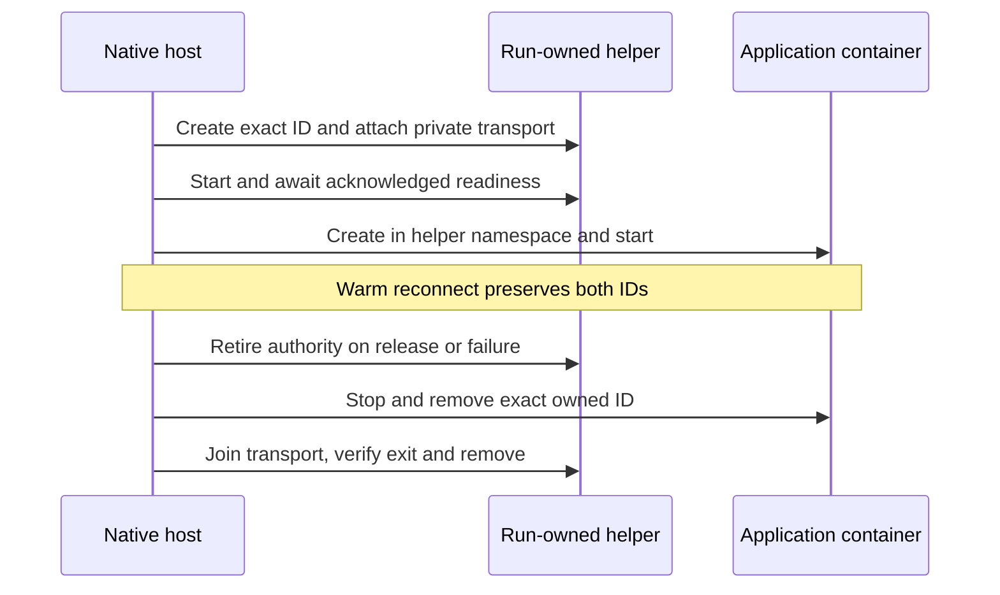

<!-- Copyright 2026 Cellar Project Authors. Licensed under Apache-2.0. -->

# Sandbox provider implementation ledger

Objective: deliver the full
[sandbox provider and compatibility plan](sandbox-provider-compatibility.md),
including local published Cloudflare package compatibility, portable four-language
controls, the named remote providers, lifetime/fencing/reconciliation behavior,
and the plan's live and fault qualification. This ledger records progress; it
does not narrow that objective or turn fixture passes into full compatibility.

## Requirement audit

| Slice | Current evidence | Remaining work / completion evidence |
| --- | --- | --- |
| SP-01 | Exact celld reference commit/files/license, npm packages/lock/integrities, imported runtime bytes and immutable Sandbox image manifest are in `tools/sandbox/compat`; drift/refusal tests pass; API/fixture inventory lists native mappings and explicit gaps | Input inventory implemented; runtime conformance remains in SP-02–SP-04 and later profiles |
| SP-02 | Native-backed DO SQL/KV/clone facade, activation-bound authority, object identity, value/returned-function namespace RPC and Node returned readable/writable byte streams and byte-stream input sessions, Request/Response results and HTTP-message arguments, and bounded default-source byte streams, event-style port WebSockets/local pairs, constructor admission, native input gates/reset, sync/async transactions and retained event/background drivers execute in Node/V8; actual published constructors are exercised; Node module HTTP dispatch, namespace bindings and activation-owned env execute against native cells | Complete loader/bootstrap, embedded web globals, other binding kinds, property/target RPC and lifetimes, full versioned lifetime/deadline qualification and profile/version admission; retain native-only dependency boundary |
| SP-03 | Actual published `@cloudflare/containers@0.3.7` constructor, state and SQL scheduling run in both engines; root-event/concurrency-block queued lifecycle and run-bound monitors; native callback admission remains held through void-control completion, with nested transaction/late-continuation refusal; Node runs published readiness with native HTTP ports, `onStart` controls, readiness `onError`, nonzero monitor/`onStop` parameters, idle SIGTERM sleep/wake cycles and persisted hook state; unchanged pinned module named/singleton/random routes execute against the engine peer; async alarm controls yield across overlapping native callback gates; Worker/DO/container WebSocket forwarding passes selected native paths | Embedded web globals, complete continuation/hook/timeout behavior, callback failure/cancellation and image lifecycle/upgrade/fault qualification |
| SP-04 | Actual `@cloudflare/sandbox@0.12.9` constructor/configuration and metadata recovery run in Node; matching upstream app/Dockerfile and `linux/amd64` image digest are pinned; unchanged application exec/file/background-process assertions pass against the real image, including later process discovery, in-object/DO HTTP/direct-RPC execStream, SDK destroy, a gated 2 MiB binary SDK RPC upload and exact binary download through Cap'n Web/local WS proxy, HTTP/WebSocket preview token/runtime routing and drained shutdown | Complete SDK HTTP/RPC/helper coverage and full RPC transport fault/lifetime semantics, complete process-helper/preview coverage, persistence/restart/fencing and failure cases |
| SP-05 | Four-language per-slot discovery and named host configuration; bounded files and protected revisioned journals; explicit reconnect/replacement; optional native scheduled expiry/cleanup with durable deadlines and fresh event authority; native fleet peers cover cold restart, removed classes, accepted-create owner expiry, handoff, provider API outage through repeated cold replacement and owner-specific object-store isolation; shared lifecycle admission prevents application/maintenance overlap; explicit terminal capability, metadata and resize controls pass the four-language native boundary | Richer operations, broader outages and partitions, physical cell deletion, remote fencing and live failure qualification |
| SP-06 | Experimental native E2B/Vercel providers implement bounded exec/files with durable binding reconciliation; protocol/restart/failure peers and CPython/Node/V8 fixtures pass; native fleet cleanup preserves the original generation without creation replay; operation and fencing gaps are declared | Live account/image, expiry, takeover and orphan qualification deferred until user configurations; broader framework/provider faults remain open |
| SP-07 | Separate 1.0.3 SDK/helper/base-image inputs; Node native exec and automatic byte-source stdin, callback-independent process observations and actual published Files operations execute against the matching helper, including cross-event binary files, explicit handle retirement and typed errors; native PTY/PID/resize now have matching-image kernel evidence; an optional native host profile owns helper-first startup, warm reconnect, failure retirement and paired cleanup; run-owned HTTP routes use fresh epoch gates, and the actual 1.0.3 DirectoryBackup/shim completes backup/restore/delete, fresh-process recovery, allocation/first-chunk cancellation and selected archive/control-acknowledgement failure paths through native HTTP and Blob storage; known-length part staging uses anonymous files and host byte/file limits, with incompressible matching-image input | HTTPS interception, S3 mounts, remaining extended container/helper APIs, abrupt crash/larger-transfer/verified-swap/lost-create/transport faults, orphan expiry, full persistence/versioned acceptance and live/remote profiles |
| SP-08 | No Daytona/Modal implementation yet | Provider implementations and individual process/files/storage/PTY/GPU/snapshot qualification |
| SP-09 | No Dynamic Worker or hosted Cloudflare provider yet | Actual isolate loader/limits/capability isolation; optional authenticated hosted gateway, outbound policy and cleanup qualification |
| SP-10 | Initial input manifest explicitly reports `conformance: not_run` | Publish operation/version compatibility results only after actual four-language, lifecycle, fault, resource, fencing and shutdown qualification |

## Delivery order

Keep the next milestones tied to usable published SDK operations. Extend the
shared native provider boundary when a feature needs it; provider selection and
credentials remain host configuration. Native Rust/Python/JS/TS controls stay
independent of the optional Workers runtime.

| Priority | Feature milestone | Acceptance boundary |
| --- | --- | --- |
| Delivered | Container-port WebSockets, local pairs, SDK binary upload/download and returned RPC responses | Pinned SDK/image round-trip; metadata, source-prefix/error, cancellation, ownership, output proof and joined cleanup tests |
| Delivered fix; broader qualification open | Requested V8 shutdown and initial-error diagnostics | Deterministic regression plus 97 selected native cases at original budgets; earlier cold-call delay remains unproven |
| Delivered Node slice | RPC `Request` transfers and HTTP-message arguments | Native metadata/body ownership, round-trip forwarding, pre-effect refusal, streaming in both directions, live abort after EOF and resource release |
| Delivered fix; profile partial | Overlapping callback/alarm resumptions | The original extra-barrier image probe passes after async alarm APIs use the asynchronous native bridge; deadlines and native gates remain intact |
| Delivered Node slice | Worker/DO/container upgrade forwarding and published Sandbox WebSocket previews | Native network tests, held-receiver disconnect and exact-image text/binary round trips with joined cleanup |
| Delivered selected slice | Concurrency-block controls and published error/exit hooks | Void controls join before native admission releases; nested blocks execute; transactions, inherited transaction views and late continuation admission refuse. Node exercises published readiness errors and nonzero exit/stop parameters |
| Delivered Linux startup fix | Large Node runtime bootstrap | Transfer source/configuration over the private pipe; bounded argv, no credential-bearing module URLs and fixed private initialization errors |
| 1 — qualification | Cold-first-call latency, callback failure/cancellation and remaining hooks/timeouts | The original 250 ms module failure and earlier two-second heartbeat remain open. The Linux wake port and stale-receipt transport fixtures have verified corrections. A newer CI binding revision conflict has a reproduced lifecycle-overlap regression and shared admission fix; fresh Linux CI remains required |
| Delivered shared slice; full profile partial | Explicit reconciliation, named portable bindings and retired-provider replacement | Per-slot discovery, independent durable resources and event-owned handles across Rust/Python/JS/TS; replacement requires confirmed retirement; no provider mutation replay |
| Delivered native/fleet slices; broader faults open | Supervised expiry/orphan cleanup and ownership-transfer faults | Durable deadlines and generation checks cover running-node cases, cold native fleet restart, removed classes, accepted-create owner expiry, handoff, provider API outage and owner-specific store isolation. Broader outages, partitions, physical deletion and remote fencing remain open |
| Delivered selected 1.x slice; full profile partial | Sandbox 1.0.3 native processes, files and directory backups | Independently pinned SDK/helper; byte-source stdin, callback-independent observations, kernel PTY/PID/resize, actual files and DirectoryBackup backup/restore/delete; fresh ownership gates and handler replacement on a retained HTTP connection |
| Following milestones | Remaining Sandbox 1.x, Daytona/Modal, Dynamic Workers and optional hosted Cloudflare | Independent profiles and the SP-07–SP-10 acceptance requirements |

Failure, lifetime and resource checks belong to each delivered feature. E2B and
Vercel live qualification remains deferred until configuration is supplied; it
does not block the local Cloudflare or common-framework milestones. This order
does not mark any partial SP profile complete.

## Native resumable upload foundation — 2026-10-27

The native Blob API now exposes backend-owned multipart identities separately
from the existing process-owned append pipeline. The local SQLite backend
persists replaceable indexed parts and current receipts across client/process
replacement. Completion validates receipts and publishes bytes/metadata while
retiring the upload in one transaction; abort preserves the current object.
Mutations retain native event authority and the Blob durability gate.

| Evidence | Result |
| --- | --- |
| Local object-store tests | 24 pass, including fresh-process resume, stale/foreign receipt refusal and concurrent completion/abort |
| Metadata capability refusal | 1 pass; unsupported metadata refuses before backend allocation |
| Native Blob integration | 1 pass at the existing 30 s budget; cell eviction, rebuilt bucket client, durable receipts, gate refusal and exact completed bytes/metadata |
| Fresh-process 64 MiB completion | Peak RSS growth 5,980,160 bytes, below the unchanged 16 MiB bound; exact streaming readback and upload-row retirement |
| Core Clippy | All library/test targets pass with `-D warnings` |
| Repository gates | Rust formatting/layout, native-only dependency guard, docs and whitespace checks pass |

See the [API and backend guide](../crates/cellar/application/blob/README.md).
This is a local native storage foundation: Workers R2 bindings,
`FixedLengthStream`, positive published backup/mount gateway tests and outbound
interception remain next. Automatic upload expiry/orphan cleanup and cloud
metadata initiation/qualification remain open. The pinned S3/GCS low-level API
cannot initiate metadata-bearing resumable uploads; that profile refuses before
allocation. No live account or container-image campaign is claimed here.

## Counted Workers byte streams — 2026-10-27

`FixedLengthStream` now provides the byte-count validation needed by the
published 1.0.3 directory-backup part gateway. It accepts safe integer number or
bigint lengths, preserves BYOB/backpressure and caller buffers, and propagates
short-write, overflow, producer-abort and consumer-cancellation failures. The
facade infers request/reply head lengths from privately branded streams, and
retains a request source's length through native body conversion without
reading option accessors twice or changing their receiver.

The native fixture caught a bundler collision: an upstream use of the global
name renamed the local constructor, making installation by `Function.name`
incorrect. Global installation now uses explicit API names, and the actual
pinned-package bundle passes its original native Worker test with binary
stream output and length-bearing routed requests. External streaming replies
retain the host's existing chunked framing policy; fixed-length external
response framing and cloned/teed length inference remain gaps.

| Check | Evidence |
| --- | --- |
| JavaScript/TypeScript suite | 137 pass, including count mismatches, cancellation, native request conversion, response-head inference, accessor behavior and package delivery |
| Native pinned Worker entrypoints | Initial full pass and five fresh-process repeats pass at original budgets; one intervening rerun reaches both stream checks, then fails the existing object route at its unchanged 250 ms deadline |
| Strict Node adapter Clippy | Library and Worker-entrypoint test targets pass with `-D warnings` |

The intervening cold-dispatch failure remains open; successful repeats do not
establish its cause or repair. On the preceding pushed head `274af242`, the full
Linux JavaScript/Node workflow `40529046449` now passes, including cold recovery,
archive/admission and fleet delivery. The SDK workflow `40529046736` is still
running, so the two new feature commits remain local to avoid cancelling that
qualification run.

This stream delivery does not qualify Workers R2 storage or the positive
backup/mount gateway paths. The native resumable storage foundation above and
these streams enable the next R2 binding slice.

## Native R2 gateway delivery — 2026-10-27

Explicit Workers `r2` bindings now call the native Blob backend. The supported
subset implements head, streamed/ranged get, single-key delete and resumable
multipart create/part/complete/abort. The native bridge validates fields/options
before effects; decoded part bytes retain their own runtime reservation through
entered backend work. Transaction callbacks refuse R2 I/O before dispatch.

The separately pinned `r2.mjs` fixture imports the unmodified published
`DirectoryBackupGateway`. It drives actual control RPC and HTTP operations
against native SQLite storage, rebuilding the node/client between the first part
and completion. No JavaScript bucket substitute supplies successful results.

| Qualification boundary | Evidence |
| --- | --- |
| Published gateway | Create, binary upload/replacement, stale-receipt refusal, short-part failure, oversized source cancellation, completion and exact ranged reads |
| Metadata and lifetime | Actual HTTP/custom metadata and uploaded date, direct body consumption, saved-binding/body refusal in later events and transaction refusal |
| Cleanup | Explicit abort/delete, drained nodes/runtime and zero remaining upload/part rows |
| Native capacity | A cancelled waiter retains its byte reservation while an independent SQLite writer blocks admission; the accepted part remains after backend completion |
| Current Rust tests | 89 unique cases: 28 shared guest, 57 Node library, two Worker integration fixtures, native Blob integration and the entered-I/O capacity control |
| JavaScript/TypeScript | 139 tooling/contract tests; both SDK input-identity suites and fixture builds pass |
| Quality | Strict core/guest and combined Node/V8 library/new-integration Clippy; 1,255-file Rust format/layout, 110-source JavaScript formatting, 466-package native-only dependency guard, docs and whitespace checks |

The initial direct `get()` fixture found an undefined optional `range` in a
strict JSON frame; omitted fields are now omitted before native submission.
The local compiler also reported an incremental-cache ICE. Validation reruns
with incremental compilation disabled; no test assertion or existing deadline
was relaxed. The dedicated storage fixture declares its own five-second handler
budget; the older 250 ms routing fixture remains unchanged and passes its final
campaign. Its separately recorded intermittent cold-dispatch failure is still
open.

All four Linux workflows for the preceding pushed head `274af242` are green,
including SDK runs for both standard/free-threaded Python ABIs and the complete
JavaScript/Node campaign. The new feature commits require fresh head CI after
push; prior-head green results are not qualification of these changes.

See the [R2 subset guide](../packages/cellar-cloudflare/r2.md). Full helper
backup/restore now requires outbound interception and complete grant lifetime.
S3 mounts, full R2 options/part-size semantics, large unbuffered uploads, automatic
expiry/orphan cleanup and cloud qualification remain outstanding. Additional
providers and SP-08–SP-10 work remain in the original plan; E2B/Vercel live
configuration is still deferred by the user.

## Updated main qualification — 2026-10-27

Merged `a9da48ac` cleanly after the feature commits. This includes verified
object-store extent snapshots and actual loaded Python ABI qualification.
The merged-head campaign passes 88 Rust tests: native Blob integration,
28 shared guest cases, 57 Node library cases and both Worker integration
fixtures. The entered-I/O capacity and earlier storage resource controls remain
separately recorded above. Combined core/guest/Node/V8 Clippy passes for all
library/test targets with `-D warnings`; Rust formatting/layout now cover 1,259
files. Native-only dependency, JavaScript formatting, docs and whitespace gates
also pass. Fresh CI is required for the resulting PR head.

## Native outbound transport and rule control — 2026-10-27

The new `cellar-egress` crate implements the private transport and rule-control
boundary needed for published Sandbox outbound gateways. It is not wired into
container startup and does not advertise `interceptOutboundHttp()` support.
The full SP-07 acceptance criteria and original provider goal remain open.

| Delivered component | Evidence |
| --- | --- |
| Canonical HTTP targets and rules | Host/glob, IP, IP:port, CIDR and catch-all matching; shared 128-entry budget; registration order; canonical default-port replacement; stale/foreign candidate and revision-exhaustion refusal |
| Bounded Yamux transport | 129 live streams, eight pending opens, explicit aggregate window; half-close, binary traffic, saturation, cancellation and retirement checks |
| Private Engine attach codec | Incremental Docker stdout framing with raw stdin; one-MiB frame ceiling; malformed/truncated/stderr frames poison both directions without frame-sized allocation |
| Acknowledged rule controller | Eight pending commands; queued cancellation skips effects; entered installation survives waiter cancellation; same-revision ack precedes visibility; missing/wrong ack, idle disconnect and controller drop retire rules |
| Helper control protocol | Session identity, monotonic revisions and acknowledgement only after the supplied network installer finishes; no claim that the callback itself installs kernel rules |
| DNS policy | Pinned Hickory parser; section-count checks before allocation; bounded single-question A/AAAA replies, zero-TTL placeholders, family-specific `/0` grants and explicit offline drop/online forward decisions |
| Current component campaign | 32 unit tests and one compiled README example pass; no existing deadline or assertion was relaxed |
| Repository gates | All-target/all-feature crate Clippy passes with `-D warnings`; Rust format/layout cover 1,274 files; native-only graph has 480 packages and no JavaScript engine; docs validate 825 references and 11 crate guides; whitespace check passes |

Two fault controls caught defects during implementation. A retained stream could
release buffered bytes before its driver observed closure; it now checks the
shared revocation flag on every I/O poll. An idle controller originally missed
peer EOF and exceeded its unchanged three-second test deadline; it now keeps
the control decoder polled while waiting for commands, without discarding a
partially read frame. Both regressions pass after their fixes.

Next connect DNS policy to UDP/TCP listeners in the helper's network namespace,
install and acknowledge firewall rules, capture actual socket destinations and
keep direct fallback inside the existing container fence. Then wire helper-first
startup, run ownership and joined removal into the engine, and route requests
through host-minted generation-bound Fetchers. Only after that integration should
the public capability be exposed and the unmodified helper backup/restore and
mount operations be positively qualified. HTTPS/CA handling, independent
intercept/fallback connection budgets and full profile fault qualification remain
required. E2B/Vercel live configuration remains deferred by the user.

The [outbound transport guide](../crates/cellar-egress/README.md) contains the
connection/installation diagrams, resource table and implementation boundaries.

## Linux outbound kernel qualification — 2026-10-27

The optional `cellar-egress` helper feature now supplies kernel original
destination lookup and marked TCP/UDP sockets. A validated nftables program
atomically replaces only its own namespace-local table, redirects HTTP and
UDP/TCP DNS, and enforces explicit offline output policy. HTTP registrations
that collide with DNS or helper listener ports refuse before installation;
the full profile must account for this limitation.

| Boundary | Current evidence |
| --- | --- |
| Actual kernel, Linux 6.8.0-117 | IPv4/IPv6 TCP port-80/8080 redirection, exact bytes and original destination; marked TCP bypass |
| DNS routing | IPv4/IPv6 UDP queries/replies, reverse-NAT source identity, marked UDP bypass and TCP port-53 byte/destination forwarding |
| Offline policy | A verified live external peer is refused through a new unmarked connection; marked access and inbound connection replies succeed |
| Replacement | The same namespace changes offline → online → offline; fresh unmarked connections follow each committed policy |
| Input identity and cleanup | Locked native build with repository version/checksum comparison; actual Rust/Node/qualifier image IDs and source hashes recorded; uniquely owned containers, network and image removed after success/failure |
| Local checks | 33 unit tests and one documentation test pass; Linux aarch64 all-target checks and strict all-feature/all-target Clippy pass |

The first actual-kernel run rejected an unquoted reserved chain name. Renaming
the chain fixed the syntax error; the unchanged behavioral campaign then passed,
and the expanded TCP DNS campaign also passed. No test was replaced with string
matching or an SDK substitute. The
[reproducible runner](../tools/sandbox/egress/README.md) and
[dedicated CI workflow](../.github/workflows/container-egress.yml)
retain build/runtime evidence; fresh GitHub execution remains required.

Rust format/layout cover 1,278 files, JavaScript formatting covers 111 sources,
and the native-only dependency guard reports 481 packages without a JavaScript
engine. Documentation and whitespace checks pass. The private VM's original
configuration and unrelated stopped container are preserved; its owned test
resources were removed and the VM returned to its stopped state.

The full helper control/data loop, persistent DNS TCP handling, bounded HTTP
routing, generation-bound Fetchers, helper-first engine startup and joined
ownership-loss teardown remain next. This kernel evidence does not enable the
public interception capability or establish published helper backup/restore,
mount, TLS or cloud compatibility. SP-07 and the original provider goal remain
partial.

## Owned Linux network-helper process — 2026-10-27

The optional `cellar-egress` binary now joins the native transport, real firewall
installation, DNS policy and connection relays in one dedicated process. It uses
nonblocking owned stdin/stdout pipe descriptors, independent 64-slot
intercept/direct limits and a separate 64-slot DNS budget. No detached Rust
tasks are spawned. Engine lifecycle and native Worker dispatch are still pending;
the public interception capability remains unavailable.

| Boundary | Current evidence |
| --- | --- |
| Actual process and control | The production binary starts over private pipes, applies actual nftables rules before readiness/installation acknowledgement, and exits successfully after joined retirement |
| DNS | UDP A/AAAA, persistent TCP observing later registrations, forwarded-answer identity, exercised forged-ID refusal and malformed-query isolation |
| Relay and replacement | Native protocol-peer HTTP bytes use the current committed handler across two requests on one live connection; marked direct fallback remains in the namespace |
| Pre-effect refusal | Typed offline, hostname and reserved-listener refusals; the external peer's connection and request counters prove no upstream effect |
| Installer faults | A fault-only wrapper stalls startup or an entered update; readiness/unacknowledged routes refuse, and timeout/retirement kills and reaps the tracked installer PID before process exit |
| Current local tests | 34 unit tests plus one documentation example pass; Linux aarch64 all-target checks and strict all-target/all-feature Clippy pass |

Broader kernel checks found two defects missed by loopback-only probes.
An offline connection to a non-loopback HTTP destination timed out at the
unchanged outer budget, while the same redirect succeeded with online policy.
The fence now explicitly admits DNATed traffic to the proxy listeners. A
separate pre-fix regression resolved the owned peer through Docker's private
loopback DNS socket, bypassing the port-53 redirect. Offline policy now drops
that unmarked access before the loopback/established allowances; marked helper
access remains available. The negative probe accepts only timeout or the
specific kernel `EPERM` send refusal, and requires a live marked DNS control.

Both regressions and the kernel/helper/retirement campaigns pass after the fixes.
The native protocol route peer does not replace the published SDK for positive
Sandbox qualification: no full Worker routing, engine startup/ownership teardown,
Sandbox backup/restore, mount or cloud claim follows from these tests. Per-class
saturation and additional kernel/runtime profiles also remain open.

The [network qualification guide](../tools/sandbox/egress/README.md) records the
three reproducible campaigns and source/image evidence. Build caches are scoped
to this checkout; the crate is recompiled from the captured source snapshot.
The full SP-02–SP-10 requirements and original goal remain active.

## Free-threaded typed-RPC qualification failure — 2026-10-27

The pushed `32e15e11` Linux typed-RPC run `40549293705` fails the portable
profile for CPython 3.14.10 free-threaded at `python->python/timestamp-min`.
The request reports a generic handler failure; later cleanup reports
`NodeLeaseExpired`. Their causal relationship is not established. The standard
Python profile, complete JavaScript/Node workflow, all four Python example jobs
and both standard/free-threaded SDK jobs pass. The typed-RPC free-threaded failure
remains a separate qualification gap.

Both local profile campaigns pass all 576 cases and their report/cleanup guards:
CPython 3.14.6 with the GIL and CPython 3.14.5 free-threaded on macOS, both using
protobuf 7.34.2. These different platform/patch controls do not repair or qualify
the Linux failure. The synthetic Python fixture now reports only a fixed failure
stage; the native matrix records bounded readiness observations before cleanup.
Exception details remain private, and request, lease, handler and shutdown
budgets and success assertions are unchanged. Diagnose the next failing Linux
observation before claiming a correction; this qualification priority stays open.

## Native Engine attach and helper topology — 2026-10-27

The native Docker client now attaches private stdin/stdout by full immutable
Engine ID before helper startup. Names and partial IDs refuse before connecting.
The actual helper and a separate Node application share one `runc` network
namespace only after readiness and acknowledged route installation. This is
qualified Engine transport/topology, not production cell lifecycle integration
or an enabled `interceptOutboundHttp()` capability.

| Boundary | Evidence |
| --- | --- |
| Raw Engine connection | Buffered upgrade bytes, raw stdin and half-close survive; malformed IDs refuse before connection |
| Refusal bounds | A declared oversized daemon error refuses before reading; actual received error bytes remain bounded to 64 KiB |
| Complete versus lost response | The pre-fix 404 control loses its complete daemon reply to macOS shutdown `ENOTCONN`. One final nonblocking response poll now preserves buffered completion; a truncated 200 reply still fails, without waiting or replay |
| Real application startup | Actual native attach precedes helper start; the separately started application resolves the registered hostname and completes an exact HTTP byte round-trip through real namespace rules |
| Startup failure | Missing installer produces the expected helper failure, refuses readiness and allocates no application container |
| In-flight retirement | After a real request arrives, transport retirement refuses further response writes, delivers zero response bytes to the application and joins the helper successfully |
| Native test campaign | Five Docker-client regressions, both existing native-container ownership/exec/port/restart cases and the Engine integration pass; all three real startup/retirement scenarios join successfully |
| Linux campaign | Kernel, helper, installer-retirement and native Engine campaigns all pass with explicit `runc`, Engine 29.5.2 and kernel 6.8.0-117-generic; source/image hashes and Engine build/runtime logs are retained |
| Environment | Both campaign owner labels are empty after cleanup; VM configuration checksum and Docker's default context are unchanged |
| Quality | Strict core/egress library/test Clippy with all features and `-D warnings`, 1,287-source Rust format/layout, 112-source JavaScript formatting, the 481-package native-only engine guard, docs and whitespace checks pass |

The two client regressions above were reproduced before correction and pass
with their original two-second bounds afterward. The Engine scenarios retain
their original 30-second per-case budget. Three additional fresh-process
free-threaded CPython 3.14.5/macOS controls also pass all 576 RPC cases and
runtime/report guards; they do not repair the separately recorded Linux
3.14.10 failure. No guest exception details or existing qualification assertions
were exposed or weakened.

See the [reproducible Engine campaign](../tools/sandbox/egress/README.md).
The next feature step is integrating this topology with production
`CellContainer` start/stop, ownership loss and generation-bound Worker dispatch,
then exercising the unmodified published Sandbox helper's backup/restore and
mount operations. Physical provider deletion, hard remote fencing, other runtime
profiles and the remaining SP-02–SP-10 acceptance work remain open; the original
goal is active. E2B/Vercel live configuration remains deferred.

## Immutable production container run resources — 2026-10-27

Production `CellContainer` state now records a typed full Engine ID with its run.
Waiters, exec handles, archive I/O, signals and removal use that captured ID.
Creation/name discovery validates ownership labels; restart cleanup checks full
IDs and host/node labels. Native invocation, activation, output/durability and
run checks remain in place. A lost create response is not automatically replayed.

| Boundary | Evidence |
| --- | --- |
| Name reuse | Rename the owned resource, occupy its old name with a foreign resource, then exercise files, exec, signals, monitoring and removal against the original ID |
| Foreign resource protection | Discovery refuses foreign labels; old-run cleanup, a subsequent refused start and domain shutdown preserve the live replacement and its identity |
| Process/file identity | The original monitor observes its original exit; the foreign replacement has none of the original file writes; native effect requests must contain immutable IDs |
| Rust | All three native container cases pass, including existing durability/activation/handle checks, host isolation, spec replacement and restart cleanup |
| Node/V8 | Both container capability cases and all five published module/restart/sleep-wake/hook cases pass at their existing budgets |
| Python | The CPython 3.14.6 GIL native-container facade campaign passes, including original event ownership, terminal, cancellation and joined runtime assertions |
| Actual Sandbox 1.0.3 | Matching unchanged image/helper campaign passes in 39.80 seconds: stdin, late reads, PTY/PID/resize, binary files, faults and destroy |
| Client regressions | All five private attach, bounded refusal, completed-response, truncated-response and half-close cases pass |
| Quality | Strict core/Node/V8/Python all-feature library/test Clippy with `-D warnings`; 1,287-file Rust format/layout, the 481-package native-only dependency guard, docs and whitespace checks pass |

The shared Engine peer now supplies distinct full IDs, preserves archive data
and waiters across rename, reports name conflicts and rejects deleted IDs. The
new identity campaign joins HTTP and exec peer tasks on its result path. Its
initial server shutdown failure was isolated to macOS `ENOTCONN`; only that
specific completed-peer shutdown and explicit cleanup cancellation are accepted.
Unexpected protocol failures and task panics remain failures. The new campaign
uses its declared 30-second outer budget and unchanged two-second monitor bound.

No public interception capability is enabled. The next feature step remains
production helper/application lifetime integration, ownership-loss retirement
and generation-bound Worker dispatch, followed by actual published helper
backup/restore and mounts. Native immutable resource identity supports that
integration; it does not complete provider hard fencing, physical deletion or
the remaining SP-02–SP-10 profiles. Live E2B/Vercel configuration remains deferred.

## Outbound CI image-input correction — 2026-10-27

Linux run `40583157657` completed the actual kernel, helper, installer-retirement
and native Engine campaigns, then failed while inspecting the Rust source tag
for its final report. BuildKit had used the base without loading that tag into
the daemon image store. The functional assertions and budgets were unchanged.

The runner now resolves the base before building, pulls only after a specific
missing-image response, and records its immutable Engine identity and platform.
It builds through a unique owned alias with pulling disabled, then removes only
that alias. Report generation uses the captured input. Locally built containerd
images may also report digests that are unavailable in a registry; those inputs
use the same alias path rather than assuming every reported digest is fetchable.

| Check | Evidence |
| --- | --- |
| Fresh-daemon CLI boundary | Missing image triggers one pull and reinspection; unrelated daemon failures propagate |
| Real default image | All four campaigns pass with the captured Rust image and exact native/helper source evidence |
| Real locally built image | All four campaigns pass through the owned alias; temporary aliases and campaign resources are absent afterward |
| Regression checks | Seven image identity/cleanup cases pass; Python compilation, documentation and whitespace checks pass |
| Environment | Original Rust image, VM configuration checksum and Docker default context are preserved |
| Linux follow-up | Fresh head CI remains required for the corrected runner |

At preceding head `7ba5ffa1`, Linux JavaScript/Node, all four Python-example jobs
and both standard/free-threaded typed-RPC campaigns pass. Both SDK jobs are
still running. These new passes
do not establish the cause or repair of the earlier Linux free-threaded
failure. The full provider profiles and original goal remain active.

## Joined native inactivity cleanup — 2026-10-27

A native regression reproduced an idle-lifetime defect: reconnect cleared the
stored task handle, but dropping that handle detached the timer. Its old deadline
later deleted the successfully reactivated container. The new cooperative
sweeper signals cancellation and joins before successful reconnect returns.
Cancellation is admitted while sleeping or waiting for SDK control; an entered
Engine deletion finishes before a reconnect or timer replacement can proceed.

| Native boundary | Evidence |
| --- | --- |
| Successful reconnect | Resource remains live beyond its previous idle deadline; a later idle eviction still removes it |
| Replacement inactivity window | Old timer retires; removal follows the new window |
| Entered deletion | Hold the actual Engine peer's delete acknowledgement; reconnect waits, then returns a new nonrunning handle after removal completes |
| Failed adoption | Foreign name discovery refuses while the original immutable resource's deadline still removes it; the foreign replacement survives |
| Explicit release | A separate pre-fix regression retains the removed cell through a pending 60-second timer; after cancellation/join, the weak resource handle retires before shutdown |
| Original contracts | Ownership/durability, exec/files/ports, host isolation, restart cleanup and renamed-resource identity cases all pass |
| Current native campaign | Eight tests pass; original assertions and budgets remain unchanged |
| Language adapters | Both Node/V8 container capability cases and all five published module/routing/sleep-wake/hook/restart cases pass after the final release correction |
| Quality | Strict native all-feature library/test Clippy; 1,288-file Rust format/layout, 481-package native-only dependency guard, docs and whitespace checks pass |

This fixes native inactivity ownership; it does not complete production network
helper integration, remote hard fencing, physical provider deletion or any
remaining versioned provider profile. The next feature priority remains owned
helper/application lifetime and generation-bound routing, then actual published
Sandbox helper backup/restore and mounts.

## Exact service deployment routing — 2026-10-27

A native regression confirmed that an absent generation silently selected the
current service Worker. HTTP, RPC and Queue service dispatch now use checked
lookup under the same current/draining snapshot. An absent nonzero generation
refuses before Worker admission. The public general-purpose lookup retains its
existing behavior, and the explicit unversioned host route (`0`) remains current.

| Boundary | Evidence |
| --- | --- |
| HTTP/RPC refusal | Unknown generation returns failure with no target-handler entry |
| Valid routes | Explicit current generation and unversioned host calls still reach the expected service |
| Queue refusal | Unknown generation leaves the consumer event uncreated; the original grouping, lease, settlement and transfer campaign passes |
| Shared native contracts | All five HTTP/service tests and the Queue integration case pass, including stream, cancellation, host policy and proof-gate controls |
| Published Worker/gateway paths | WorkerEntrypoint routing/props and the unchanged published DirectoryBackupGateway native resumable-storage fixture pass |
| Contract documentation | The routing guide distinguishes exact, absent and explicit unversioned routes |
| Quality | Strict native all-feature library/test Clippy, Rust formatting and documentation/whitespace checks pass; module layout and the native-only dependency graph are unchanged |

This closes the fallback that would invalidate a persistent container handler's
generation binding. It does not implement persistent Fetchers, production
helper/application lifetime, per-request ownership gates or HTTP interception;
those remain the next feature delivery. The full provider goal remains active.

## Production helper/application lifetime — 2026-10-27

An optional native host profile now gives each application run its own immutable
helper identity, private Engine transport and shared network namespace. The host
awaits helper readiness before creating the application. The application drops
all capabilities; only the helper receives `NET_ADMIN`. Selecting this profile
requires explicit `runc` and an immutable helper image with nftables.



| Boundary | Evidence / behavior |
| --- | --- |
| Actual production API | The real Engine campaign configures an execution domain and `ContainerEngine`, then starts the actual helper and separate Node HTTP application |
| Port ownership | Docker initially refused application `ExposedPorts` in shared-container network mode with HTTP 400; publications now belong entirely to the helper |
| Warm reconnect | The same application/helper IDs survive past the cancelled idle deadline; explicit release removes both |
| Failure | Missing installer allocates no application; killing the actual helper invalidates routing, preserves its original monitor error and removes the owned pair |
| Ownership | Native release retires authority synchronously before waiting for SDK serialization; full resource IDs and node/host/cell/class/run labels bound cleanup |
| Uncertain create | An empty Engine inventory cannot discharge a submitted create whose response/ID is unresolved; retain the cleanup obligation and helper capacity rather than replay creation |
| Startup races | Late readiness cannot restore failed transport authority; abandoning startup before helper allocation terminates its monitor and clears running state |
| Joined transport | Cancellation returns the task handle to its run; timeout aborts and joins it; repeated cleanup after confirmed removal is idempotent |
| Capacity | Each pending/allocated helper reserves another 256 MiB until removal is confirmed |
| Runner recovery | The test publishes ownership before allocation; timeout output is retained and recovery validates exact labels before removing containers, networks and that owner's nft table |

The completed source snapshot passes all real-image campaigns with Engine
29.5.2, Linux 6.8.0-117-generic, arm64 and explicit `runc`. The three production
scenarios finish in 4.62 seconds; existing kernel, helper, installer-retirement
and private Engine scenarios also pass. All three campaign owner filters are
empty after cleanup. Nine selected native configuration/lifecycle/port tests,
eight native container regressions and strict native all-feature library/test
Clippy pass. Both Node/V8 container cases and all five published module,
routing, sleep/wake, hook and restart cases also pass. The actual matching
Sandbox 1.0.3 image passes stdin, late reads, PTY/resize, files, faults and destroy
in 37.63 seconds. JavaScript tooling passes 139 cases, and the qualification
runner passes 13 input/ownership/timeout-recovery cases. Original case and
process budgets remain unchanged.

Selected quality gates also pass: strict Node/V8/provider library/test Clippy,
Rust format/layout for 1,292 files, JavaScript formatting for 113 sources, the
481-package native-only dependency guard, docs and whitespace checks. Qualified
source hashes still match the completed snapshot. Original base/Sandbox/fence
images, the VM configuration checksum and Docker default context are preserved;
the private VM is stopped after qualification.

Before the final pass, bounded HTTP diagnostics reproduce
a 403 without the owned fixture header at a VM-selected loopback publication.
A local bind after cleanup refuses that same port: Docker's VM allocator cannot
see occupied Mac host ports. The helper profile now selects and temporarily
holds available host-port candidates through creation, releasing them immediately
before helper startup so the VM forwarder can bind. A local reservation test
checks existing occupancy, unique selections, held capacity and release. This
reduces the host/VM allocation collision; it is not an atomic port handoff, and
macOS still requires a working daemon forwarder.

At pushed head `9dc616ec`, Linux JavaScript/Node CI fails the accepted-create
owner-expiry successor test. The exact local test passes, and new failure-only
readiness, witness, peer and shutdown observations preserve its original
15-second deadline. This is diagnostic progress, not a claimed Linux correction.
The same head's Linux outbound workflow passes, qualifying the earlier runner
image-input/report correction. Its typed-RPC free-threaded job passes, while the
GIL profile fails at `rust->node/empty-message`: pre-cleanup observations show the
owner already closed/unready and cleanup reports `NodeLeaseExpired`. Why renewal
was lost remains unproven; the earlier free-threaded finding is not repaired by
a later pass. SDK and Python-example workflows remain queued at this observation.

This profile enables native lifecycle ownership, not public outbound
interception. Persistent generation-bound Worker service routes, bounded HTTP
message dispatch, full published Sandbox backup/restore and mounts remain next.
Other runtime/provider profiles and broader ownership-transfer faults need their
own qualification. E2B/Vercel live configuration remains deferred, and the full
SP-02–SP-10 goal stays active.

## Verified implementation details

### Provider capability discovery

`cellar-container::Adapter::capabilities` describes host configuration without
creating a session or contacting an engine. Invocation-owned
`container.capabilities` is provided by the shared boundary, including for a
restricted provider that does not implement that operation itself. It requires
root-cell event authority and never reaches the provider's effect dispatcher.

The version-1 descriptor contains provider name, explicit execution environment,
actually supported operations, host body limit and the provider's declared
handle limit. Existing custom providers default to `unspecified` environment
and an unknown handle limit, rather than claiming Linux or unlimited resources.
Native declares Linux and its enforced 64-handle limit. Future snapshot, PTY or
isolate features are not advertised before their operations exist.

Python exposes an immutable dataclass/tuple; JS exposes a frozen descriptor and
operation list; TS declarations preserve readonly fields. This is a partial
SP-05 delivery, not a remote provider or compatibility implementation.

### Published input audit

The pinned Containers package executes synchronous Durable Object SQL from its
constructor and alarm scheduling and uses synchronous `storage.kv`. The Sandbox
package additionally imports Workers RPC/tracing and uses storage transactions
and the real Cap'n Web transport. Replacing SQL cursors with empty arrays or
rewriting package APIs is not acceptable conformance evidence.

The native operation boundary now has a bounded, invocation-owned synchronous
path for the optional compatibility runtime. SDK operations still execute in
the original native turn with the same operation/value budgets, effect
classification, epoch checks and cancellation. No language runtime thread
operates cell SQLite. A finite allowlist excludes external/network/container
I/O from synchronous calls. V8 waits on a private reply channel; Node's private
I/O worker wakes a bounded shared buffer and accounts queued messages against
one shared byte limit. The application event-loop watchdog still applies.

Both backends pass real-node SQL/KV mutation and fresh-runtime restart tests,
including cell isolation, saved-context refusal, asynchronous/synchronous
mutation conflicts, alarm reads and pre-effect refusal of synchronous external
calls. Runtime tests cover operation exhaustion, unsafe post-mutation replies,
cancellation with subsequent runtime reuse, and joined shutdown without a reply.
The follow-up adds the actual SQL/KV facade, constructor admission and native
value-only DO RPC slices described below. Complete module/DO dispatch, target
RPC and native critical-section/transaction/lifetime semantics remain required.

### Native-backed Workers storage and activation slice

`packages/cellar-cloudflare` owns the optional module/storage/activation facade.
SQL uses real lazy native cursors with typed blobs, explicit JS numeric
conversion, shared raw/object iteration, counters and size. Handle count and
retained Rust payload bytes are bounded; post-step/result/quota failures remain
unknown outcomes. Cursor release frees quota and cancellation/drop schedules
native cleanup. SQLite VM/page-cache/RSS limits are a separate qualification.

KV uses the existing engine-free persisted-clone codec, with serialization only
inside Node/V8. Cycles, shared binary backing stores, bigint, dates, maps/sets,
errors, sparse arrays and lone UTF-16 value strings survive round trips and
runtime restart. Unsupported RPC/delegate capabilities fail instead of becoming
empty objects. Batches validate/decode before writes, limit aggregate clone
bytes, and protect host-private key access. List iteration jumps the reserved
range in either direction without consuming the visible limit.

A private activation getter reuses only the current continuation's exact native
object token and checks invocation/owner liveness. The Rust host independently
binds resources to `InvocationAuthority`; the container provider authority now
reuses that exact invocation/facet check. Tests cover foreign cells, saved event
contexts/cursors, idle eviction with a new epoch, and instance replacement at the
same epoch. Native identity and V8 random/UUID scheduling paths are implemented.

Published Containers 0.3.7 construction/state/scheduling and Sandbox 0.12.9
construction/configuration/metadata recovery execute through real native nodes.
The fixtures now use the activation-bound `durableObjectContainer` running
property rather than retaining an asynchronously observed stopped value. They
now supply the root-event queued lifecycle slice described below; they do not
run port methods, the unchanged upstream apps or the Sandbox image. Shared
initialization is memoized in the fixture adapter so an
alarm and fetch cannot construct duplicate objects for one activation.

The provider contract separately declares `synchronous_running` and implements
`ProviderSession::running_snapshot`. Native reads the actual cell-owned engine
state without I/O; the shared session checks invocation/facet authority before
and after the observation. Async-only providers refuse before dispatch. Rust,
Python and JS/TS capability descriptors report the opt-in. Node/V8 fixtures
observe actual native start/destroy against the engine protocol peer and reject
another cell's saved running facade. The observation also executes inside native
sync/async transactions, and both codecs refuse to persist the branded live
container capability as plain data. This is running-property evidence, not
evidence that a full published application or a real image works.

### Queued root-event lifecycle

The optional Workers container facade separates synchronous admission from
native execution. Start/signal return void after shared input validation and
effect-free provider preflight. Native, invocation-owned tickets retain immutable
inputs, consume once and hold quota until execution or discard: at most 64
commands, with aggregate serialized input bytes bounded by the host body limit.
The provider must opt in to both queued lifecycle and synchronous running.

Execution retains the original event, authority checks, provider serialization
and output gate. It does not occupy the ordinary JS storage mutation slot.
Submitted failures keep their unknown outcome and are not automatically replayed;
explicit destroy may clean up. Transaction and block callbacks currently refuse
queued lifecycle before effects; callback-owned queue drainage remains required.

Node/V8 peer fixtures exercise blocked startup with native storage progress,
duplicate/invalid admission refusal, normal destroy, explicit monitor error
identity, restart and a submitted startup failure. Native integration also
reproduces and fixes delayed polling of an old monitor after destroy/restart:
each monitor captures its run's exit record before returning its future. Old
records survive only while producers/observers retain them. This is protocol-peer
qualification, not an unchanged package/image or full lifetime-profile pass.
The blocked-start probe observes engine entry before issuing its same-cell
progress request. An earlier probe issued that synchronous request while the
fixture was still exercising callback gates and timed out in Node. Arbitrary
interleaving around callback admission remains unqualified by this test.

### Abortable container HTTP and buffered Workers ports

The shared provider session accepts an optional native abort signal. An
already-aborted signal refuses before dispatch; cancellation after admission
drops the invocation-owned provider future and reports an unknown outcome.
An available provider acknowledgement wins a simultaneous abort. Guest failure
mapping preserves these outcomes without treating cancellation as rollback.

Node and V8 issue private per-operation cancellation capabilities for portable
`container.port.fetch`, using the same bounded native acknowledgement path as
typed RPC. The operation slot and byte quota remain held until Rust responds.
Other container operations do not acquire that guest cancellation capability.

The Workers port facade waits for admitted startup, bounds request-body
consumption before dispatch, forwards through the selected native port and
constructs a standard buffered response. Redirects stay manual. Aborted body
reads cancel their JS stream source; native cancellation maps to the caller's
abort reason. The facade requires standard Request/Response globals, available
in Node; embedded V8 explicitly refuses until its web runtime is implemented.

Thirteen JavaScript build/type/package/port tests pass, including binary data,
redirect preservation, oversize streamed input refusal, aborted pending body
reads and retired authority. Native provider tests cover pre-dispatch refusal,
dropping pending work and completion winning a simultaneous abort. Node executes
the real published `startAndWaitForPorts`, persists healthy state, invokes
`onStart`, forwards HTTP, and recovers stopped state through the package's own
monitor/stop synchronizer and `onStop`. Both fresh-runtime rounds pass; V8 checks
the explicit missing-web-profile refusal. Native Node/V8 integration tests also
cancel pending-head and pending-body endpoints, assert the `Cancelled` code and
unknown submitted outcome, observe peer cleanup, and perform storage/fetch work
afterward while the container remains running. The pre-aborted calls keep
`not_committed`. All 34 JS runtime unit tests and 15 Workers integrations pass.
Streaming responses, TCP streams,
WebSocket upgrades, complete timeout semantics and unchanged applications/images
remain required. This does not change the pinned inventory's `not_run` status.

### Real-image startup preparation

On 2026-10-25 a separate task-owned Colima VM (Docker 29.5.2, aarch64 with
Rosetta amd64 emulation) pulled the exact pinned Sandbox 0.12.9 manifest digest.
Its amd64 image started `/container-server/sandbox`, reported version 0.12.9,
and returned `success: true` / `status: healthy` from `/api/ping` over an explicit
loopback port. This proves image startup only: published SDK calls through
Cellar, image ownership/network policy and teardown qualification remain pending.

The VM's first automatically published port reached an unrelated pre-existing
host service. Qualification switched to an explicitly selected free loopback
port and verified the expected Sandbox protocol response. A successful HTTP
status alone is insufficient evidence that a VM port reaches the intended image.

Constructor callbacks remain attached to their original event and admission
refuses failed initialization, including rejection with `undefined`. The
follow-up below now uses the actual native gate/reset and async transaction
paths. The retained-driver follow-up below adds response/background/disconnect
behavior; full profile qualification remains required. Do not replace native contracts with detached JS work, guessed rollback or an HTTP-only
RPC substitute. Module/bootstrap globals,
automatic environment bindings, RPC objects and full container lifecycle remain
SP-02/SP-03 work.

### Native callback scopes, input gates and asynchronous transactions

The engine-free SDK exposes an opaque `CallbackScope` captured only inside a
currently polled native block/transaction callback. Its original invocation and
facet authority, block liveness and transaction view are rechecked for each
adapter operation. Native block/transaction guards are installed only for that
poll, then restored. A weak block reference prevents an escaped scope token from
retaining the host input gate after its boundary ends.

The optional JS adapter owns a bounded callback registry per event and uses
`Context::block_concurrency_while`, `Storage::transaction` and native completion
work. Node AsyncLocalStorage and V8 continuation metadata carry the callback
token across awaits. Closing the boundary waits for native commit/rollback.
Callback completion may overlap the next callback's admission without occupying
the JS mutation slot; native queues/guards remain responsible for serialization.
The completion remains a mutation for failure classification, including lost
acknowledgements.

Async transactions share SQL/KV state across global and transaction facades,
support nested commit/rollback and explicit rollback, preserve callback results
and arbitrary thrown values (including `undefined`), and refuse escaped views.
Unrelated promises cannot borrow an active transaction; promises from a closed
callback cannot fall back to root authority. Constructor/method blocks now use
the real input gate. Fixtures observe the Rust callback boundary while a second
request is queued, then verify actual activation reconstruction after failure
and zero application method invocations after failed constructor admission.

This is still partial SP-02 delivery. Default handlers close their bridge on
event completion/cancellation. The retained-driver follow-up below connects
Workers response/background work and dropped transactions to native ownership.
Full profile/deadline qualification and abort/reconstruction remain unfinished. Native SDK lifetime tests do not prove those JS
profile guarantees. The complete delivery objective is unchanged.

### Native synchronous transactions

`storage.transactionSync` now enters the real `Storage::transaction_sync` on the
original native execution domain. A bounded inline callback loop replies to
Node/V8 synchronous requests while keeping that SQLite stack frame installed.
It uses a finite synchronous allowlist, exact callback tokens, current invocation/
activation checks, one deadline across nested callbacks and the shared callback
quota. An optional native `CallbackScope::run_sync` reinstalls an outer async
callback's guards when a synchronous child starts.

Both engines carry a synchronous-continuation bit and refuse async SDK submission
before effects. Native Promise brand checks reject returned Promises even when
their prototypes are masked, without reading a plain object's `then` getter.
Completion is acknowledged only after native commit/rollback and a renewed
invocation check; rollback poisoning or result loss cannot masquerade as a
successful rollback. Ordinary return values and thrown values remain in JS,
retaining identity and `undefined`. Continuations captured inside a closed sync
boundary cannot fall back to root storage authority.

Tests execute actual SQL/KV commit and rollback, nested sync/async savepoints,
escaped continuations, refused async mutations and nesting refusal/release in
Node and V8. Runaway callback tests require refused HTTP output, joined native
shutdown and a new runtime observing the write absent. These do not complete
background/response/disconnect lifetime support or the full SDK/image/provider
qualification. The entire delivery objective remains active.

### Native namespace and value-only cell RPC

The optional JS runtime now maps native `Invocation::CellRpc` and `Output::Rpc`
directly, with an explicit `EventKind::CellRpc` registration and typed handler
declaration. Namespace ID operations use the original native SDK, including
UTF-16 name hashing, unique IDs and namespace-key validation. Event-owned
namespace facades expose method stubs without an HTTP envelope or hosted service.

`activateDurableObject.rpc` dispatches only public prototype methods above the
DO base, including inheritance. It refuses own fields/arrows, getters, reserved
system handlers and base-object properties. Clone graphs retain cycles, shared
binary data, bigint, undefined and thrown values. Remote error own properties
and causes survive while error stacks are stripped. Result serialization failures
are transport/result failures with unknown mutation outcomes, not invented
business exceptions or rollback. Native `Stub::call_with_limits` and the bounded
RPC response decoder apply clone byte/object/value/depth limits to arguments
and both normal/error replies. Rust/native-only callers retain default limits.

Real Node/V8 fixtures exercise native JSON interoperability, fresh-runtime
SQLite recovery, distinct cells/namespaces, forged/name-mismatched IDs, stale
stubs, inherited methods, visibility, rich value/error graphs, and writes before
both business errors and unavailable results. TypeScript declarations and
compile checks cover the implemented storage/RPC slice. This does not implement
automatic activation-owned env bindings, HTTP namespace fetch, placement,
property RPC, pipelining, cross-event stub failure state or remote `RpcTarget`
lifetime/capability transport. Those remain required for the published Sandbox
methods and full SP-02/SP-04 acceptance.

## Reproduction commands

```sh
npm ci --ignore-scripts --prefix tools/sandbox/compat
npm run inventory --prefix tools/sandbox/compat
npm test --prefix tools/sandbox/compat
node tools/sandbox/compat/build.mjs
npm test --prefix tools/javascript
python3 tools/python/test_encoding.py
```

The full affected Rust command is:

```sh
cargo test --locked -p cellar-container -p cellar-guest -p cellar-javascript -p cellar-python \
  --features cellar-python/embed,cellar-javascript/embed,cellar-javascript/node
cargo test --locked -p cellar-javascript --no-default-features --features node --lib
```

Native builds use the checkout's existing target directory on the workspace
volume and the repository's documented Rust/Python prerequisites. The current
main branch also needs `npm ci --ignore-scripts --prefix examples/streaming` and
`npm run --prefix examples/streaming build` before Cargo builds the embedded
streaming example.

Checkpoint `37d53cf6` passed 81 Rust harness/doc cases plus the
standalone CPython bridge, startup and live streaming programs. Four unrelated
fleet-package/documentation cases remain explicitly ignored by their harnesses.
The bridge program includes container controls, owner/crash recovery, alarm
recovery, fault/output gates and joined shutdown. The isolated CPython container
scenario also passes. Node-only library tests pass 13 cases. Published input
checks pass four tests; JS/build/type checks pass eight; Python encoding passes
12. A final repeat of the JS library and synchronous restart tests passes 24
cases after tightening the post-reply authority/allocation guards.

Strict affected-crate and Node-only Clippy, Rust formatting/module layout (918
files), documentation references, new fixture/plan links and whitespace checks
pass. The all-feature native-only dependency guard reports 455 packages with no
JavaScript engine. An initial wider run hit the existing 250 ms V8 fixture
deadline; it passed again with that deadline unchanged. The Node npm example
also required rebuilding its ignored output before the wider run. Hosted CI,
real provider accounts and actual Cloudflare package/image conformance remain
separate qualification; none is claimed here.

The new slice passes 615 Rust harness cases after merging main's Raft image
limit update (`7b38f670`) without conflicts. The checks run across the native core and affected
container/guest/JS/Python libraries and selected integrations, plus standalone
CPython streaming and isolated container programs. This includes five real-node
Worker/constructor tests (Sandbox constructor in Node), 23 JS runtime tests,
SQL buffer/handle quotas and same-epoch instance replacement. A final rerun of
the five runtime fixtures after clone-brand changes also passes. Node-only
qualification passes 14 library cases and three runtime fixtures.

Strict native/affected-crate all-target Clippy and Node-only Clippy pass. Rust
formatting/layout checks cover 927 files. Published input tests (four), JS/build/
type tests (eight), documentation/fixture links and whitespace checks pass. The
native-only all-feature dependency guard still reports 455 packages with no JS
engine. Hosted CI and all remaining SDK/image/cloud qualification remain separate.
The full SP-01–SP-10 objective stays active.

The native value-only RPC checkpoint passes **623 Rust harness cases** across
the core/native/container/guest/JS/Python libraries and selected integrations,
plus the standalone CPython streaming program. Seven real-node Workers fixtures
include the two new Node/V8 native RPC recovery scenarios. Node-only checks pass
14 library cases and four Workers fixtures. Strict affected-crate all-target
Clippy passes; formatting/layout cover 930 Rust files. Documentation and
whitespace checks pass. The all-feature native dependency guard still reports
455 packages without a JS engine. JavaScript/build/type checks pass nine cases,
pinned-input checks pass four, and the package dry run includes all declarations
and namespace implementation files. Full SDK/image/cloud conformance remains
unqualified and the complete delivery objective remains active.

The native callback checkpoint passes 627 distinct Rust harness cases across
the owning suites and isolated reruns, plus the standalone CPython streaming
program. This includes the native 30-second gate/transaction suites, closed and
foreign callback tokens, nine real-node Workers fixtures, nested child drainage,
128-boundary admission/refusal/release, and both backend restart paths. Node-only
qualification passes 14 library cases and five Workers fixtures. Strict affected
all-target and Node-only Clippy pass; formatting/layout cover 931 Rust files.
Documentation/fixture links, whitespace, nine JS/build/type checks, four pinned
input checks and the 455-package native-only engine boundary pass.

Combined runs under concurrent host stress hit existing 100 ms V8 pump, 5-second startup
and 250 ms fixture handler deadlines. The same runtime unit, V8 example, Node
addon and transport checks pass in serial/isolated reruns with every deadline
and assertion unchanged. These are local results, not hosted CI or a complete
Workers/SDK/image/provider conformance claim. Full response/background/disconnect
lifetimes, synchronous transactions and the remaining SP-01–SP-10 work stay open.


The synchronous transaction checkpoint passes 23 JavaScript runtime library
cases and 11 real-node Workers fixtures, including two runaway callback rollback/
restart faults. The owning native concurrency/transaction suites pass both cases
with live/closed synchronous scope checks. Node-only qualification passes 14
library cases and six Workers fixtures. Five additional Node runtime, live SSE/
WebSocket and synchronous restart integration cases pass. The shared callback
quota fixture also refuses synchronous admission while 128 async boundaries
remain open, then permits reuse after they close.

Strict native and affected-crate all-target Clippy and Node-only Clippy pass.
Formatting/layout cover 932 Rust files; documentation links, whitespace, nine
JS/build/type checks, four pinned-input checks and the native-only all-feature
dependency guard (455 packages, no engine) pass. This is focused qualification
of the new boundary and transports, not a repeat of all 627 earlier harness
cases or completion of the remaining SP-01–SP-10 acceptance scope.


### Retained Workers event drivers

`Source::workers_lifetimes()` selects native-owned background drivers rather than
transferring effects to a language task. HTTP and native value-only RPC results
can publish before the original driver finishes draining JS jobs. Explicit
`waitUntil` promises, whole async transaction callbacks and outstanding native SDK
operations retain that invocation's exact authority. Repeated registration by
completing jobs is drained; rejected explicit background work reports a native
background failure without changing an already published response. Live explicit
registrations are bounded by the host's batch limit. A once-only response
publication uses reserved completion capacity even when ordinary SDK pending/total
budgets are exhausted; ordinary operations still refuse at their original limits.
The original default Cellar
handler/stream cancellation behavior remains available.

The new fixture exercises response ordering, foreign saved-context refusal,
dropped transaction commit/rollback, nested and rejected background work, quota
refusal, native RPC result ordering and disconnects before and after response
headers. It also rejects oversized responses while finishing accepted background
work, saturates total/pending SDK budgets without blocking response publication,
and proves native shutdown waits for a held RPC, resumes the JS callback and
persists its write across a fresh runtime. Both engines pass these cases. A follow-up regression exposed premature V8
completion when an I/O-derived continuation crossed eight promise awaits before
starting another native call. Both backends now retain the private job registry
until their full microtask checkpoint reports no owned jobs or native operations;
backend cancellation performs final cleanup. The regression now passes in both
engines, including a subsequent real SQLite write from the derived native call.
Full compatibility-date/flag deadline/eviction behavior,
container monitors, timers and the remaining delivery scope stay open.


The retained-driver checkpoint passes 23 JavaScript runtime library cases, 15
real-node Workers fixtures and five Node/V8 transport/restart integrations. All
compatibility fixtures now enable retained lifetimes, including the actual
published Container/Sandbox constructors. Shared guest tests pass 13 cases;
CPython passes 25 library cases plus its standalone live-streaming program.
Node-only qualification passes 14 library cases and eight Workers fixtures.
These focused checks do not repeat or replace the earlier broad harness audit.

Strict affected-crate all-target and Node-only Clippy, Rust formatting/layout
(934 files), documentation/fixture links, whitespace, nine JS/build/type checks,
four pinned-input checks and the native-only dependency guard (455 packages, no
engine) pass. An initial combined V8 streaming check exceeded its existing 100 ms
budget under host build load. It passed an isolated rerun and the later complete
transport rerun with all deadlines and assertions unchanged. These are local
results. Full Workers/SDK/image/provider and hosted CI qualification remain open;
the complete SP-01–SP-10 objective stays active.

### Node module HTTP and activation-owned environment

`workersApplication` now adapts an application's default fetch handler and
exported DO classes without rewriting their source. The native host separately
declares each class, namespace, event kind, variable and container image. Node
uses standard Request/Response with bounded buffered conversion, separate
Set-Cookie headers, native namespace routing and per-operation cancellation.
Embedded V8 explicitly refuses this module HTTP profile before host startup
because its web bootstrap remains absent.

Module-provided DO environment namespaces and saved stubs resolve the current
event of the same activation; another object's continuation is refused. Native
tests cover named/opaque IDs, binary HTTP, variables, restart recovery and a
write whose oversized reply fails while the earlier effect remains observable.
The public event-owned namespace helper retains its original lifetime.

The actual pinned celld Container module with Containers 0.3.7 now executes its
named, singleton and random routes against native cells and the engine protocol
peer. Four distinct objects own four native container records. Cleanup uses
the package's inherited destroy method, waits for delayed engine acknowledgement
and requires zero remaining containers plus joined native shutdown. Full monitor
wrapper promises are retained under the original event's bounded job quota.
This is peer evidence, not real-image conformance or complete package lifecycle.

The web extension slice supplies ordinary `Response.webSocket: null` and a
byte-only IdentityTransformStream with BYOB reads, backpressure, cancellation
and preserved caller buffers. JavaScript tests exercise those behaviors and
HTTP size/header bounds; this does not implement upgrade transport or streamed
HTTP across the native bridge. The complete pinned baseline remains `not_run`.

Module follow-up validation on Rust 1.98.1: 34 JS runtime unit tests, 16 Workers
integrations, 2 portable container integrations, 2 typed RPC integrations and
2 module integrations pass. The module target passes again after its test-helper
readability refactor. Provider/guest checks pass (8 + 16 unit tests and 1 native
provider contract), as do the isolated CPython container scenario and 2 provider
documentation tests. All 19 JavaScript build/type/package/HTTP/stream tests and
4 pinned-input tests pass; package dry-run includes all 18 declared files.
Strict affected-crate all-target Clippy, Rust format/layout (1047 sources), JS
formatting (48 owned sources), documentation references and the 466-package
native-only engine guard pass. No live cloud-provider result is claimed.

### Real SDK/image qualification and independent Workers I/O

| Boundary | Delivered / observed evidence |
| --- | --- |
| Routed object calls | Workers RPC/HTTP can overlap under native routing/output gates and existing operation/byte quotas; they remain mutations for failure provenance |
| Workers port requests | A profile-only `workers.container.fetch` operation delegates to the selected provider; native lifetime admission is required before effects and ordinary portable storage mutation rules remain intact |
| Local progress | Port I/O no longer occupies the JS local-storage mutation slot; the actual Sandbox onStart transaction can progress while version/port work is pending |
| Alarm ownership | Module dispatch serializes alarm callbacks per object, retaining each original native invocation; revocation releases a cancelled wait without allowing a later callback to bypass an active predecessor |
| Real image | Unchanged pinned Sandbox app/SDK executes commands with stdout/stderr/nonzero child exit and a file round trip across requests |
| Remaining live failure | `/serve` starts the process, then loses its function-bearing result at the value-only RPC codec; `/processes` is not reached and requires the same delegate transport |

The full opt-in `sandbox_image` acceptance target remains failing at `/serve`;
its assertions and complete route requirements are retained. Explicit SDK destroy
and zero-owned-container checks run after failures too. The first live runs also
exposed overlapping alarm callbacks: one SDK timer promise remained unresolved,
and native shutdown correctly reported undrained work. Serial alarm admission
fixes that real-image drain failure without increasing shutdown deadlines.

A task-owned Colima daemon uses an observed-free ephemeral port range to avoid
a verified host/VM forwarding collision. The initial test command terminated
the SDK's persistent shell; the corrected probe runs a child shell and preserves
the exact exit-code assertion. Later file comparison uses JSON-encoded contents
to preserve the trailing newline independently of session-output normalization.
This is evidence for those assertions, not a full SP-04 pass. RPC function and
RpcTarget transport must retain their native event/activation authority, quotas,
caller disposal and cancellation; removing process methods is not conformance.

Follow-up validation: 21 JS build/type/package/HTTP/alarm tests pass, including
queued and active alarm revocation. Native qualification passes 34 runtime unit,
2 portable container, 16 Workers and 3 module integrations. The new alarm probe
uses a 250 ms actor-operation deadline to force redelivery while its handler
remains live; its two-second observation window is inside a separate five-second
handler budget. Existing handler deadlines and assertions remain unchanged.
The provider/guest unit and contract checks pass (8 + 16 + 1), as do strict
all-target Clippy, Rust format/layout (1048 sources), JS formatting (49 sources),
input identity checks, documentation checks and the native-only dependency guard.

One combined typed RPC run hit the existing 250 ms V8 codec-budget deadline;
the exact current binary passed that test in isolation without source changes.
The stale-codec test passed in the combined run. The full live image target was
rebuilt against the final runtime: command/file assertions and explicit teardown
pass, `cells_drained` and `application_work_drained` are true with no timeout,
and the overall target remains failing at `/serve`'s function-bearing result.
This is not a complete published SDK/image qualification result.

### Native RPC result transport lifetime

Native `RpcData::Leased` carries a finite value with a shared, revocable result
lifetime. `sdk::rpc::Lease::for_context` retains the original native event under
its existing cancellation, retirement and deadline limits. Weak closure
observers and revocation guards do not keep an ownership alias alive.

| Boundary | Implemented behavior |
| --- | --- |
| Local calls | Aliases share one lifetime; the last drop notifies the original producer |
| Peer calls | The existing authenticated RPC route sends a versioned finite-value prefix followed by a live response body; body closure releases the result |
| Revocation | Explicit close, producer retirement or peer-reader domain shutdown closes retained aliases and releases owned transport work |
| Bounds | Check the finite peer value's 64 MiB ceiling before allocation; reject invalid/truncated framing, nested leases and unknown versions |
| Existing value services | Refuse leased values or arguments explicitly; preserve payload accounting and the existing output proofs |

This does not yet export/import JS functions or `RpcTarget`, dispatch callbacks,
provide reverse callback arguments, or implement language-level `dup`/disposal.
Those operations must retain the original event and apply their own quotas and
output proof before returning delegated results. The live Sandbox `/serve`
failure therefore remains unresolved, and SP-02/SP-04 stay partial. Full routed
peer/fault qualification and profile-specific result budgets also remain open.

Validation for this transport slice passes six lease/framing unit tests and the
extended real native-cell integration. The latter checks cleanup through the
producer's original SDK context and revocation on retirement while a caller
retains an alias. HTTP/1 loopback tests check caller-drop and server-revocation
behavior; they do not substitute for a routed multi-node fault test. All 16
shared guest unit tests, strict affected-crate all-target Clippy, Rust
format/layout (1,051 sources), JS formatting (49 sources), all 21 JS tooling
tests, three container documentation examples, documentation references and
the 466-package native-only engine guard pass.

Final Node/V8 regressions pass all 16 Workers integrations and both typed RPC
integrations with existing deadlines and assertions unchanged. The new native
lease API documentation example also compiles. No new live SDK/image or
cloud-account acceptance result is claimed for this transport-only change.

### Returned functions and live Sandbox processes

The optional Workers adapter now materializes returned functions over native
leased results. The native registry binds each export group to its original
cell object, scope, epoch and event; a fresh routed CellRpc only brokers a call
to that event's existing driver. It never supplies SDK authority to the function.

| Boundary | Behavior |
| --- | --- |
| Value graph | Preserve cycles, aliases, sparse arrays, maps and shared buffers; fresh marker identities carry no authority without a native lease |
| Callable result | Support plain-object functions, nested returned functions and native value arguments; errors retain existing clone/error behavior |
| Ownership | Native handles for each imported function, separate `dup` aliases, explicit/object disposal, automatic caller-end cleanup and producer revocation |
| Resource admission | Enforce native handle/group quotas, pending-call semaphores, bounded mailboxes and shared bridge-byte reservations |
| Output proof | Flush the original producer's storage before sending a delegated reply; the broker event's output gate cannot establish that proof |
| Failed publication | Close unpublished groups so an unrepresentable result does not strand its producer |
| Scope | Export/import uses root events; ordinary value RPC retains its existing transaction/block callback path |

The first actual SDK/image run passes all unchanged route assertions: stdout,
stderr and exit 7; exact file contents across requests; `/serve` process startup;
and `/processes` discovering the same live process in a later request. Explicit
SDK destroy removes its containers, and both cell/application work drain without
timeout. A rebuilt run after adding shared-budget reservations also passes.
Methods stay on process objects; no DTO stripping or SDK/application rewriting
was used. The test remains the existing basic-route acceptance, not full SP-04.

Initial Node/V8 native RPC checks pass invocation-owned calls, cyclic callable
graphs, nested functions, duplication, explicit disposal and refusal of saved
functions in a later event/restart. Node initially stalled because its local
mutation classifier counted a mailbox poll as a mutation; matching the Rust
independent-operation classifier fixes it without extending any deadline.

Still required: returned `RpcTarget` and property RPC, function properties,
callback arguments/reverse transport, scoped callback imports, pipelining,
multi-node fault/output-proof qualification, complete disconnect/deadline
semantics, streamed SDK output and previews. Hosted providers, portable files
and durable remote bindings, newer Sandbox profiles and Dynamic Workers remain
open. The complete published baseline continues to report `conformance: not_run`.

The publication-failure regression now checks an oversized function-bearing
reply after a storage write: the caller receives an unknown outcome, the write
remains visible, and the unpublished export closes without stranding its event.
Codec tests also check object prototypes, no-op value disposal, stale disposal
and job admission before native export registration. TypeScript maps returned
functions to asynchronous, disposable stubs with separately owned `dup` aliases.

Repeated live runs exposed an isolated-daemon resource limit: 29 empty test
bridges exhausted Docker's default address pools, confirmed by a direct engine
probe. Only inactive, host-labelled bridges in this task's daemon were removed.
The image harness now removes its own verified empty bridges after shutdown;
two consecutive runs pass and leave only the three default networks. Container
and network ownership assertions remain strict, and all deadlines are unchanged.

Final-source checks pass 36 runtime unit tests, 16 Workers integrations, both
typed RPC integrations, 16 shared guest unit tests, 25 JS/tool/type checks and
four pinned-input checks. Strict affected-crate all-target Clippy passes with
Node, embedded V8 and CPython enabled. The final image run after the declared-RPC
admission guard passes with joined shutdown and removal of owned containers and
networks. Rust layout/format covers 1,056 files; JS format covers 51 sources.
Documentation and whitespace checks and the native-only 466-package engine guard
pass. This remains local evidence, not hosted CI or live-cloud qualification.


### Portable provider files

`container.file.read`, `.write`, `.stat` and `.list` extend the shared provider
vocabulary and Rust/Python/JS/TS facades. Native uses Docker/Podman archive
endpoints; it does not shell out or extract archives on the host. Every file
operation retains native invocation/owner/run checks and the mutation output
gate, including reads which issue external I/O.

| Boundary | Delivered behavior |
| --- | --- |
| Input | Canonical absolute UTF-8 container paths; host byte limits, permission-only modes and entry budgets; no implicit directory creation |
| Data | Binary bytes, zero-byte files, UTF-8/query punctuation in names and portable metadata |
| Native archives | Bound downloads including overhead, check raw entry offsets/sizes before GNU/PAX processing, reject sparse/truncated/multi-file reads and never extract on the host |
| Listings | Direct-child metadata, duplicate-name refusal and complete-result byte/entry limits; native archive scans include descendant contents |
| Provider failures | Pre-dispatch validation refuses before provider calls; lost write replies preserve the observable effect and are not replayed; oversized/invalid provider replies remain unknown outcomes |
| Live image | Independent portable-file fixture preserves exact bytes and permissions across requests, validates them through a real container process, rejects oversized archive/list results, destroys the instance and joins shutdown |

The real-image target also reruns the unchanged published Sandbox application;
both tests pass. This is local Docker/amd64-image evidence, not Podman or live
cloud qualification. Native-only dependency inspection remains engine-free
(466 reachable packages). Durable remote bindings, fencing/reconciliation and
the remaining SP-05 work are still required; no remote provider is claimed.

Validation for this slice passes four archive unit tests, both native container
integrations, 11 provider unit tests, the custom-provider integration and three
adapter doctests. Node and embedded V8 container integrations and the CPython
container harness pass; all 25 JS/tool/type tests pass. Final regressions pass
36 runtime unit tests, 16 Workers integrations and both typed RPC integrations.
Strict all-target Clippy passes for the host, provider and both language crates
with Node/V8/CPython enabled. Format/layout covers 1,061 Rust files and JS format
covers 52 owned sources; documentation and whitespace checks pass. Both real
image tests pass again after the strict JS byte-input guard, with owned container
and network cleanup. No existing assertion or deadline was weakened.


### Protected durable binding journal

Native host providers can retain a credential-free resource ID, provider and
configuration/parameter digests, generation, stable request ID, desired lifecycle intent
and pending/confirmed observation in `BindingJournal`. Records live in reserved
SQLite tables rather than application KV. Application SQL cannot read or alter
them, and business `delete_all` preserves records and format markers.

| Boundary | Behavior |
| --- | --- |
| Invocation | Journal handles capture exact root-event authority; stateless, foreign-cell, later-event and storage-transaction use refuses |
| Reservation | Version-checked writes await required storage durability and recheck the current revision before returning |
| Unknown create | Keep the pending reservation and stable identity across restart; a second initial reservation conflicts instead of authorizing another create |
| Generation | Keep provider/config/request identity stable, never replace or forget a known resource, and require confirmed retirement plus a fresh request ID before generation + 1 |
| Bounds | 64 host-selected binding records per cell, 16 KiB per encoded record; retained tombstones count toward the limit |
| Recovery | Validate format-1 marker/layout and retained records before schema mutation; refuse unmarked, incompatible or corrupt data |
| SQL failure | Native autocommit and implicit batches use fixed savepoints; failed updates roll back and preserve original SQLite failures |

The private journal is a persistence primitive, not a shipped remote backend or
provider-side fence. Its activation epoch records provenance and is explicitly
not a distributed ownership token. Providers must verify account/configuration
identity, correlate remote request metadata, enforce their service/broker lease
and fence, and qualify expiry/orphan cleanup. Named guest bindings and their
four-language discovery still require integration. The full SP-05–SP-10 scope
remains open; no live-cloud result is claimed for this change.

Final-source validation passes all 44 storage unit tests, 11 shared-provider unit
tests and both provider integrations. The native journal fixture covers three
host lifecycles, pending-create recovery, superseded reservations, revision
conflicts, transaction refusal, protected SQL, business clear and replacement.
Strict all-target Clippy passes for `cellar` and `cellar-container`. Rust
format/layout checks cover 1,065 files; docs and native-only dependency checks pass. Native-only dependencies remain 466 packages with no JS engine.

The journal fixture also exhibited first-request timeouts at its existing 250 ms
handler budget during intermediate runs. The final uninstrumented run passes
in 0.63 seconds overall with the same per-handler budget; the timeout cause is
not established. No assertion or deadline was relaxed. This local result does
not complete the broader deadline/fault or live-provider qualification.


### Experimental direct E2B execution profile

The Rust `e2b::E2b` provider uses pinned upstream control OpenAPI and envd
HTTP/Connect protocols. The existing Rust, Python, JavaScript and TypeScript
container APIs select it in the native host; no vendor SDK or JavaScript engine
is introduced into a native-only application.

| Boundary | Delivered behavior |
| --- | --- |
| Explicit ownership choice | Direct E2B requires `LocalChecksAndExpiry`; strict provider-fence admission refuses before allocation. Shared capabilities expose the configured `fencing` guarantee in all four languages. |
| Durable lifecycle | Persist a stable creation identity before POST, retain unknown outcomes across restart, reconcile by exact protected metadata and confirm one resource; never blindly replay a create after an empty listing. |
| Delete / replacement | Persist deletion intent, inspect the original ID after a lost reply, confirm retirement before a new generation; reject foreign configuration or metadata before commands/deletion. |
| Protocol / credentials | Host-pinned HTTPS endpoints, manual redirects, separate API/envd authentication, bounded control bodies and original-context HTTP; no credentials in guest results or the protected journal. |
| Commands / files | Direct argv, cwd/env/Unix username, bounded binary stdout/stderr and child exit codes; file read/write/stat/list, UTF-8 names and permission modes. Writes use tee/chmod without shell construction or implicit mkdir. |
| Cancellation / bounds | Overall operation deadline, incremental Connect decoding, combined output budgets, strict framing/terminal checks and dropped native streams on failure. Stdin submission and stdout draining run concurrently. |

The native protocol peer covers lost create/delete replies, host recovery,
metadata mismatches, binary/empty/512 KiB files, combined output, nonzero child
exits, malformed/compressed/truncated streams, output overflow, timeout cleanup
and redirect refusal. Actual CPython, Node and embedded V8 fixtures exercise the
same backend and reject a saved facade from a later event. TypeScript checks
cover the portable API and fencing descriptor. These tests execute no E2B VM;
source pins and local fixtures do not establish live provider or SDK conformance.

Direct E2B cannot fence an already accepted remote request. Fixed lifetime is
not inactivity or automatic owner-loss cleanup. Interactive handles, monitor,
signals, ports/previews, PTY/snapshots and Workers queued/synchronous lifecycle
remain unsupported. A fenced broker, live-account expiry/takeover/orphan/fault
qualification, named guest bindings and the remaining SP-05/SP-06 requirements
are still open. The E2B manifest retains `qualification: not_run`; Vercel,
Daytona, Modal, current Sandbox, Dynamic Workers and the rest of SP-01–SP-10
remain in the active full goal.


Final-source checks pass 14 provider unit tests, 16 shared guest unit tests, all
three provider integrations and four adapter doctests. E2B acceptance passes in
CPython, Node and embedded V8; the existing native-provider container regressions
also pass in those runtimes. Strict all-target Clippy passes for the provider,
shared guest and both language crates with all affected runtime features enabled.
All 25 JS/tool/type tests, both E2B pinned-input tests, 55 owned JS/TS formatting
checks, documentation references and the 466-package native-only dependency guard
pass. Rust format/layout covers 1,080 sources. Owned-source whitespace checks
pass; the pinned process protobuf retains its upstream whitespace and is checked
byte-for-byte instead. No existing deadline or assertion was weakened, and no
live-cloud qualification is claimed.


### Experimental Vercel named-sandbox/session profile

The native `vercel::Vercel` provider implements portable lifecycle, bounded
commands and file operations over the pinned named-sandbox/session REST API.
Reviewed upstream source is `vercel/sandbox` at
`8910e6205b1c72e1ad6ebaa2ceae236a3aa4d87f`, SDK reference `3.9.0`.
The shared native HTTP adapter retains original invocation authority, bounded
response collection, manual redirects and future-drop cleanup for E2B and Vercel.
Neither provider embeds a vendor SDK or adds a JavaScript engine to native hosts.

| Boundary | Behavior / evidence |
| --- | --- |
| Ownership | Shared host `Ownership` choice retains E2B's existing public path; direct Vercel refuses strict fencing and requires explicit `LocalChecksAndExpiry`. |
| Identity | Durably reserve a random name and creation intent, correlate one protected ownership tag, pin the exact returned session ID, and refuse changed sessions before command/deletion effects. |
| Lifecycle | Disable persistence and use `resume=false` inspection; lost creates reconcile the same name without another POST. Confirm retirement before replacing a generation. |
| Deletion | Persist deletion intent, delete the verified named resource with owned orphan-snapshot cleanup requested, observe absence, and reconcile a lost reply without blindly replaying deletion. |
| Binary execution | Image-local Python helper receives JSON over stdin and emits ASCII/base64 channel frames over Vercel's text logs; argv/cwd/env never enter a shell. Native code validates command/session identity and both framing layers. |
| Files | Raw binary read endpoint; helper write/stat/list with existing-parent semantics, binary data, modes and bounded direct-child metadata. Lost stdin/write replies remain uncertain and observable, without replay. |
| Local acceptance | Native protocol/restart fixture, actual CPython/Node/V8 using the same portable application fixture as E2B, and separate tests of the actual helper with owned temporary files and controlled subprocesses. |

The helper is a remote image prerequisite, not an embedded Python interpreter.
Its local acceptance checks invalid UTF-8 on both channels, child exit/cwd/env,
concurrent 512 KiB stdout/stderr pipes, large/empty files, permissions, symlinks,
entry/byte limits, no implicit mkdir, output overflow and joined child deadline
cleanup. The native protocol peer covers lost create/delete/write replies,
foreign metadata/session refusal, native recovery, exact binary files, command
output, truncated/error/oversized streams, deadline/stream cleanup and credential
redirect refusal. The peer executes no VM or real command.

Still required: live Vercel image/account acceptance, expiry/takeover/orphan and
remote-fencing qualification; interactive processes, signals/monitor, inactivity,
ports/previews, PTY and snapshots; named guest binding discovery and the full
SP-05/SP-06 profile. Fixed session timeout does not establish owner-loss cleanup.
The manifest keeps `qualification: not_run`; Workers synchronous lifecycle remains
unsupported. Other SP-01–SP-10 targets stay active and incomplete.


Final-source validation passes 16 provider unit tests, 16 shared guest tests,
all four native provider integrations and five adapter doctests. E2B and Vercel
fixtures pass in CPython, Node and embedded V8; the existing Node/V8 native
container regressions also pass. Strict all-target Clippy passes for the provider,
shared guest and both language crates with all affected runtime features enabled.
Four actual-helper tests, four E2B/Vercel pinned-input tests, all 25 JS/tool/type
tests, format/layout (1,092 Rust sources; 57 owned JS/TS sources), documentation
references and the 466-package engine-free native dependency guard pass. CI now
runs the Vercel input and helper checks. No live-account acceptance is claimed.

The existing journal regression again exceeded its unchanged 250 ms initial
handler budget in an intermediate full-suite run. Three unchanged standalone
runs and the final full-suite run pass; the latency cause remains unproven.
No deadline or assertion was relaxed. This repeats the earlier timing caveat and
is not evidence that the broader deadline/fault qualification is resolved.

### Incremental port responses and published Sandbox streaming

The common provider vocabulary now includes `FetchStream`, `ReadResponse` and
`CancelResponse`. Native keeps the HTTP head and bounded prefix separate from
its body stream. Each pull has a byte limit, concurrent reads refuse, EOF frees
the handle, and cancellation drops the response consumer. Response handles share
the existing 64-resource invocation limit. Original event authority is checked
before and after reads; a retained response cannot borrow a later event's handle
table. Dropping the event releases abandoned consumers.

| Application surface | Implemented path |
| --- | --- |
| Rust | The shared `Session` operations, including native abort signals |
| Python | `port.fetch_stream()`, `read()`, `chunks()` and `cancel()` |
| JavaScript / TypeScript | `port.fetchStream()`, typed pull/iterator/cancel methods and read abort signals |
| Optional Cloudflare facade | `getTcpPort().fetch()` returns a demand-driven web byte stream, including BYOB and abort after headers |

The [stream guide](../crates/cellar-container/streams.md) documents the wire
frames, lifecycle, limits and four-language usage. Upload bodies remain bounded
and buffered. Cancelling output cannot establish command termination or HTTP
rollback. E2B/Vercel do not advertise these new operations.

The real-image fixture extends the published `Sandbox` class with a probe that
calls its unchanged `execStream()` and published SSE parser. A command writes its
first stdout event and waits for a file; only the reader's observation of that
event allows a second SDK command to create the file. The reader then observes
final stdout, stderr and exit code 7. This passes against the pinned 0.12.9 SDK
and linux/amd64 image digest already recorded in the manifest. The original
upstream exec/file/process routes also pass, followed by explicit destroy,
complete host drain and no remaining owned containers.

This is incremental port consumption inside the object. Streamed RPC return
values, Worker response forwarding, previews, upgrades, fault/ownership
qualification and the complete SP-02/SP-04 profiles remain pending. Live E2B and
Vercel account qualification is deferred at the user's request; Cloudflare and
the common framework remain the current priority. The full SP-01–SP-10 goal is
active and incomplete.


During the stricter real-image rerun, native startup refused before the stream
probe: the fence helper exited 137. Test-only provider diagnostics exposed the
native chain, and the task-owned VM's kernel log confirmed a memory-cgroup OOM
kill of `nft` under its 16 MiB cap. The VM retained 22 Cellar fence tables from
prior namespaces. The one-shot helper now has a bounded 64 MiB memory/swap
allowance; CPU, capabilities, rules, validation and refusal on fence failure stay
intact. The stricter image test passes against the same ruleset without deleting
fences or relaxing deadlines. Much larger rulesets remain unqualified.

The image probe specifically requires a stdout event before releasing the file
gate, and separate stdout/stderr data events for final output. SDK start records
repeat the command text and cannot satisfy these checks. Test-only native
provider diagnostics preserve the production guest error envelope's privacy.

Validation passes 20 provider unit tests (including strict stream-frame checks),
16 shared guest tests, all four provider integrations and five adapter doctests.
Node and embedded V8 pass finite/pending HTTP reads, the shared handle cap,
pre-dispatch refusal, pending-read abort, stale-reader refusal and abandoned
connection cleanup. CPython passes its new finite/pending stream facade checks.
All three Worker-module regressions, all three native engine/package tests, the
stricter published SDK/image probe, 29 JS/tool/type checks and four compatibility
inventory checks pass. Strict adapter all-target Clippy and native-host library
Clippy pass. Format/layout covers 1,095 Rust files and 58 owned JS/TS sources;
documentation references, guide links and native-only dependency checks pass.

An intermediate Worker-module count request returned HTTP 500 without a backend
cause in the original diagnostic. The test now retains status/body/restart
context on failure; the final run passes at its unchanged budget. That original
cause remains unproven. No deadline or assertion was weakened; the image output
assertions were strengthened to distinguish data events from SDK start records.

### Worker and Durable Object HTTP response forwarding

Standard web `Response` bodies now flow incrementally through the optional
module adapter and namespace `fetch()` facade. The native transport retains
headers/body capabilities under the original invocation and facet, with bounded
prefixes and reads. A joined disconnect waiter wakes pending web reads and
releases upstream consumers; it uses the existing operation and pending budgets.

| Boundary | Implementation / evidence |
| --- | --- |
| Native authority | Response reads, forwarding and cancellation check exact native invocation/facet authority; an actual Rust host test refuses a foreign live event and a later event of the same cell. |
| Body versus event lifetime | Explicit `response.finish` closes the HTTP body independently of background monitors/jobs. Native network tests verify successful EOF, failure and cancellation while independent `waitUntil` work remains held and can later finish. |
| Durability at EOF | `Context::finish_stream` gates clean EOF behind writes performed after the final chunk. The native proof fixture withholds that gate, then verifies successful release and typed `DurabilityUnproven` refusal without clean EOF or a success acknowledgement. |
| Web conversion | Headers precede the first read; per-chunk limits permit larger cumulative output. HEAD/no-body responses release unused readers; disturbed bodies refuse; producer/overflow errors remain body failures. |
| Publication | A post-header failure errors the body and preserves earlier effects; it cannot replace the status already sent. The existing module regression now requires that body failure and still verifies the committed effect. |
| Packaging | The actual packed npm artifact imports and dispatches in an isolated directory. This caught and fixed the previously omitted `response.js`; the new `output.js` is also included. |

The pinned Sandbox 0.12.9 SDK/image now passes an additional external HTTP test:
a probe calls the unchanged `execStream()` inside its published Sandbox class,
returns the SSE body through a DO fetch and Worker fetch, and the real network
client must observe a stdout event before a second request releases the command.
The client then verifies final stdout/stderr data events and exit code 7. This is
HTTP forwarding, not returned-stream RPC transport. Original upstream basic
routes, the in-object stream probe, explicit destroy and joined shutdown also
pass; no owned containers remain.

Validation passes the Worker/DO HTTP network test, three module regressions,
native live/stale handle authority, native EOF proof/cleanup/retirement, CPython
streaming, and the published SDK/image test. Node's existing SSE/WS test passes;
embedded V8's existing SSE/WS test passes in its diagnostic run. Frontend/tool
checks pass 37 tests, including packed-package import and cleanup/error cases.
All 16 shared guest tests, affected-adapter all-target Clippy and native-host
library Clippy pass. Rust format/layout checks cover 1,104 sources after merging main, JS formatting
covers 62 owned sources, and documentation plus the native-only dependency guard
pass.
The full SP-01–SP-10 goal remains active: RPC stream transfers, upgrades, previews,
full loader/bindings/lifetimes/fault qualification and the other planned provider
profiles remain incomplete. Live E2B/Vercel qualification stays deferred.

Intermediate existing SSE runs exceeded Node's unchanged 250 ms handler budget
and failed embedded V8 dispatch/lifetime cleanup. Native EOF completion fixed a
separately reproduced container-monitor body hang. The original SSE/V8 failures
remain unproven; V8 now distinguishes execution termination at those call sites,
and its diagnostic rerun passed at the unchanged 100 ms pump budget. No deadline
or assertion was relaxed and no timing fix is claimed.

The branch was merged with main `0c23ae0b` after its SQLite and Node transport
hardening landed. The sole conflict combined test-host configuration helpers;
default test policies remain unchanged. Post-merge validation passes all seven
selected Node/V8 HTTP/WS, Worker-module and authority tests, native EOF proof,
and both pinned-image scenarios (SDK HTTP streams plus portable files). Both
image scenarios drain their native/application work; no owned containers remain.
Format/layout, documentation and the native-only dependency guard pass again.

### Returned RPC readable byte streams

The optional Node Workers profile now transfers returned readable byte streams,
including nested/cyclic result graphs with shared aliases. It uses the existing
native lease, bounded producer mailbox and original event/facet authority; each
read and EOF reply still waits for that producer's storage output proof. Stream
arguments, writable streams and Request/Response RPC transfer remain required.
The internal publication cuts over together with its reader, retaining marker 1.

| Boundary | Implementation / evidence |
| --- | --- |
| Transfer ownership | Acquire a BYOB reader without pulling; the sender's source remains locked after transfer. Object/locked streams refuse, and failed graph/export admission restores untouched readers. |
| Native authority | Distinct empty markers and exact known kind counts are validated in Rust; persisted value bytes cannot mint a live stream. Imported handles retain the native lease and refuse later-event reads. |
| Negotiated limits | Native publication advertises the producer budget and import clamps it to the consumer budget. Pulls grant at most the smaller budget minus 128 bytes of clone/control reserve, capped at 64 KiB. Arguments account for the routed base64 envelope; native clone and bridge checks remain independent. |
| Backpressure / EOF | One bounded BYOB read per pull, with larger cumulative bodies. EOF and native release failures remain failures; a pending BYOB request receives its final zero-byte completion. |
| Cancellation / disposal | Explicit cancel joins upstream cancellation and releases the import; synchronous disposal starts the same owned cleanup. Lease loss wakes the producer poll and joins source cancellation, including a pending read. Invalid cancellation reasons are refused after cleanup without that reason. |
| Scope and lifetime | Native network tests exercise source errors, client disconnect, clean EOF with independent background jobs held, unconsumed imports, uncloneable reasons and stale readers; joined shutdown reports zero bridge bytes/invocations. |

The real pinned Sandbox 0.12.9 image also passes a direct RPC stream probe. The
Worker calls the unchanged published `stub.execStream()` method, wraps its
returned byte stream in a Response, and the network client must observe a stdout
event before a second request releases the command. Final stdout/stderr data
events and exit code 7 follow. The earlier in-object/DO-HTTP probes and original
application routes still pass, followed by SDK destroy and drained shutdown.
This is returned readable-stream evidence, not a complete RPC transfer profile.

A broader native regression repeatedly refused an independent post-disconnect
`waitUntil` storage write. Targeted tracing proved `ConcurrentMutation` with
`not_committed`: the pending response write occupied the local storage mutation
slot. Both JS and Rust admission now separate response chunk/EOF output waits
from that slot, preserving native output gates and uncertain-effect failure
classification. The original test passes, followed by all 16 Workers tests and
the full selected suite. Diagnostic logging was removed; no deadline or
assertion was relaxed.

Validation passes 56 JS-adapter library tests, 16 Workers tests, three module
tests, two Node/V8 SSE/WS tests, native response authority and Worker/DO HTTP/RPC
streaming: 79 selected native tests total. Both pinned-image scenarios pass,
as do native EOF proof, 46 JS/tool/type checks, four inventory checks and strict
JS/guest all-target Clippy. Format/layout covers 1,104 Rust sources and formatting
covers 64 owned JS/TS sources; documentation and the 466-package native-only
dependency guard pass. An earlier parallel library run hit an embedded V8
cancellation-budget failure; the serial library runs pass with unchanged budgets.
That separate timing cause remains unproven.

The complete SP-01–SP-10 goal remains active. Readable results do not complete
stream inputs, writable/message transfer, upgrades, previews, full lifetime/fault
qualification, the remaining provider profiles or release qualification. Live
E2B/Vercel acceptance stays deferred per the user's configuration instruction.

### Returned RPC writable byte streams

The optional Node profile now transfers writable results over the existing
native lease/mailbox path. A dedicated private factory owns web writers; Rust
validates the additional `writable` kind beside the existing function/readable
markers. Native authority, producer storage proof, live-handle quotas and the
negotiated producer/consumer budget remain shared with returned functions.

| Boundary | Implementation / evidence |
| --- | --- |
| Ownership / graph | The original sender stays locked. Nested aliases resolve to one imported stream. Failed graph/encoding/export admission restores an untouched writer; value-only persisted bytes cannot recreate it. |
| Bounded frames | Caller writes accept Uint8Array, including empty chunks. Larger values split into `min(64 KiB, floor((budget - 128) * 3 / 4) - 64)` bytes, reserving routed base64 and clone/control fields. Each source also validates its own chunk limit. |
| Backpressure / proof | Each frame waits for the actual sink and then its original native producer's storage proof. Close waits for the sink close; neither is acknowledged optimistically. |
| Partial outcomes | A later frame's proven pre-effect refusal cannot establish rollback of a larger write with accepted frames. The composite failure becomes `Ambiguous/unknown`, preserving the original failure as its cause. No data frame is replayed. |
| Abort / dispose | Explicit abort and native lease loss join the standard source-writer abort. Accepted in-flight writes can finish before abort; cancellation cannot prove rollback. Synchronous disposal starts the same owned cleanup, including for a locked imported writer. |
| Failure / retirement | Sink write/close/abort failures remain failures, without a successful close. Imports drop on caller completion; unconsumed native writers abort. Retained writers refuse SDK work under a later event. |

The new native `workers_writable` fixture sends 4 KiB through a 1 KiB message
budget, holding write and close acknowledgements behind independent requests.
It verifies exact persisted binary bytes, retained background work after close,
a failed write's accepted prefix, abort reasons, uncloneable reasons, abandoned
imports and stale-writer refusal. An actual identity-transform pair crosses one
mixed RPC result; readable/writable traffic progresses concurrently, writable
aliases stay identical, and both sides drain. Native shutdown reports zero
bridge reservations and active invocations.

Validation passes all 80 selected native JS-adapter tests (56 library, 16 Workers,
three module, two SSE/WS, authority, readable streaming and writable streaming),
56 JS/tool/type checks, four pinned-input inventory tests and strict JS/guest
all-target Clippy. Both pinned Sandbox image scenarios still pass as regressions;
these remain SDK basic/readable-stream acceptance, not SDK upload acceptance.
Rust format/layout covers 1,105 sources, formatting covers 67 owned JS/TS sources,
and documentation plus the 466-package native-only dependency guard pass.

The complete goal remains active. Stream arguments still need a bidirectional
native request session; the peer request tunnel explicitly refuses leased
arguments. The pinned SDK's HTTP file client also explicitly refuses
`writeFileStream`, which needs its separate RPC/Cap'n Web upload transport.
Idle remote-loss notification and complete disconnect/cross-event semantics,
message transfers, upgrades, previews and full fault qualification remain open,
along with the remaining provider and release requirements. Live E2B/Vercel
qualification stays deferred; writable results do not narrow the SP-01–SP-10 goal.

### RPC byte-stream arguments and caller-owned sessions

Node namespace methods and returned RPC functions now accept readable byte
sources and writable byte sinks. A private session uses four returned native
controls instead of requiring the caller to expose a routable object. The
original caller owns source/sink work; the original callee owns its input
proxies and method execution. This extends the existing native lease/mailbox
framework without introducing a JavaScript engine into native-only hosts.

| Boundary | Implementation / evidence |
| --- | --- |
| Admission | Rust validates bounded clone graphs, argument arrays, distinct stream-only markers and exact counts. Invocation reservations count inputs plus four controls against handle/pending quotas. Local graph/encoding/admission failures restore untouched source locks. Callback arguments remain refused. |
| Identity / authority | Native handles retain original object, epoch and invocation checks. Stream inputs work from a stateless Worker, through another DO, and through returned functions. Serialized markers alone grant no authority. The raw native request tunnel still refuses leased arguments; this higher-level session uses actual returned native leases. |
| Flow / bounds | One source read or sink write progresses under consumer demand. Payload grants account for both base64 layers in completion submissions and the smaller host budget. A larger transfer does not become one buffered request. |
| Output proof | Native delegated invocation proves the original cell caller's storage writes before forwarding. Stateless Workers have no local SQLite capability. Callee replies retain the existing producer proof. |
| Lifetime | A returned stream/function may capture an input while the original caller event lives. Private control waits consume native budgets but do not hold the caller alive forever. After public/background jobs drain, cleanup cancels the waiter, closes proxies, joins the pump and all answers admitted by it, then releases native reservations. |
| Failure | Bounded source/sink errors pass native validation and stack stripping; accepted prefixes remain observable. Failed data acknowledgement is an unknown composite outcome; no frame is replayed. Cleanup racing an observed source failure cannot replace it with a later expired-command refusal. Cancellation can overtake and join a pending read. |

The native `workers_inputs` fixture observes a first upload chunk before an
independent HTTP request releases the source, and separately holds an actual
sink write. It transfers 4 KiB through a 2 KiB message budget, checks exact bytes
and alias identity, forwards through another DO, invokes a returned function
with a stream, reads an input captured by a returned function/stream, verifies
cancel reasons, preserved source-error prefixes and stripped producer stacks,
unused-input cleanup, and
pre-effect quota/encoding refusal. Shutdown must drain application work and all
native bridge reservations. Six bounded protocol-peer tests additionally cover
nested framing, backpressure, cancellation/cleanup races and failed
acknowledgement without replay; that peer is not native authority evidence.

The first native run exposed a root Worker storage-proof request; proof now
belongs to the native cell-aware operation. A subsequent bounded run exposed the
second base64 layer, and another exposed a source-error/cleanup race. Those
failures were corrected without increasing the test's message budget or
weakening assertions. New session tests use their own explicit handshake budget;
existing tests keep their original deadlines.

Validation passes 82 selected native adapter tests (57 library, 16 Workers,
three module, two Node/V8 SSE/WS, authority, readable responses/results, writable
results and stream arguments), 62 JS/tool/type checks, four pinned-input tests,
strict affected-adapter all-target Clippy, documentation and the 466-package
native-only dependency guard. Formatting/layout checks cover 1,107 Rust sources;
formatting covers 70 owned JS/TS sources. One broader run hit the previously
observed V8 shutdown lifetime-cancellation budget failure while Clippy compiled.
The unchanged isolated test and final serial suite pass at the same budgets;
the cause remains unproven, without a timing-fix claim.

Both pinned-image scenarios pass on the final source and leave no owned
containers. One intervening SDK image run failed at `/__stream` with an
unavailable HTTP endpoint after earlier commands succeeded; portable files and
joined cleanup still passed. VM kernel logs showed no new OOM. The unchanged
image assertions pass on rerun, but the connectivity cause remains unproven.
The harness now captures bounded state/recent logs of verified owning-host
containers before explicit SDK destroy on failure; it never dumps environment
configuration or inspects other hosts. No image assertion, deadline or native
mutation retry rule was changed.

This does not qualify the SDK's separate Cap'n Web upload transport. Published
Sandbox SDK upload acceptance, Request/Response RPC transfers, upgraded routing,
full abrupt-disconnect/remote-loss and cross-event fault semantics, previews,
remaining provider profiles and release qualification are still required by the
full SP-01–SP-10 goal. Live E2B/Vercel qualification remains deferred until the
user supplies configurations; the complete goal stays active.

### Container WebSockets and published SDK RPC uploads

The optional Node profile supports native container-port upgrades and local
`WebSocketPair` endpoints used by the published Containers proxy. The pinned
Sandbox SDK now uploads readable byte sources with its actual Cap'n Web
transport when the declared host variable `SANDBOX_TRANSPORT` is `rpc`. This
uses the same selected provider and native cell authority as portable APIs;
neither the SDK nor its control server is rewritten.

| Contract | Implementation / acceptance |
| --- | --- |
| Upgrade | Bodyless GET; actual status/protocol/network handshake headers; declined upgrades remain HTTP responses. Rust/Python/JS/TS portable facades expose the headers. |
| Ownership | Original-event pumps own native socket I/O. Later events of the same activation enqueue after their own storage output proof. Foreign or retired activations refuse. |
| Flow / bounds | Text and copied binary frames; real EventTarget/MessageEvent delivery; at most 64 queued entries and two frame budgets of bytes per queue, plus native handle, operation and retained-work quotas. |
| Failure / cleanup | Peer close, receive cancellation and event drainage wake and join pumps. Unaccepted upgrades release. Post-upgrade representation/admission failure remains an unknown outcome and schedules release. Accepted frames are never replayed. |
| Real SDK upload | 2 MiB + 17 binary bytes through the published SDK and pinned image; observe a real temporary-file prefix before releasing the source, then require SDK success/byte count, exact final bytes, explicit destroy and drained native bridge resources. |

Actual Cap'n Web initialization exposed overlapping storage proofs being refused
as `ConcurrentMutation/not_committed`. `storage.sync` is an output barrier,
not a SQLite mutation; Node and V8 admission now let proofs overlap while still
refusing a second real mutation. A regression holds an actual admitted write,
admits two proofs and refuses another write before completing the first write.
Native durability/output gates and uncertain-effect classification remain intact.

The first image attempts also exposed missing local-pair support and an incorrect
test assumption about when the final file appears. Inspection of the pinned
server showed atomic `.tmp.<uuid>` writing and rename at EOF. The test observes
that real temporary file through a separate SDK execution session: commands in
the writer's own session serialize behind the upload. It still requires bytes
before source release and an unpublished destination, without relaxing existing
assertions/deadlines or adding mutation retries. Temporary tracing was removed.

Worker/DO upgrade forwarding, `Request`/`Response` RPC transfer, hibernation,
complete idle/reconnect/disconnect semantics, sleep/wake/hooks, previews and
remaining SP-01–SP-10 requirements stay open. The facade does not supply the
global network WebSocket constructor. Full SDK conformance remains `not_run`;
this evidence qualifies the selected operation and pinned image only.

Validation after merging `main` at `d3206c92`: 91 selected Node/V8 native
library/integration tests, all three pinned-image scenarios, 21 provider unit
tests, the CPython container fixture and native WebSocket opening test pass.
The 69 JS/tool/type checks, four pinned-input checks, strict affected-adapter
all-target Clippy and native-host library Clippy pass. Formatting/layout covers
1,150 Rust sources; JS formatting covers 76 owned sources. Documentation and
the 466-package native-only dependency guard pass. The merge also passed all
six peer-tunnel scope/ownership tests. Earlier intermittent budget/connectivity
causes remain recorded above; this delivery does not claim to fix them.

### Returned HTTP responses and published SDK binary downloads

DO RPC results can contain real `Response` objects. Native marker validation
checks bounded status, headers, URL and body metadata alongside a live stream
lease; serialized markers cannot recreate capabilities. Body chunks retain the
original producer event and storage output proof. Bodyless/error responses
release their lease immediately, aliases share one response, and cancellation or
unused-result disposal joins upstream cleanup. Used bodies, opaque responses
and WebSocket upgrades refuse this transfer.

| Delivery | Evidence / limit |
| --- | --- |
| HTTP response result | Native fixture preserves status/text, separate cookies, null/error bodies and aliases; a 3 KiB source crosses a 2 KiB bridge budget before source release |
| Failure and cancellation | Preserve a prefix before source error; client disconnect and unconsumed-body disposal cancel the producer; shutdown leaves no retained bridge work |
| Default byte sources | Returned streams may emit bounded `Uint8Array` chunks through a standard reader; split into negotiated native frames, skip empty chunks, reject objects/oversized chunks and cancel upstream |
| Input admission | Generic stream arguments still require a byte source before calling the target; no broad object-stream input support was added |
| Published SDK download | Unchanged `readFile(path, { encoding: "none" })` returns its file-result object/content stream; every downloaded byte matches the real 2 MiB + 17-byte SDK upload |
| Still open | Request transfer and HTTP-message arguments, full cross-event/remote-loss qualification, upgraded routing, previews and the remaining SP profiles |

The published SDK returns a file-result object, not a `Response`. Its Cap'n Web
pipe uses a standard `TransformStream`, whose Node readable does not supply a
BYOB reader. Returned streams therefore validate each default-source chunk at
the existing native boundary. No SDK source or package resolution was replaced.
The first native response fixture also exposed a source continuing after
cancellation; the fixture now stops that continuation without weakening its
cancellation-state assertion. An empty-chunk regression exposed a stalled byte
read; the receiver now continues demand under the same native operation budget.

The broader regression run exposed a distinct WebSocket admission race: an
echo can invoke a storage-writing message handler while the original send
acknowledgement is pending. Socket output was incorrectly occupying the local
storage mutation slot. Text/binary sends and close now share the independent
output-operation admission rule; native effect classification, output proofs
and provider ownership remain unchanged. A Node/V8 regression holds all three
output operations, admits a storage write and still refuses another overlapping
storage mutation. The native socket fixture retains its storage/order assertions.

Validation on the feature revision based on `d3206c92`: all three pinned-image
scenarios, 74 JS/tool/type tests, four input-pin tests, strict adapter all-target
Clippy, format/layout (1,152 Rust sources; 79 JS/TS sources), docs and the
466-package native dependency guard pass. The new response fixture and the
socket fixture both pass again in isolation without a compiler running.

Broader native qualification is **not green**. The final serial runs passed 64
library tests, two container tests and 19 other integration tests, with nine
failures across Node compatibility, SSE/WebSockets, stream inputs, responses,
module startup/alarms and HTTP streaming. Failures included execution/handler
budgets, startup/input deadlines, an alarm HTTP 500 and drainage. An earlier V8
shutdown-budget failure passed unchanged in isolation. Concurrent qualification
work and substantial disk traffic were observed, but causality is unproven;
passing isolated reruns do not close these failures. No deadline or assertion was
relaxed. Reproduction and resolution remain a qualification gate before full
profile or release claims.

The follow-up merge of `main` at `ce687427` preserves both sandbox bundle ignores
and binding-example build ignores, plus both the feature-gated Python Vercel test
and binding-example binary. The new JS/TS binding examples build, Cargo metadata
validates both Python targets, adapter all-target Clippy passes, and format/layout
(1,156 Rust sources), docs (808 local references) and the native dependency guard
pass. This merge adds examples/manifests; it does not resolve the runtime failures
recorded above.

### Qualification follow-up after PR #117

The follow-up starts from merged `main` at `80026d16`. A deterministic V8
regression now closes the host during an unacknowledged synchronous native
mutation, catches cancellation in the guest and continues running. Before the
fix, requested interruption returned an execution-budget error. The runtime now
retains the first stop cause and treats only a typed V8 interruption caused by
an explicit host stop as joined shutdown. A timeout or protocol failure cannot
be relabelled by a later host return. Real runaway/startup budget tests still
fail as intended, and the new regression passes in Node and V8 with zero bridge
reservations. No mutation is replayed and no budget is increased.

Stream-input, response, writable and WebSocket fixtures now preserve their
original exercise error together with bridge usage and shutdown evidence;
a drainage error can no longer replace the initial request failure.

All 95 selected native library/integration tests pass serially at the original
budgets after this change. The preserved diagnostic runs also reproduced a cold
call timing out before its cell handler entered, while lease renewal succeeded
promptly. That delay's cause remains unproven. Disk-waiting build processes and
other qualification work were observed; a passing campaign does not establish
the cause of those earlier delays or complete SP-10 release/fault qualification.


### RPC Request results and HTTP-message inputs

The optional Node profile now transfers real Requests in results and accepts
Request/Response arguments through caller-owned native input sessions. Shared
HTTP metadata validation runs before target dispatch; unsupported heads or
already used/locked/aborted sources are refused without a target mutation.
Body streams retain their producer event, native limits and output proof.

| Delivered behavior | Evidence |
| --- | --- |
| Request head/body and shared aliases; Response arguments | Native gated 32 KiB + 17 binary upload through an 8 KiB bridge limit |
| Live signal after EOF | Both Request arguments and returned Requests wait for later aborts |
| Later-event proof | Protocol test holds the aborting caller's proof; source cancellation remains in the original context. Native returned Request observes the later caller's committed write |
| Abort exception | Custom DOMException name/message survive native cloning |
| Unused Request | Owned cleanup closes an idle signal waiter and body without retaining the event |
| Native refusal | Request metadata tests reject unsupported methods, URLs, mode/cache combinations, headers, body combinations and extension fields before routing |

The complete selected campaign passes 97 native library/integration cases, 84
JS/tool/type checks and all three pinned Sandbox image scenarios. Strict adapter
all-target Clippy also passes. This includes the shutdown-cause fix above at the
original existing budgets. Full remote-loss/disconnect profiles, embedded web
globals, Workers-specific HTTP extensions and SP-10 release qualification remain
open. Default-reader chunks must fit the producer body limit; aggregate streams
may be larger. EOF does not release a Request's signal lease; disposal and event
cleanup do.


### Published idle lifecycle and local HTTP previews

The published Containers 0.3.7 alarm loop now has a native sleep/wake fixture.
It observes readiness, persisted start/stop/expiry hook counts, exactly one
SIGTERM per idle cycle, alarm removal while stopped and joined resource cleanup.
Four cycles pass across recreation of both the language runtime and native host
on the same SQLite state.
Its deterministic engine peer models a process which exits cleanly on SIGTERM;
this does not substitute for image-specific shutdown qualification.

The separate Sandbox 0.12.9 image scenario calls unchanged `startProcess`, the
returned process's `waitForPort`, `exposePort`, `proxyToSandbox`, `getExposedPorts`,
`unexposePort` and `destroy`.

| Boundary | Image evidence |
| --- | --- |
| HTTP forwarding | Method, path/query and exact binary body reach the application port |
| Routing headers | Forged internal preview headers are replaced and stripped before reaching the service |
| Invalid authorization | A different same-length token returns 404 |
| Stopped runtime | Retained authorization returns 410; preview traffic does not create a container |
| Replaced runtime | Waking the sandbox does not silently reactivate an old exposure |
| Explicit re-exposure | Retains the durable URL/token and activates the new runtime |
| Revocation | `unexposePort` makes the previously valid URL return 404 |
| Teardown | SDK destroy and native shutdown leave zero owned containers and bridge reservations |

This delivery uncovered and fixes two missing Node Workers surfaces. Cancellation
of the SDK's process-readiness stream leaves a floating `pipeTo().finally()`
rejection; the admitted profile now emits Workers rejection events and reports
uncancelled notifications. Late handling runs in the original promise scope.
Ordinary Node applications and bootstrap failures retain fatal behavior. The
SDK's token comparison now uses `crypto.subtle.timingSafeEqual`, backed by Node's
native constant-time implementation.

The pinned image exposes only control port 3000. Deployment `exposed_ports`
adds at most 64 distinct TCP declarations without rebuilding that image. On
non-Linux hosts those additional ports publish on loopback using daemon-assigned
host ports. Package manifests require `container-ports-v1`, and invalid ports
refuse before container admission. Image EXPOSE metadata remains available.

#### Resolved callback/alarm qualification failure

An extra harness barrier after monitor completion exposed an overlapping native
callback/alarm gap. The following stop probe reached the empty block, then a
previous alarm attempted synchronous `storage.apply` while another callback's
input gate remained held. Blocking the language thread prevented that callback
from completing, and Node's original two-second event-loop watchdog fired:

```js
const monitor = this.monitor;
await this.ctx.container.destroy();
await monitor;
await this.ctx.blockConcurrencyWhile(async () => {});
await this.syncPendingStoppedEvents();
```

`getAlarm`, `setAlarm` and `deleteAlarm` are asynchronous public APIs. They now
await the asynchronous native bridge instead of blocking on its synchronous
reply channel. The pending alarm yields while native admission is held, allowing
the callback to finish. The bridge still executes the original native operation
with its context, output proof, ownership checks and budgets.

The owned alarm regression fails before this change and passes after it. The
original extra-barrier probe is restored in the pinned-image fixture and passes
at the same deadlines, including zero retained bridge resources. This resolves
the reproduced alarm deadlock; it does not qualify every continuation or permit
queued container controls inside transaction/block callbacks. Those controls,
upgraded routing and complete Workers conformance remain open.


### Merged-main delivery verification

The delivery branch incorporates `main` at `73dab42b`. Its V8 startup/admission
changes and typed shutdown interruption remain intact. A new regression proves
that an earlier runtime failure cannot be relabelled by later host shutdown.
The ordinary Node floating-rejection fatality regression also passes.

| Check | Result |
| --- | --- |
| Selected Node/V8 adapter library and native integrations | 104 passed |
| Rust core library, native containers and native image packaging | 643 + 2 + 1 passed |
| Exact Sandbox 0.12.9 image scenarios | All 4 passed: portable files, published routes/streams, RPC binary files, HTTP previews |
| JS/tool/type checks | 88 passed, including held native admission for asynchronous alarm controls |
| SDK/reference/image input pin checks | 4 passed |
| Strict Clippy | Affected adapter all-target and core/container/package targets pass |
| Native-only dependency graph | 466 reachable packages; no JavaScript engine |

This table records the complete campaign before the async-alarm follow-up. The
follow-up passes all 88 JS checks, all four exact-image scenarios, the 16-test
Workers target and three of four module tests. Independent Node-only and
V8-only strict Clippy, Rust format/layout, JS format and docs checks also pass.

The repeat campaign does **not** pass the complete module target: its first
`/alice/count` request intermittently exceeds the existing 250 ms handler budget.
It also fails with the prior alarm implementation restored. Temporary boundary
timing observes a much slower first native object admission than the restarted
case, but does not establish its cause. No deadline or assertion was changed,
and the passing instrumented run is not a resolution. Initial V8 authority-start
and first-request timeouts pass in isolation and on the 16-test repeat; their
intermittency likewise remains part of broader qualification. Temporary probes
are removed. These selected checks do not establish complete SP-10 qualification.

E2B/Vercel real-account qualification still awaits configuration; durable provider
reconnect/expiry/orphan delivery and separately qualified 1.x/additional-provider
profiles remain outstanding.

### Worker/DO upgrades and published WebSocket previews

The Node module dispatcher can return an unaccepted container socket or local
pair endpoint, and forward an unchanged namespace upgrade through later Worker/DO
hops. Private transfer capabilities bind to the canonical opening event, so
same-event facade aliases work without granting a later event authority. Accepted,
synthetic and already-transferred endpoints refuse; invalid heads close only
their own untransferred endpoint.

| Boundary | Delivery and evidence |
| --- | --- |
| Native server | Explicit `accept_polled` retains frame delivery and native I/O cleanup in the opening event even after publishing the upgrade; later events cannot borrow it or turn it into a hibernating socket. Ordinary invocation-delivered and hibernating sockets keep their existing modes |
| Namespace routing | Forward the existing native upgrade without another language proxy; edited response headers pass native bounds and survive the final handshake |
| Frame flow | Two original-event pumps await each send, preserve binary/text kinds and keep existing frame, queue, operation and retained-work bounds |
| Disconnect | A cancellable native close observer does not take the frame-reader lock or consume queued frames. It wakes a bridge while local delivery is held and preserves terminal metadata across retirement |
| Native network fixture | Worker and DO pairs, container forwarding, namespace acceptance, storage callbacks, headers, clean/abrupt disconnect, an unaccepted local receiver and zero-resource joined shutdown |
| Published preview image | The unchanged 0.12.9 `proxyToSandbox` helper forwards text/binary WebSockets, strips forged routing headers and closes cleanly or abruptly before/after explicit re-exposure |

The image keeps its exact digest and dependencies. Only the probe service changes
to use HTTP/WebSockets from Bun 1.3.12 already included in that image; no rewritten
Sandbox SDK or replacement control server supplies the result.

Two regressions fail before their fixes: returning a valid upgrade through the
module adapter, and disconnecting while application acceptance holds delivery.
The latter requires observing native closure independently of the busy frame
pump. Native queue tests also prove the observer does not consume the buffered
prefix, wakes despite a held reader/full queue and retains the close code/reason.

The fresh `main` baseline and feature campaign both pass the module target at
the original 250 ms budget. Three separate cold-first-call probes also pass.
This does not establish a cause or a fix for the earlier intermittent latency;
no assertion or deadline was weakened.

The branch incorporates `main` at `185c397a`, including V8 completion reservations
and isolated Linux engine-peer ports. The new native ownership probe additionally
keeps an upgrade live while a later event attempts send/read/close/accept, requires
every attempt to refuse, then ends the opening event without a JS close and
observes native transport cleanup. Polled servers also refuse hibernation.

| Combined-source verification | Result |
| --- | --- |
| Adapter library / Workers target | 76 + 16 passed |
| Streaming, HTTP messages, module, port and upgrade targets | 11 passed, including all 5 module tests at existing budgets |
| Native close-queue tests / existing native WebSocket integration targets | 3 + 4 passed; the integration targets each execute their test without a name filter |
| Exact Sandbox 0.12.9 image scenarios | All 4 passed, including WebSocket previews and RPC binary files |
| JS/tool/type checks / reference input pins | 95 + 4 passed |
| Strict Clippy | Adapter all-target and affected core/library/WebSocket targets pass |
| Repository checks | Rust/JS formatting, 1,184-file layout, docs and native-only dependency guard pass; 466 native packages, no JS engine |

Complete slow-peer/overflow, cross-node, ownership-loss, hibernation and versioned
Workers/SDK conformance remain open. Callback-owned queued controls and remaining
hooks are the next local compatibility work; named durable provider bindings,
reconnect/expiry/orphan cleanup and separate Sandbox 1.x/additional providers
remain subsequent delivery milestones.

### Concurrency-block controls and published error/exit hooks

Queued start/signal/destroy operations now run in native concurrency callbacks.
The JS bridge retains their complete promises before submitting callback finish,
including destroy's monitor-drain wrapper. Native callback checks remain active
for each poll. A private continuation-token query selects the original callback;
it supplies no native authority of its own.

| Boundary | Selected evidence |
| --- | --- |
| Void start | Hold the real engine startup acknowledgement; another native cell invocation remains outside the input gate until the accepted control completes |
| Nested blocks | Signal and awaited destroy execute under their original callbacks; destroy acknowledges cleanup before the next state write |
| Transaction inheritance | Both direct transactions and blocks nested in them refuse admission before effects; exact engine signal counts exclude refused calls |
| Returned continuation | Resume an original-token continuation while startup is held and the callback body has returned; new control admission refuses with `ContextExpired` / `not_committed` |
| Published `onStart` | The unchanged 0.3.7 package invokes the subclass hook in a native block; its signal reaches the engine once per successful start |
| Published `onError` | Readiness failure invokes the real hook; a hook throw does not replace the original failure |
| Published `onStop` | Explicit destroy reports the package's normal stop parameters; a later nonzero run reports exit code 137 / reason `exit`, with hook state persisted in native DO storage |
| Constructor/idle alarm | Preserve the numeric-alarm assertion at constructor admission, then run the published idle/no-schedule handler, require the alarm to clear, and admit another read |

The Node/V8 constructor/queued-control target exercises fresh and recreated
runtimes against the engine peer. Hook HTTP/readiness assertions require Node's
web runtime. These selected paths do not complete SP-03: callback failure and
cancellation, complete timeout/hook behavior, image faults and full versioned
conformance remain open. The 250 ms first-request timeout and an alarm-start
failure reproduced in the combined native campaign; a fresh full module run
then passes unchanged. A passing timing probe measured about 135 ms between
the Worker's native routed call and entry into the first DO's JS handler, versus
about 10 ms for later cell admissions. This narrows the investigation boundary
without establishing a cause or a fix; the temporary timing probes were removed.
Named provider bindings and supervised expiry/orphan cleanup remain feature
milestones; the explicit reconciliation slice below advances event-driven
reconnect and cleanup observation. Live E2B/Vercel tests still await configuration.

| Callback/hook campaign | Result |
| --- | --- |
| Adapter library / Workers target | 76 + 16 passed; Node/V8 callback controls run before and after runtime recreation |
| HTTP messages / fresh module and streaming/upgrade/socket targets | 2 + 8 passed in completed targeted suites; all five module cases pass on the fresh full run |
| Exact Sandbox 0.12.9 image | All four scenarios pass, including previews and RPC binary files |
| JS/tool/type checks / input pins | 95 + 4 passed |
| Static checks | Strict adapter all-target and core-library Clippy, Rust/JS formatting, layout, docs and native-only dependency guard pass |
| Cold dispatch repetitions | One of three further default probes times out. An alternating eight-run-per-configuration comparison reproduces the timeout with both default and eager Node compilation; no flag change is justified or applied |

Timing budgets remain unchanged. The initial combined module campaign has two
failures; the later passing full run does not erase
that unresolved intermittent qualification failure.

A later repetition also exposed a fixture assertion that incorrectly required
the constructor alarm on every subsequent request. The published SDK can clear
it when stopped without schedules, and alarm delivery may temporarily consume
the timestamp. The constructor assertion now runs at admission; a separate
published idle-handler scenario requires a cleared alarm and a successful later
request. This corrects the fixture's lifecycle invariant without changing the
SDK, native alarm behavior or deadlines.

### Explicit provider reconciliation and observed retirement

The portable `container.reconcile` operation gives Rust, Python, JavaScript and
TypeScript an event-owned recovery boundary. It returns only a bounded lifecycle
state and nullable decimal generation; provider IDs and credentials stay native.
It can checkpoint verified evidence but sends no create, resume or delete request.
Because journal writes are possible, the shared session serializes it as a
control under the native mutation/output gate.

| Boundary | Delivered behavior / local evidence |
| --- | --- |
| No reservation | Return `unbound` without calling the provider |
| Lost create reply | Recover the original E2B resource or exact Vercel session after host restart; retain generation 1 and issue exactly one create |
| Unresolved/foreign evidence | Hidden results, metadata mismatch and changed Vercel sessions refuse; no replacement, deletion or command replay |
| Fixed expiry | An exact-resource absent observation retires a confirmed generation; the next explicit start advances its generation |
| Pending deletion | A successful acknowledgement while the resource remains visible retains pending intent; reconciliation returns `deleting`, including after restart |
| Lost delete reply | Observed absence confirms retirement without another DELETE |
| Native engine | Report running/stopped with no remote-journal generation; preserve native engine authority |
| Language facades | Frozen Python/JS values and TS readonly types; saved facades cannot borrow a later event's authority |

E2B destruction now checks absence before confirming retirement, matching the
existing Vercel cleanup boundary. Protocol fixtures exercise provider expiry and
delayed removal; they do not execute cloud VMs or prove live provider behavior.

The serial module campaign also exposed an invalid zero-byte assertion while
the Node engine/transport was still live: zero active invocations coexisted with
90 retained bridge bytes. An isolated unchanged rerun passed. The lifecycle
fixture now retains its native-invocation drain assertion, then requires stopped
admission, zero invocations and zero retained bytes **after NodeRuntime joins**.
Live transport reservations are part of `BridgeUsage`; a native host drain alone
does not end that transport. No delay, relaxed deadline or byte allowance was
added. All five module cases pass with the joined assertion.

Named guest binding selection, supervised orphan sweeps, ownership-transfer and
late-completion faults remain open. The cold 250 ms dispatch failure is still
unresolved; serial module passes do not erase the earlier cold-process failures.
SP-02–SP-06 remain partial, Sandbox 1.x/additional providers remain separate
profiles, and E2B/Vercel live-account testing still awaits configuration.

| Reconciliation campaign (macOS host) | Result |
| --- | --- |
| Shared provider library / native integrations | 22 + 4 passed, including paused/stopped state, unknown-state refusal and three native-host rounds |
| JS runtime library / selected integrations | 76 + 11 passed across Node 24.13.1 and embedded V8; all five module cases pass with the joined cleanup check |
| CPython 3.14.6 | Both provider fixtures and the native-container fixture pass |
| JS/tool/type checks | 95 passed with Node 24.13.1 |
| Strict Clippy | All targets in cellar-container, cellar-guest, cellar-javascript (Node/V8) and cellar-python (embed) pass |
| Format / layout / docs / native graph | 1,188 Rust files, 94 JS sources, documentation references and the 466-package native-only guard pass |

The initial machine-default Homebrew Node 26.5.0 run failed two package-copy
launch tests. Both pass under Node 24.13.1; this campaign does not qualify the
Homebrew Node 26 packaging path. Exact Sandbox image tests were not rerun for
this portable API slice. Earlier native/image evidence retains its own limits.

### Named provider selection and discovery

Hosts can declare additional provider slots with `Source::container_binding`
or the shared Rust `Bindings` registry. Python/JavaScript/TypeScript select them
with `ctx.containers.get(name)` and discover names/capabilities using
`ctx.containers.list()`. The existing default facade and Workers controls keep
the `container` slot. No vendor SDK, ambient credentials or native-engine alias
is introduced by selection.

| Boundary | Delivered behavior |
| --- | --- |
| Admission | Exact provider binding identity, unique names and no default/named journal collision; startup rechecks later default overrides |
| Bounds | 63 additional slots, 128-byte ASCII names, per-slot resource limits and bounded discovery output |
| Discovery | Default first, then names in sorted order; credentials and remote resource IDs remain native; no provider I/O |
| Selection | Unknown/invalid slots refuse before effects; no fallback to a default or another provider |
| Authority | Original root-event checks remain in every session; a saved named facade/session cannot borrow a later event |
| Handles | Processes, sockets, WebSockets and HTTP response readers retain their selected slot on follow-up and release calls |
| Durable resources | Separate E2B/Vercel journal names and generations; destroying the default resource preserves the named backup |

The native Rust protocol campaigns exercise a named resource and stale-session
refusal. The language fixtures use two real protocol-peer resources with the
same file path and different bytes, then read them in a later event and retire
them independently. A shared-runner unit exercises every process/socket/response
follow-up against its selected slot. These are local protocol/runtime tests;
they do not qualify live VMs, remote fencing or background orphan cleanup.

The cold 250 ms admission timeout and remaining callback faults remain open.
Host-supervised cleanup, ownership-transfer failure evidence and separately
versioned Sandbox 1.x/additional-provider profiles remain subsequent deliveries.

| Named-binding campaign | Result |
| --- | --- |
| Shared provider library / native integrations | 24 + 4 passed; includes configuration bounds, named native-Rust execution and later-event refusal |
| JS runtime library / selected integrations | 77 + 11 passed, including Node/V8 two-resource peers, all child-handle selectors and unchanged default Cloudflare module routes |
| CPython 3.14.6 | E2B/Vercel two-resource fixtures and the native-container fixture pass |
| JS/tool/type checks | 95 passed with Node 24.13.1 |
| Strict Clippy / static checks | All targets in the four affected crates, 1,190-file Rust format/layout, 94 JS sources, documentation references and the 466-package native-only guard pass |
| Updated main | Merge `b3ff49a6` without conflicts; rerun eight native/Node/V8/CPython provider cases successfully on that base |

The extra-slot language fixtures use local protocol peers, not configured cloud
accounts. Exact Sandbox image scenarios were not rerun for this shared-framework
slice. The earlier cold-process and Homebrew Node 26 packaging failures remain
open; this campaign does not broaden those qualification claims.

### Linux Node bootstrap size and private input

The merged named-binding change exposed a Linux startup failure in both the
JavaScript SDK and typed-RPC lifecycle jobs: every Node launch failed before
application admission. The combined runtime was 134,996 bytes in one `--eval`
argument. A Linux differential probe launched 131,071 bytes and rejected the
actual runtime with `argument list too long`; executable lookup was successful.
This failure is separate from the earlier cold 250 ms dispatch timeout.

| Boundary | Delivered behavior / evidence |
| --- | --- |
| Process arguments | A fixed launcher replaces the full runtime argument; source and configuration use the inherited private pipe |
| Configuration | Passed to the loaded module as a function argument; authentication never enters its module URL, argv, environment or a bootstrap file |
| Input failures | Malformed JSON and initialization errors exit with a fixed status without printing private input or error stacks |
| Budgets | The original startup deadline covers pipe writes; configuration retains its value-size check; owned process-group cleanup remains joined |
| Regression | The real Rust worker, padded by 128 KiB, fails through a Linux-bound argv wrapper before the fix and passes afterward |
| Linux execution | Actual 136,073-byte combined runtime on pinned Node 24.13.1 launches with an 872-byte maximum argument, authenticates and completes a native-protocol variable call |

The JavaScript CI job now runs independent Rust test cases serially, matching
the testing guide and avoiding interference between lease-sensitive fixtures.
No assertion, timeout or required test was relaxed.

| Bootstrap qualification campaign | Result |
| --- | --- |
| Native Node/V8 runtime and selected integrations | 110 passed, including HTTP-message RPC, streaming, module dispatch, upgrades and providers |
| Node-only runtime library | 54 passed |
| Owned-runtime RPC lifecycle matrix | 96 passed: 16 worker-failure, 32 worker-shutdown, 16 V8-termination and 32 V8-shutdown cases |
| Exact Sandbox 0.12.9 image | All four ignored opt-in image scenarios pass, including published SDK operations, portable archives, RPC files and preview routing |
| JS/tool/type checks | 97 passed; includes large private bootstrap and malformed-input/initialization privacy regressions |
| Strict Clippy / static checks | Node/V8 all-target Clippy, 1,190-file Rust format/layout, 96 JS sources, documentation references and the 466-package native-only guard pass |

The Linux probe uses
`node@sha256:a81a03dd965b4052269a57fac857004022b522a4bf06e7a739e25e18bce45af2`
on `linux/arm64` with networking disabled. It exercises the actual JS runtime
against a local authenticated protocol peer, not a Linux native Cellar host.
The native and exact-image suites run on macOS, with the manifest-pinned
`linux/amd64` Sandbox image on the isolated engine. The lifecycle report keeps
`remote_fleet_qualified: false`. Fresh Linux CI remains necessary to confirm the
complete native-host path; the failed upstream jobs were 121893367312
(JavaScript SDK) and 121893367015 (typed RPC).

The original cold 250 ms dispatch issue, Homebrew Node 26 package-copy path,
host-supervised cleanup and ownership-transfer qualification remain open.
SP-02–SP-06 remain partial; Sandbox 1.x, additional providers and Dynamic Workers
still require their separate profiles and evidence.

### Provider replacement after confirmed retirement

The protected journal already permitted a fresh generation after confirmed
retirement, but both remote adapters checked the previous provider configuration
before considering that state. A configuration change therefore refused even
when its predecessor's deletion was durably confirmed. The real native-restart
regression first reproduced that refusal at `reconcile`.

Both adapters now recognize the shared terminal-state predicate before applying
active-resource identity checks. Reading a retired binding and destroying it
again require no provider I/O. Explicit `start` persists the next generation and
fresh request identity under the new configuration. Unresolved or live resources
still require their original provider/configuration; no journal is erased.

| Restart campaign | Required evidence / result |
| --- | --- |
| E2B and Vercel reconfiguration | Each provider accepts a changed namespace only after confirmed retirement |
| E2B → Vercel and Vercel → E2B | Same durable slot advances from generation 1 to 2 under the selected replacement provider |
| Lost creation reply | Exactly one resource allocated; new configuration refuses without provider I/O; original configuration recovers the reservation without replay |
| Running / pending deletion | Every selected lifecycle/exec call through the replacement refuses before contacting either protocol peer |
| Confirmed retirement | `reconcile`, `running` and repeated `destroy` return terminal observations without I/O; replacement allocates exactly once |
| Old configuration after replacement | Lifecycle/exec calls refuse before reaching the new resource |
| Cleanup | Each native host stops admission, drains cells/application work and joins; both protocol peers are stopped |

The complete `cellar-container` campaign passes 24 library tests, five native
integration tests (including this four-path campaign) and five documentation
tests. All four protected-journal storage tests, strict all-target Clippy for
`cellar`/`cellar-container`, 1,191-file format/layout and documentation checks
also pass. The original configuration must remain available until its resource is
confirmed retired. These are local protocol/native recovery tests, not live
cloud expiry, two-owner fencing or supervised orphan-sweep qualification.


### Sandbox 1.0.3 native exec / Files and qualification follow-ups

This is a separate partial profile, not a replacement for the celld/Sandbox
0.12.9 baseline. The [profile guide](../tools/sandbox/cloudflare-v1/README.md)
records exact SDK/helper/base-image inputs, commands, limits and gaps.

| Delivery | Contract / evidence |
| --- | --- |
| Node process facade | Literal argv; pipe/ignore/combined byte streams, bounded stdin writes and output collection, nonzero exit codes, inactivity timeout and explicit signals |
| Native admission | Per-event bounded control/cleanup queues; captured original invocation; no mutation replay after unknown results |
| Observation cancellation | stdout/stderr reads and wait use private native cancellation controls; Node/V8 regressions exhaust ordinary quotas and join cleanup under the original authority |
| Published Files | Unmodified `@cloudflare/sandbox@1.0.3` and matching `sandbox-shim`; streamed binary write/read, mkdir, rename, stat, remove and typed missing-file errors |
| Qualification inputs | Immutable amd64 helper/base references, SDK integrity/source/license and lock hashes; fixture/Dockerfile hashes verified before bundle build; CI builds this independent profile |

The live-abort fixture reproduced a native signalling error. Docker exec inspect
reported daemon PID 61235 while the actual process reported container PID 8.
Installing a standalone `kill` tool did not fix the failure. Native exec now
captures a private PID header from `/bin/sh` before replacing it with the literal
argv. Only that namespace PID is signalled using the shell builtin; a fresh exec
inspection refuses to signal after a known exit. No standalone `kill` executable
is required. Images without `/bin/sh` retain direct exec but signalling refuses
an unverified PID. The header is stripped before guest output; malformed/oversize
identity and pre-header stderr refuse within bounded admission. No reader task
is spawned while waiting for identity. Full PID-reuse/fault fencing remains
unqualified.

The merged PR's Linux JS job [121944660488](https://github.com/crabbuild/cellar/actions/runs/40429870362/job/121944660488)
then exposed `ValueLimit` on an RPC source error after its accepted 4 KiB prefix.
V8 included the entire bootstrap data URL in runtime stack frames before native
stack stripping. A fixed `cellar:node-bootstrap` source name preserves the error and
original limits without embedding configuration in source or URLs. The launcher
regression fails before this fix and passes afterward. Updated `main` independently
added the production source label in PR #132. Integration keeps that exact label,
places it at the private launcher boundary and preserves its native regression;
there is one label assignment for the loaded module. A network-disabled Linux
Node 24.13.1 probe serializes its 256 KiB-source error in 188 bytes. Full native
RPC verification and this slice's final campaign results are recorded below.

The integrated exact-image rerun exposed a second bounded-resource failure:
0.12.9 preview/RPC startup waited on a firewall helper that Docker confirmed was
OOM-killed. The isolated daemon held 119 existing nftables tables. The original
transaction, and a `destroy table` alternative, both exhausted the existing
64 MiB limit. Neither script was committed during the differential dry runs.

| Firewall qualification | Evidence |
| --- | --- |
| Reproduction | nft 1.0.9, Linux 6.8.0-117, immutable fence image `sha256:1273323abb9e3116bd6a0f605e6340b2c0e050d1c32e6c90ebaa477b98494933`; original dry run exits 137, OOM true, peak 67,108,864 bytes |
| Fix | Final `list table inet` names only this host's table; nft's cache evaluator then loads that table instead of unrelated hosts' chains/sets. Atomic replacement and all isolation rules remain intact |
| Same limits | Production dry run exits 0, OOM false, peak 3,637,248 bytes under the unchanged 64 MiB / 0.0625 CPU limits |
| Kernel application | Apply and reapply to a fresh probe table both retain two input rules and two forward rules, hooks at priority -10; remove exactly that probe table afterward |
| Reproducibility | [Read-only cache probe](../tools/sandbox/fence-cache-probe.py) reads the actual production rules, compares the old control and current transaction, and verifies ownership before removing probe containers |

The cache behavior was checked against the official
[nftables 1.0.9 source](https://www.netfilter.org/pub/nftables/nftables-1.0.9.tar.xz),
`src/cache.c` (`nft_cache_evaluate` and `evaluate_cache_list`). The apply/reapply probe
touched only its newly allocated table and removed it afterward. Per-host firewall
retirement and supervised provider orphan cleanup remain separate work.

| Final integrated campaign | Result |
| --- | --- |
| Native SDK and Node/V8 integrations | 50 pass across 20 test binaries; includes all four Sandbox 0.12.9 image scenarios and the separate 1.0.3 image scenario |
| Guest / Node / V8 runtime libraries | 16 guest and 82 JS runtime tests pass; process observation cancellation and original authority remain covered |
| RPC inputs / HTTP messages | Accepted 4 KiB prefix and original source error survive the unchanged 2 KiB clone limit; producer stack stripping, request/response bodies, cancellation and joined resource accounting pass |
| Sandbox 1.0.3 image | Matching helper, binary exec/exit 7, missing executable/exit 127, 2 MiB + 17-byte Files SHA-256 round trip across events, two parallel/70 sequential stats, typed errors, stale refusal, quota failure and live abort pass; host and Node bridge join with zero retained bytes |
| PID identity parser | Five unit cases pass for fragmented identity, exact binary remainder, literal argv, malformed/bounded identity and bounded pre-header stderr; this unchanged pure module was tested before main integration and is exercised by the final native image campaign |
| JS/tool/type and inventory | 104 JS/tool/type checks, two inventory/drift tests and the published SDK fixture build pass |
| Final quality | Strict all-target Clippy for cellar/container/guest and Node/V8; 1,205-file Rust format/layout, 102-source JS format, docs/references and 466-package native dependency guard pass |

The integrated campaign includes `main` commit `927d3f34` (PR #132). The isolated
engine is Docker 29.5.2; the built 1.x image is
`sha256:949a64bfcf8b506af234784173c2b4926a9b0e643ada6dc127a074f9784bfb40`.
SDK/helper/base source identities remain in the separate profile manifest.
Native tests run serially with their existing assertions and deadlines. The
initial image run also had a 2-second heartbeat failure; the later integrated
run exposed the concrete fence OOM. The final four-case baseline run
passes after the cache fix, but does not establish that the earlier intermittent
heartbeat or cold 250 ms module failures are fixed. The Homebrew Node 26 package
path, full Linux/native-host CI, supervised cleanup, ownership takeover and full
1.x/provider/release profiles remain open. Live E2B/Vercel still awaits user
configuration; these provider integrations use local protocol peers.

## Host-managed retained-provider maintenance

The optional [native supervision contract](../crates/cellar-container/supervision.md)
registers host-owned backends independently from invocation-owned provider
sessions. E2B and Vercel implement this contract below the language adapters.
The host remains independent of `cellar-container` and JavaScript engines.

| Delivered boundary | Behavior |
| --- | --- |
| Durable reservation | Binding, immutable generation policy and internal deadline share one SQLite savepoint before external creation |
| Scheduling | Existing `resource-reconciliation` work and native wake projection; no application-alarm takeover |
| Authority | Fresh finite native events, output proof before effects, exact checkpoint checks and bounded attempts |
| Retention | Maximum lifetime from reservation; optional idle deadline from successful command/file interactions; polling and late completions cannot renew expiry |
| Replacement | Old task completion/activity cannot update a replacement generation |
| Late command/file results | Require the original confirmed running generation before and after activity durability; replacement or retirement refuses publication with uncertain effects |
| Cleanup | Verified original provider/configuration/resource; uncertain creates are never replayed; uncertain deletes default to inspection |
| Backend loss | Keep the obligation and back off without dispatching a substitute configuration |
| Recovery | Protected records survive business clear and SQLite reopen; unaged unmanaged reservations become immediately due when adopted |

The first native integration run failed before business clear with SQLite
authorization code 23. Maintenance savepoint control now uses the existing
framework transaction authorization, while application SQL restrictions remain
installed. This failure was not addressed by relaxing storage authorization.

| Current evidence | Result |
| --- | --- |
| Provider/guest campaign | 34 container cases and 17 guest cases pass, including the five existing provider integrations |
| Running-node supervision | Five cases pass for both peers: unattended expiry after business clear, lost create/delete responses, backend loss/return, default inspection after uncertain deletion and refusal of a late command result after replacement |
| Safety assertions | No create replay, preserved user alarm/generation, typed expiry before dispatch, confirmed retirement, replacement remains usable after refusing an old result, and fully drained shutdown |
| Binding/maintenance storage | Nine cases pass: atomic failure rollback, private rows, unsupported/corrupt layouts, immutable expiry, stale task/activity rejection, business clear and reopen |
| Language paths | Four Node/V8 provider cases and two standalone CPython executables pass with both named bindings refusing expired commands before effects; two TypeScript checks and one packaged-facade smoke test pass |
| Recovery admission | Provider-only retained cells are admitted without event-source identity; retired-only cells refuse without leaking a resident connection. Existing unavailable-application alarms retain their uncounted retries |
| Host runtime and scheduler | 16 native worker cases and eight internal-work cases pass on the final build, including wrong/closed domains, rollback, clock reversal, stale installations and user-alarm preservation |
| Native dependency guard | 466 reachable packages with all native features; no JavaScript engine |
| Quality | Strict all-target lint for core/container/guest plus Node/V8 and embedded Python passes; 1,213-source Rust format/layout, 102-source JS format, docs/links and the native dependency guard pass |

The publication check initially moved a missing-binding refusal ahead of
provider-specific command validation. The unchanged E2B acceptance fixture
caught this regression. Admission now preserves validation order, and requires
the captured generation only when publishing a successful provider result.

This campaign qualified retained-resource obligations on a running native node
using local protocol peers. It did not establish unattended fleet startup; the
following campaign adds that evidence for selected native recovery paths.
Live-account behavior and provider-side fencing remain unqualified. A standalone
node without replication does not automatically rediscover untouched cells on
cold boot. Full SP-05/SP-06 and SP-10 stay partial.

## Fleet recovery and owner-expiry qualification

The [fleet acceptance fixture](../crates/cellar-container/tests/supervision_fleet.rs)
uses real native replication, wake discovery, ownership, node logs and output
proofs over a private local object store. Replacement nodes start in fresh
directories, excluding local cell SQLite and owner-log caches. It calls the
actual E2B/Vercel adapters through local protocol peers; those peers do not run
cloud VMs or establish live-account behavior.

| Scenario, repeated for both providers | Required evidence |
| --- | --- |
| Same-name cold restart | Retire the original generation before any application, operator or cell-state request |
| Removed class after a lost create reply | Recover the original pending request, discover and retire its resource without calling the application or cell factory |
| Accepted create during owner suspension | Hold the reply after allocation; suspend the core for 2.5 seconds against a 1-second lease; require `NodeLeaseExpired`, a closed domain and no successful HTTP response; a fresh successor retires the pending generation |
| Live handoff and cold verification | After cleanup, transfer ownership to an already running receiver with no local cell files; read the same retirement record, business value and user alarm |
| Effect and lifetime checks | Exactly one create and one delete; no mutation replay; same original request identity for restart/class removal; shutdown joins ingress, application work, cells and local durability without timeout |

The first verification fixture used `Preserve` before starting a differently
named verifier. That mode intentionally retains ownership for a same-name
restart. Replacing it with `Handoff` without a live receiver then failed the
drain assertion. Starting the receiving node before handoff follows the native
shutdown contract and passes the original assertions and deadlines. These were
fixture lifecycle corrections, not production fixes or relaxed safety checks.

| Current campaign | Result |
| --- | --- |
| Container tests | All 37 pass: 24 library, five existing provider integrations, five running-node supervision cases and three fleet cases (six new provider scenarios) |
| Fleet shutdown | Preserve and handoff report drained ingress/cells/application work, no pending events/dispatches, quiesced log, closed local durability and no timeout; preserve also prepares clean reload |
| Strict lint | Container all-target Clippy passes; existing vendored Raft lifetime warnings remain |
| Repository checks | 1,214-source Rust format/layout, docs/816 local references and the 466-package native dependency guard pass |

The earlier 90-check campaign remains the language/storage/scheduler evidence;
this campaign reruns the affected container suite and adds three fleet tests.
No full image campaign or live provider account was rerun for this test-only
slice. Provider/object-store outages, network partitions, physical cell deletion
and provider-enforced fencing remain open. E2B/Vercel live tests still await the
user's configuration; full SP-05/SP-06 and SP-10 are partial.

The previous PR head's Linux JavaScript job also timed out on `/wake` in the
published Container sleep/wake fixture, after its provider and Worker checks
passed. That five-second lifecycle failure remains under investigation; the
fleet results above do not resolve or supersede it.

## Container lifecycle CI investigation

The [Linux job on `7a26c623`](https://github.com/crabbuild/cellar/actions/runs/40459794588/job/122041419842)
used Ubuntu 22.04, Rust 1.98.1 and Node 24.21.0. It passed provider, Worker,
stream-input and HTTP-message tests before the published Container wake request
timed out at its existing five-second deadline.

| Probe | Observation |
| --- | --- |
| Node 24.13.1, two Tokio workers, focused lifecycle test | 20 consecutive runs pass with the original four sleep/wake cycles per run |
| Same runtime, full five-test module sequence | The original first-call `250ms` budget failure reproduces in `module_http_and_activation_owned_bindings_survive_events_and_restart`; the lifecycle test still passes |
| Bounded diagnostics | Fixture logs distinguish Worker wake, DO fetch and start/stop hook entry and settlement; failures capture cycle/stage, elapsed time, pre-cleanup bridge usage and at most 24 engine method/path observations |
| Node 24.21.0, two Tokio workers, instrumented full module sequence | All five tests pass on macOS with the original budgets; this does not resolve the Linux CI failure |

These are investigations, not fixes. Diagnostics do not change the published
package, handler/client deadlines, sleep policy or original lifecycle/shutdown
assertions. No engine request bodies are included. Native activation before DO
entry, callback/monitor ordering and Node-version differences remain candidate
boundaries until a reproducing trace distinguishes them.

## Sandbox 1.0.3 streamed stdin and process ownership

The selected Node process profile now accepts
`stdin: ReadableStream<Uint8Array>`, following the
[upstream container API](https://developers.cloudflare.com/containers/api/durable-object-container/).
The [pinned fixture](../tools/sandbox/cloudflare-v1/README.md) uses actual native
exec with the unchanged published Files implementation and matching helper.
Stream mode exposes no second stdin writer.

| Boundary | Implemented behavior and evidence |
| --- | --- |
| Before allocation | Reserve the source reader, dynamic event retention and active callback ownership. Locked/non-stream/pre-aborted input and retention admission failure refuse before provider effects |
| Failed allocation | Release the unconsumed source without cancelling it; never replay the command |
| Pump | Pull one byte chunk, split at the native body limit and await each write acknowledgement; no command or chunk replay after an uncertain response |
| Cancellation | Early exit, abort and lost authority cancel pending input; queued writes recheck cancellation before dispatch. Source failure starts native retirement while an application cancellation hook remains pending, then joins both |
| Error provenance | Preserve the original source/write failure over secondary observation or cancellation failures; output quota and ignored-output failures remain failures even after process exit resolves |
| Callback completion | Retain the accepted callback through input settlement. Admitted process reads/waits and automatic discard drains use the original event and handle authority without borrowing a closed callback's SQL view |
| Refusal boundary | A new ordinary read from a closed callback refuses before provider dispatch. A forged observation flag on storage cannot grant authority or write a key. Streamed and buffered process allocation inside a transaction return `ValidationError` / `not_committed` with zero source pulls and zero provider calls |
| Independent storage | Existing process writes, stdin closure, signals and resource release use the native provider control queue without holding the bridge SQLite mutation slot; mutation failure classification, event checks and output proofs remain intact |
| Signal default | Cloudflare `kill()` defaults to SIGTERM (15); automatic abort/source-failure cleanup explicitly requests SIGKILL (9) |

| Current evidence | Result |
| --- | --- |
| Pinned image | Sandbox 1.0.3 helper `sha256:fc1740c3cba26461f0ab1771287c84018ab2cca43a70ebb823087c85d780aaec`, local amd64 image `sha256:949a64bfcf8b506af234784173c2b4926a9b0e643ada6dc127a074f9784bfb40` |
| Source stdin | Exact 2 MiB + 17-byte length/SHA-256 through 64 KiB native chunks; delayed process output after callback completion; nonempty ignored stdout/stderr after callback closure |
| Capacity reuse | 130 sequential byte echoes exceed both existing handle/retention capacities without widening them; exactly 134 provider allocations on the stdin route exclude the refused transaction |
| Explicit retirement | A provider decorator counts allocated/released handles independently of session-drop fallback. Every route requires zero active and zero fallback-released handles; final allocation and explicit-release totals match |
| Safety | Early exit and invalid chunks unlock source readers; late reads and forged storage authority refuse; existing Files/fault/cross-event checks and drained native/Node shutdown remain required |
| Facade and packaging | 119 JS tooling tests pass, including 21 exec checks, two TypeScript checks and packed-facade imports; both SDK/helper input identity/drift checks pass |
| Native runtime | 83 Node/V8 library checks, including a new held-I/O/storage-admission regression, pass. The affected adapter/Worker/RPC/HTTP/WebSocket campaign passes 116 checks and reproduces one existing cold-module failure |
| Quality | Strict Node/V8 all-target Clippy, 1,215-source Rust format/layout, 103-source JS formatting, docs/816 references and the 466-package native dependency guard pass |

Failed controls preserved during development include the callback-owned process
wait being cancelled, a secondary `Cancelled` masking the source `TypeError`,
nonempty automatic discard reads failing after callback closure, native cleanup
waiting for an application cancel hook, a missing packed helper file, and
ignored stderr failure becoming successful output after exit. Each now has a
specific implementation change and regression evidence. An initial fixture
expected `Validation` rather than the authoritative `ValidationError`; correcting
that literal preserved the zero-dispatch/source-pull assertions.

The image campaign retains its 120-second native handler budget, 30-second JS
budget, 2,048 guest operations and original two-second heartbeat. The 250 ms
module budget still fails in the wider local sequence; this delivery does not
resolve it or the earlier heartbeat failure. Stream cancellation is not rollback
or a hard remote stop. Embedded V8 web streams, the rest of Sandbox 1.x,
live E2B/Vercel and the full SP-07–SP-10 qualification remain open.

## Linux published-Container wake correction

The [Linux CI trace on `ebe31c33`](https://github.com/crabbuild/cellar/actions/runs/40464869264/job/122057748996)
reproduced the five-second wake failure after native startup, before `onStart`.
The lifecycle fixture declares port 8080 but used a peer listening on a random
port. macOS's published port mapping reached that listener; Linux correctly
connected to the inspected IP and requested container port, which had no listener.
The fixture now uses `Peer::start_with_http_port(8080)`, as the unchanged
published-container routing fixture already does. No production routing or
upstream package behavior changes.

| Comparison | Result |
| --- | --- |
| Linux arm64, original peer | Same first `/wake` timeout at 5.0026 seconds, no `onStart`, two retained invocations before cleanup; shutdown still joins |
| Same Linux environment, corrected peer | Four sleep/wake cycles across native/Node restart pass; original hook counts, stop parameters, cleared alarms and drain assertions remain intact |
| Corrected peer, full Linux module sequence | All five tests pass, including lifecycle, module recovery, port isolation, overlapping alarms and unchanged published container routes |
| Tools and limits | Rust 1.98.1, Node 24.21.0, two Tokio workers; unchanged five-second handler/client deadlines and published one-second sleep policy |
| Build environment | The initial 4 GiB VM exhausted compiler memory before tests. The controlled comparison uses an isolated 8 GiB VM and one build job, with a checkout-specific target directory; this changes no application/provider resource limit |

The separate 250 ms first module call still fails in the wider macOS campaign.
On `ebe31c33`, both SDK CI Python variants also fail
`settlement_race_expiry_replacement_refuses_old_ack_and_extension`: old ack and
extend calls return `Ambiguous` after a closed peer transport rather than the
expected `StaleReceipt`. The following campaign isolates that receipt-state
race; the earlier two-second Node heartbeat failure remains open.

## Receipt-state race and idle peer transport

The SDK CI failure reproduces locally: the original expiry race returns
`Ambiguous` for an old acknowledgement after the proxy's upstream connection
closes, while the extension can still return `StaleReceipt`. Its ordinary
30-second delivery lease and the RPC tunnel's 30-second idle lifetime can expire
together while the signed requests are held before owner submission.

The fixture now prepares the original append, projection and competing-lease
probe on the destination. It starts the consumer during the final ten seconds
of the expiry wait, initializes the separate remote ack/extend callers, and
preserves the original one-second submission lead. An added assertion requires
the consumer node's whole age plus the original call budget to remain below the
existing tunnel idle limit. Even startup-created connections must satisfy that
bound. Requests still come from the actual SDK and cross the real peer proxy.

| Evidence | Result |
| --- | --- |
| Original isolated expiry control | Fails with `Ambiguous` ack / `StaleReceipt` extension after 30.63 seconds, matching the SDK CI transport failure |
| Setup-call minimization | Moving initial work alone still fails: the consumer can already have opened RPC tunnels during setup. Temporary connection probes were removed from the final change |
| Fresh-consumer campaign | All three expiry/reset/acknowledgement-replay races pass; original receipt, extension target, captured packet bytes, replacement generation and checkpoint assertions remain intact |
| Isolated expiry repeat | Both obsolete operations return `StaleReceipt`; the complete case passes again in 36.67 seconds, including original drain assertions |
| Refusal / replay | Expiry returns `StaleReceipt` for both obsolete requests; reset returns `SubscriptionReset`; replay acknowledges only the original lease and preserves its successor |
| Limits / shutdown | Original 30-second delivery lease, three-second operation budget, ten-second node lease and tunnel policy remain unchanged. The original no-timeout/no-node-closure assertions and joined shutdown remain required |
| Quality | Strict core/native-node Clippy, Rust layout and documentation checks pass; repository formatting is applied and checked independently |

This is a fixture correction with an additional freshness precondition.
Production receipt decisions, peer transport, retry classification and proof
gates are unchanged. Transport loss still has an uncertain outcome; it cannot
serve as evidence of a receipt-state refusal. Linux SDK CI must qualify the
updated PR head independently; full failure qualification remains partial.


## Provider outages and lifecycle admission

The [JavaScript CI job on `c7b67994`](https://github.com/crabbuild/cellar/actions/runs/40485701193/job/122126823024)
failed before the guest tests: the late-command replacement fixture received
`provider binding revision conflict` while destroying a resource. Persisting
deletion intent makes native maintenance immediately eligible; its event-local
session lock did not coordinate with the application's pending lifecycle I/O.

| Boundary | Implementation / acceptance |
| --- | --- |
| Shared lifecycle admission | Start, destroy and reconcile acquire the same binding guard as native maintenance; locks belong to the native activation and have at most 64 live names |
| Waiting | Cancellable acquisition rechecks the original invocation/activation authority; maintenance rereads its installation and exact task before claiming or issuing provider I/O |
| Completion | Hold admission through provider I/O and checkpoint durability; strict journal CAS and post-proof validation remain intact |
| Data work | Commands/files remain concurrent; a late old-generation result must still fail publication after retirement/replacement |
| Direct host contracts | Journal users acquire admission before loading lifecycle state. Maintenance backends already run under the guard and must not reacquire it |
| Uncertainty | Dropping a wait grants no effect authority. Dropping accepted work does not establish rollback, authorize mutation replay or provide remote fencing |

The regression peer removes the actual resource and holds the DELETE reply.
Before the fix, a second event reports `deleted` while the original destroy is
still pending. After the fix, reconciliation waits, a cancelled waiter releases
admission, the protected record remains pending, and releasing the reply permits
retirement and a fresh generation. Exact create/delete counts and native joined
shutdown remain required for both provider peers. The existing held-command
replacement regression exercises the concurrent data path.

| Added fleet fault | Evidence required |
| --- | --- |
| Provider API unavailable | Authenticated real API requests receive 503 before effects; two same-name replacements use fresh local directories with the business class removed; each retains the original deletion obligation |
| API restored | Read the latest wake deadline through an independent native domain; cleanup runs without business invocation/factory calls and retires the original request/resource/generation with exactly one create and one delete |
| Owner store isolated | Refuse actual object-store operations on all original-owner clients, require node-lease expiry and domain closure, and keep the caller's executor alive |
| Healthy successor | Recover through separate healthy clients while the original clients stay isolated; retire the same resource without business construction and verify its tombstone, acknowledged business data and application alarm after another cold restart |

The store fault is extracted from the existing native event recovery fixture;
its operation failures and original event assertions are preserved. The peers
execute neither E2B nor Vercel VMs. This covers these selected native faults,
not live-account behavior, arbitrary partitions or provider-side hard fencing.

Failed controls remain part of the record. The first new outage test used a
15-second post-repair assertion and failed while a valid retry remained durable;
the observed retry was about 16 seconds away. The fixture now derives its wait
from the independently published deadline, checks the existing 60-second backoff
cap and permits the original five-second completion budget after that deadline.
No existing handler, request, lease, inspection or shutdown deadline is widened.
An intermediate five-case fleet campaign passed both new fault cases but failed
the existing held-create case before provider acceptance at its original
three-second deadline. Its focused diagnostic run passed both providers; no
reproducing cause was captured and this is not claimed as a separate cold-start
fix.


| Current campaign | Result |
| --- | --- |
| Container suite | All 40 tests pass: 24 library, five provider/journal integrations, six running-node supervision cases and five native fleet cases; each supervision/fleet scenario runs both provider peers |
| Core journal/scheduler | All nine selected tests pass; strict revision, recovery, capacity, private-table, lifetime and independent-deadline assertions remain intact |
| Shared store-fault extraction | Both existing native event-owner isolation and running-source fenced-takeover regressions pass, with their original receipt/refusal and shutdown assertions |
| Guest runtimes | All four E2B/Vercel Node/V8 acceptance tests and both standalone CPython provider programs pass, including named bindings, retention refusal and joined shutdown |
| Strict lint | All-target Clippy passes for core, container, guest, Node/V8 and embedded Python together; existing vendored Raft lifetime warnings remain |
| Repository checks | Rust format/layout for 1,216 sources, docs/816 local references, whitespace and the 466-package native engine exclusion guard pass |
| Environment | macOS arm64, Rust 1.98.1, Node 24.21.0 and CPython 3.14.6; checkout-specific workspace-volume build directory, two build jobs and serial live test execution |

This is 55 Rust tests plus two standalone Python acceptance programs. The
complete fleet suite passes after the lifecycle fix, including the original
held-create case; the earlier mixed campaign still does not establish a cold
admission fix. No real Cloudflare image, JS/TS tooling campaign or live E2B/Vercel
account was rerun for this native lifecycle slice. The previous image and
package evidence remains separately recorded above. Fresh Linux PR-head CI is
required; the full SP-02–SP-10 profiles remain partial or outstanding.


## Native terminal execution and process metadata

The shared native provider now accepts `pty: { cols, rows }` and advertises an
explicit `exec_pty` capability. The native Rust SDK uses `TerminalSize`; Python
uses `pty=(cols, rows)` and JavaScript/TypeScript use the same named dimensions.
Process `info()` reports `pid` and `is_pty`, and `resize` uses the original
resource handle. E2B/Vercel keep `exec_pty: false` and refuse terminal arguments
before provider execution, including through their direct command validators.

| Boundary | Implemented contract |
| --- | --- |
| Allocation | Validate dimensions 1–65,535; require Docker API 1.42+ before allocating a terminal, with initial rows/columns on exec create/start |
| Identity | Consume only the shell's private PID prelude; accept terminal CRLF, preserve the exact following bytes and never substitute Docker's daemon-host PID |
| Missing handshake | Portable metadata reports absent PID; Cloudflare reports undefined. The pinned helper image provides the shell and verifies its actual process PID |
| Terminal transport | Raw PTY bytes, combined stderr and native terminal discipline; ordinary pipes retain their framed binary transport |
| Metadata / resize | Existing native cell/run and common invocation checks; readonly immutable metadata, bounded dimensions, output proof before acknowledged native resize and no replay |
| Cloudflare shape | `pty: true` defaults to 80×24, pipe stdin and combined stderr; `resize` returns void and reserves event/callback ownership before queueing. Failed acknowledgement remains reported event work |
| Retirement | Observed process exit closes its logical input lifetime, permitting explicit native retirement even when default PTY stdin was untouched |
| Stream faults | Split oversized Docker frames into 64 KiB reads instead of frame-sized allocations; truncated headers/bodies and malformed framing fail reads and wait rather than publishing successful partial EOF |

| Current campaign | Result |
| --- | --- |
| Native process transport | Nine exec identity/stream tests pass, including raw CRLF/binary output, fragmented PID admission, large framed output with backpressure and truncation refusal |
| Native SDK | Both native-container integrations pass; API 1.41 refusal allocates no process, while supported terminal create/resize parameters, combined channels, metadata and existing ownership/run checks pass |
| Shared providers / fleet | All 41 container tests pass: 25 library, five provider/journal integrations, six running-node supervision and five native fleet cases |
| Runtime / language facades | All 83 Node/V8 library tests, two terminal-capability integrations, four E2B/Vercel acceptance cases and five Worker module cases pass; CPython's container program and both provider programs also pass |
| Actual image | The unchanged 1.0.3 helper/base image passes the complete extended image test in 40.29 seconds: kernel 80×24 then 132×40, actual Node PID equality, true tty input/output, combined stderr/CRLF, two terminal allocations and exactly one provider resize |
| Authority / cleanup | Invalid and foreign-event resizes produce no provider resize; fast default PTY input still retires. Every route requires zero active/fallback-released handles, final explicit allocation/release equality and joined native/Node shutdown |
| Existing image assertions | Exact 2 MiB + 17-byte stdin/Files hashes, original 134 stdin allocations, source/callback/transaction/ignored-output/error cases and all file/fault/destroy routes remain intact |
| Tooling | All 124 JS checks pass, including 26 process-facade checks, both TypeScript suites and packed imports; both 1.x identity/drift checks and the fixture build pass. The terminal child program is separately pinned readable source |
| Strict lint | Core/container/guest/Node/V8/embedded-Python all-target Clippy passes; existing vendored Raft lifetime warnings remain |
| Repository checks | Rust format/layout for 1,218 sources, JS formatting for 104 sources, docs/816 references, whitespace and the 466-package native engine exclusion guard pass |

This totals 147 Rust tests (including the image case), three standalone Python
acceptance programs, 124 JS tooling tests and two input identity checks. The
selected campaign keeps the original 120-second native image handler,
30-second JS budget, 2,048 operations and two-second Node heartbeat. The private
Colima profile uses its original two CPUs/four GiB with no mounts; Rust runs on
macOS arm64 using the checkout-specific workspace target. Node is 24.21.0 and
CPython is 3.14.6. The immutable image remains
`sha256:949a64bfcf8b506af234784173c2b4926a9b0e643ada6dc127a074f9784bfb40`
with helper
`sha256:fc1740c3cba26461f0ab1771287c84018ab2cca43a70ebb823087c85d780aaec`.
After qualification the owned VM is stopped, its configuration bytes match the
original, Docker's active context remains `default`, and unrelated stopped
containers are preserved.

The first real-image campaign failed because resize called a context method
that the facade does not expose; its unit fixture incorrectly supplied that
method. The actual event-retention hook already verifies authority. Removing
the nonexistent call and the incorrect fixture method produces the passing image
campaign; shutdown assertions and all budgets remain unchanged. Bounded route
and shutdown diagnostics preserve the initiating failure instead of hiding it
behind a later drain assertion.

The preceding lifecycle commit's
[Linux JavaScript/Node CI](https://github.com/crabbuild/cellar/actions/runs/40494986716)
passes, as do its Python example and typed-RPC workflows; its full SDK workflow
was still running when checked. A fresh Linux run must qualify terminal changes.
The earlier 250 ms cold-call failure did not reproduce in the initial full
module run, five fresh full-module controls or the latest module campaign. This
is passing evidence, not a verified cold-start fix; the earlier heartbeat
failure also remains open. Broader PTY cancellation/termination faults, other
engine/platform qualification, remaining 1.x APIs, live providers and the full
SP-02–SP-10 requirements remain partial or outstanding.


## Peer-proxy cancellation and cold fleet qualification

The completed SDK matrix on `b537d8c2` fails three settlement-race cases with
standard Python and two with free-threaded Python. Some old calls return the
correct typed receipt refusal before an ordinary follow-up route loses its
connection. A socket-level control reproduces a separate concrete defect: an
idle caller's TCP reset escapes the proxy's request reader, terminates its
listener and aborts another active relay.

The proxy now treats caller-side socket cancellation as local to that relay.
It never forwards or replays the cancelled request. Upstream failures still
require the explicit shutdown cut, and malformed/truncated HTTP remains fatal.
The first unexpected relay error is printed and retained with a 4 KiB bound.
Production settlement, transport, retry rules and timeouts are unchanged.

| Evidence | Result |
| --- | --- |
| Idle pooled-caller reset control | Fails before the fix with `read proxy caller request: Connection reset by peer`; the listener and another relay are lost |
| Patched proxy campaign | All 12 checks pass, including the original reply-loss/upgrade cases, continued active/new connections after reset and fatal truncated-head/body framing |
| Receipt races | All three pass using the SDK CI's serial/all-features mode; original packet, receipt, checkpoint, lease, operation budget and joined-shutdown assertions remain intact |
| Broader native campaign | All 95 native-node tests and all five provider fleet scenarios pass serially, including owner loss, receipt/late-reply faults, outage recovery, native lifecycle and joined shutdown |
| Linux terminal-head CI | JavaScript run `40504854655` fails one of five provider fleet cases: cold same-name recovery exceeds its original 15-second cleanup deadline; its other four fleet cases pass |
| Cold-recovery local controls | The initial isolated case and five fresh-process repeats pass, against both protocol peers each time; this does not establish a cold-recovery fix |
| Bounded fleet diagnostics | Preserve provider identity, node closure, business construction, attempted/failed inspections and deletions, the latest 16 protocol method/paths and shutdown outcome on failure; no provider exception text or credentials |

The TCP regression establishes the proxy defect, not the cause of every Linux
connection loss. Fresh SDK matrix evidence must qualify the fix independently.
Cold provider recovery, the intermittent 250 ms module call, the earlier
two-second Node heartbeat and full failure qualification remain open. No test
deadline, lease, handler budget or assertion is widened or removed.


## Void process controls with native admission

The Node Workers facade now matches the upstream void `kill(signal?)` contract.
It queues SIGTERM by default; callers observe process completion through
`exitCode`. Both kill and resize first reserve the original event/callback and
obtain a bounded native admission ticket synchronously. The native synchronous
transaction boundary therefore refuses them before queued work can leave that
transaction. The existing provider capability, invocation and output-proof
checks also govern ticket execution.

Tickets are one-shot and session-local. A queue refusal discards its unconsumed
ticket; a failed provider acknowledgement remains reported event work and is
never replayed. Internal abort/source-failure cleanup keeps its acknowledged
private signal path so the initiating failure still wins. Portable/native
Rust, Python and JavaScript process kill operations retain their existing
acknowledged contracts; this change concerns the optional Workers facade.

| Current campaign | Result |
| --- | --- |
| Process tooling | All 30 process checks pass: void/default signal, exit observation, event/callback/native admission refusal, invalid signals, lost acknowledgement without replay and discarded queue-refusal tickets |
| JavaScript / TypeScript | All 128 tooling checks pass; the explicit type fixture accepts void kill and rejects an acknowledgement-promise assignment. All 104 JS/TS sources pass formatting |
| Shared provider | All 25 library checks and the provider authority/failure integration pass; queue admission requires the selected operation to be advertised |
| Runtime / guests | All 83 Node/V8 library checks, both native-container integrations and all five Worker module tests pass |
| Actual pinned image | Complete campaign passes in 38.15 seconds: transaction-bound kill/resize refuse with `ValidationError` / `not_committed`, the terminal still resizes exactly once, and void default kill terminates a ready Node process with observed nonzero exit |
| Preserved assertions | Original 134 stdin allocations, exact 2 MiB + 17-byte hashes, PID/kernel geometry, source/callback/transaction refusals, fault/destroy routes, explicit allocation/release accounting and joined native/Node shutdown remain required |
| Native qualification | All 95 native-node and five fleet cases pass, as recorded in the preceding cancellation campaign; six isolated cold-recovery controls also pass |
| Quality / environment | Strict core/container/guest/Node/V8 Clippy, Rust format/layout for 1,218 sources, docs/816 references, whitespace and the 466-package native engine guard pass; the pinned helper/base image and all resource/time budgets remain unchanged |

This is 217 Rust tests across the native, fleet, provider, runtime, guest and
image campaigns, plus the separately recorded repeated controls. The image
retains its 120-second native handler, 30-second JavaScript budget, 2,048
operations and two-second heartbeat. The private two-CPU/four-GiB Colima
configuration is unchanged; qualification leaves no owned containers and stops
the VM, preserving the unrelated stopped container and Docker's default context.

Fresh Linux CI must qualify these changes independently. The prior terminal
head's Python examples and typed-RPC workflows pass; its JavaScript fleet
failure and still-running SDK matrix do not establish a passing release.
Cold recovery, the intermittent first-call/heartbeat failures, broader terminal
faults, provider hard fencing and the remaining SP-02–SP-10 requirements stay
partial or outstanding. Live E2B/Vercel configuration remains deferred.


## Native Worker entrypoints for Sandbox gateways

Node Worker modules now dispatch class-based default exports, named
`WorkerEntrypoint` classes and object fetch exports through Cellar's existing
service routes. `ctx.exports` supplies callable loopback bindings with copied
props and declared Durable Object namespaces. Configured service bindings use
the host's selected script/entrypoint; guest route data cannot select a script
or replace a configured binding's props.

Incoming Worker RPC uses an explicitly registered `EventKind::WorkerRpc`.
Public prototype methods/properties and nested receiver paths execute on a fresh
instance with its native invocation. Clone values, binary data and remote thrown
values use the existing bounded native codec and stack stripping. HTTP uses the
existing native fetch/response ownership path. A callee's `waitUntil` retains its
original native authority after the RPC response, independently of its caller.

| Boundary | Current evidence |
| --- | --- |
| Native route selection | Actual configured service, same-script loopback, class default, named object fetch and DO-to-Worker calls; no JavaScript-local method-call substitute |
| Props / instances | Mutating the caller's props after binding creation cannot change the callee; two method invocations each start with fresh instance state |
| Visibility / values | Inherited method, getter, nested receiver, binary property and remote error name/message/code survive; own instance state and base ctx/env refuse |
| Pre-effect refusal | Seven malformed requests refuse with `ValidationError` / `not_committed` and zero method effects: forged script, configured props override, malformed/oversized props, non-array arguments and empty/oversized paths |
| Lost result | An unrepresentable return after method execution reports unknown with exactly one observed effect; no replay |
| Unsupported capabilities | Request/Response/stream/function arguments and props, including a web value nested in an Error cause, refuse before callee effects. Four unsupported result/throw kinds each execute once and report unknown; a normal TypeError with a cyclic cause round-trips |
| Lifetime / cleanup | A returned RPC leaves a retained callee continuation, which later reads its own native variable binding; saved Worker stubs refuse a later event; complete node/Node-runtime join reports zero invocations and retained bytes |
| Published 1.0.3 gateways | Unmodified `DirectoryBackupGateway` fetch denies a grant and its control RPC refuses deny props; unmodified `S3Gateway` denies a revoked mount route through native fetch |
| Rust campaign | 17 shared guest tests, all 83 Node/V8 library checks and 28 integration cases pass, including existing DO RPC, module recovery, binary/HTTP-message transfers, stream arguments/results and upgrades |
| Tooling | All 129 JS checks, explicit entrypoint/props/service TypeScript contracts, both SDK/helper input checks and the fixture builds pass; packed package includes the new service module |
| Quality | Strict guest/Node/V8 all-target Clippy, Rust format/layout for 1,220 sources, JS formatting for 106, documentation/816 references, whitespace and the 466-package native engine-exclusion guard pass |

This is 128 Rust tests and 129 JS tooling tests in the current campaign. Native
integration keeps the original 250 ms handler deadline and existing runtime
limits. The gateway fixture is separately checksummed against the unchanged
1.0.3 SDK source and helper/base-image pins. It needs neither an engine nor an
account, and makes no successful storage or mount claim.

The first native control exposed service calls entering the DO result-session
decoder; service-shaped calls now use their native value-RPC route. A strict
error/visibility assertion then caught remote error envelopes being treated as
values; the service facade now unwraps and throws them. The expanded controls
pass with those assertions and all original budgets intact.

The strict-copy control also caught V8 encoding a pre-sized array as sparse,
which native error admission correctly refused. Copies now fill dense arrays
before setting their final length, preserving genuine sparse tails; a wire-tag
regression and native thrown-error assertions enforce both contracts.

A raw Node 24.21.0 serializer control turns Request, Response and ReadableStream
into empty ordinary objects. The Worker value profile now uses a strict graph
copy before serialization, including Error causes, so unsupported capabilities
cannot silently flatten. Node's lazy stack accessor is read once and copied;
the original native error/stack rules and graph quotas remain in force.

Full Worker RPC capability transfer remains required: callable/stream/HTTP-message
arguments/results, returned RpcTargets, transferable service bindings and service
capabilities inside props currently refuse rather than becoming plain data.
R2 bindings, outbound interception, positive multipart backup/restore and S3 mount
campaigns with the actual helper/image remain next deliveries. Embedded V8 still
lacks this facade's web bootstrap. These additions advance SP-02/SP-07; they do
not finish the full profiles, provider fencing, Dynamic Workers or release
qualification. Live E2B/Vercel configuration remains deferred.

The preceding control commit's Linux JavaScript run `40509651797` passed
its adapter/real-node tests and quality/engine gates, then was cancelled at the
45-minute workflow limit during the V8 binding example sequence. All completed
example checks in that sequence passed; the run does not prove full completion.
The JavaScript workflow now permits 90 minutes for its full source builds and
serial example/fleet sequence; individual test/application deadlines are
unchanged. This is a CI scheduling correction, not a first-call/heartbeat fix.
Its SDK matrix has finished with three free-threaded and two standard failures
in the settlement races. Both retain an upstream `Broken pipe` in the fault
proxy; the earlier caller-reset correction did not qualify these races. Fresh
CI must qualify this entrypoint revision; passing local controls do not close
the earlier cold-first-call or heartbeat findings.

## Forward idle upstream EOF to pooled callers

The preceding revision's Linux SDK jobs finished with three free-threaded and
two standard settlement failures. Both retained `forward proxy request
upstream: Broken pipe`. Caller-reset handling alone did not qualify those races.

A real TCP control proves another proxy defect: after a complete reply, an idle
upstream can close cleanly while the proxy keeps the caller's pooled connection
open. The original control fails its two-second deadline. The proxy now observes
upstream EOF while waiting for the next caller request, retiring only that relay
before another submission. It neither reconnects nor replays signed requests.
Unexpected resets, partial messages and unsolicited upstream bytes remain fatal.

| Campaign | Result |
| --- | --- |
| Deterministic idle EOF | Fails before the correction; passes afterward, preserving another active relay and a subsequent connection |
| Proxy boundary | All 13 cases pass, including malformed framing, undeclared reset, binary upgrades, caller cancellation and armed reply cuts |
| Broad native node | 95 pass, one fails; all three settlement races pass with their existing deadlines |
| Remaining native failure | Direct consumer overlap after acknowledgment loses its new-fetch RPC to a peer reset near the 30-second lease boundary, returning `Ambiguous`; this case does not use the changed proxy |
| Isolated overlap control | Passes in 38.23 seconds; the original callback spans expiry for 851 ms within the unchanged three-second budget, with two effects and final checkpoint 2 |
| Adapter regression | 128 Rust and 129 JS tests, both pinned SDK/helper identity checks, strict guest/Node/V8/native-node Clippy and native dependency guard pass |

The broad campaign is not green. The isolated overlap control and fresh Linux
qualification remain separate evidence; the passing rerun does not establish a fix.
No lease, operation, handler or heartbeat deadline has changed. The optional
entrypoint delivery and this connection-lifetime correction remain partial
SP-02/SP-07 and qualification work; the full provider goal stays open.

## Integrate current main without losing sandbox admission

Main advanced to `784edc1b` with the recovery pipeline and named-RPC admission
changes. The merge preserves bounded RPC control decoding and its native-future
reservation alongside the sandbox's event-owned observations, transaction
refusals, cleanup and native Worker service routing. Both branches' lifecycle
changes use the published port 8080; the richer stage diagnostics are retained.

Main's RPC transport advertises its receiving idle interval and retires cached
senders before expiry, using the originating domain's clock. Its deterministic
idle-reuse control targets the same boundary as the direct consumer-overlap
failure recorded above. It does not authorize replay after a submitted call's
reply is lost. This is upstream implementation evidence, distinct from a passing
isolated rerun or complete release qualification.

| Post-merge campaign | Result |
| --- | --- |
| Shared guest / allocation | 26 pass |
| Native peer tunnels | 25 pass, including idle-reuse, original-domain retirement, reply admission and submitted-reply-loss controls |
| Node / V8 runtime | All 83 library checks pass |
| Container, Worker and typed RPC | 32 integration cases pass, including the new entrypoints, actual published lifecycle hooks, HTTP/stream transfers and generated Rust/V8/Node calls across restart |
| Native receipt races | Both consumer-overlap cases and all three settlement races pass at the original bounds |
| Fault proxy | All 13 controls pass |
| Python | Actual embedded CPython typed-RPC harness passes |
| JavaScript / inputs | All 129 tooling cases, TypeScript contracts, both pinned input checks and fixture builds pass |

This is 184 Rust tests plus the Python RPC harness. The earlier broad pre-merge
campaign remains recorded as 95 passes and one peer-reset failure; this targeted
post-merge campaign does not replace full Linux qualification.

The first post-merge named-RPC control hit its unchanged 250 ms host deadline
before the required RPC fixtures had been rebuilt from current main. Rebuilding
those fixtures and rerunning passes both generated-RPC tests. This does not
establish a cold-first-call performance fix, and the original deadline remains
unchanged. Fresh SDK/JavaScript CI, cold recovery and heartbeat qualification
remain required. Positive R2 backup/mount work and the full provider goal remain
open; no VM or live cloud-account campaign was rerun for this merge.

## Run-owned HTTP routes and published directory backups — 2026-10-27

The optional native `runc` helper profile now routes plain HTTP to a declared
service or exported Worker entrypoint. It captures immutable deployment/route
metadata and copied props, retaining no installing event or guest callback.
Every request obtains a fresh scope/epoch Service gate. A retired generation
refuses instead of silently selecting the current deployment.

| Boundary | Delivered behavior |
| --- | --- |
| Provider opt-in | `Native.with_http_interception()`; default native and remote providers omit/refuse the operation before dispatch |
| Configuration | Before-start routes install before application allocation; live replacements retain rule order and apply per message on an existing connection |
| Native lifetime | Root-cell/run ownership, explicit cancellation, bounded headers/route metadata, streamed bodies and joined transport retirement |
| Node incoming bodies | Explicit `Source::workers_http_streams()`; original-invocation reads/cancellation, one retained producer chunk and at most the configured bytes per bridge frame |
| Shared controls | Native Rust SDK plus portable Python/JavaScript/TypeScript binding-name calls; Workers accepts actual service/export capabilities and copied props |
| Published helper | Unmodified `DirectoryBackup`, `DirectoryBackupGateway`, `Files` and matching sandbox-shim 1.0.3 |

On updated main `cd9a9689`, the real-image campaign passes in 8.86 s: one
container TCP connection carries a pre-start handler from a later event, direct,
intercepted and replacement-handler
requests/replies, each preserving 2 MiB + 17 bytes and SHA-256. The SDK archives
a directory, stores its record in cell SQLite, restores modified files in a
later event and deletes the archive after container destruction. Native node
and Node runtime join with zero retained bridge bytes/invocations and no owned
containers; cleanup removes only empty owned networks.

This campaign exposed and corrected two integration gaps: independent facade
getters now reuse the event's canonical context after the native activation
check; incoming HTTP reads split coalesced producer chunks without increasing
the bridge's 64 KiB frame limit. Original buffered request limits remain intact.
The native route/wire tests additionally cover fresh gates, expired deployment
refusal, stream bytes, malformed authority and pending-request retirement.

PR #137 merged during delivery, so this follow-up starts from updated main.
Its last head `7a7644b4` has passing JavaScript/Node and outbound-network CI;
these controls do not establish the cause of the earlier owner-expiry, GIL
`NodeLeaseExpired`, free-threaded, cold-call or heartbeat findings.

| Final local checks on this follow-up | Result |
| --- | --- |
| Native route/network tests | 10 pass; unchanged 10 s / 45 s overall bounds and production generation reaping |
| Shared provider / guest tests | 26 / 31 pass, including bounded frame splitting and source cancellation |
| Node integration | 16 pass; native ownership, published constructors, entrypoints, routing and sleep/wake hooks |
| Combined Node/V8 mode | 19 pass across containers, ownership transport and Workers activation/callback/storage cases |
| JavaScript/TypeScript | 145 pass; 116 sources formatted; pinned SDK input/drift tests pass |
| Python facade | Syntax and binding-name wire checks pass; strict embedded library Clippy passes |
| Strict core/Node/V8 Clippy | All selected library/test targets pass with `-D warnings`; existing dependency warnings remain |
| Repository gates | Rust format/layout (1,320 files), native-only graph (482 packages, no JS engine), docs (833 references) and whitespace pass |

The image campaign removed its owned resources and helper tag, preserved the
preloaded images/default Docker context and original VM configuration, and
returned the private VM to stopped state.

SP-02–SP-07 remain partial. Next deliver the remaining published helper APIs
and backup failure/restart cases, then S3 mounts/HTTPS under explicit capability
profiles, broader provider recovery/physical deletion and additional providers.
Live E2B/Vercel configuration remains deferred; full SP-08–SP-10 qualification
and hosted/Dynamic Workers remain open.


## Directory-backup process recovery and failure qualification — 2026-10-27

The matching 1.0.3 SDK/shim now passes a two-process campaign in 26.53 s.
The first native process writes an archive and record, then joins its native
node and Node process. A second native process starts with a different empty
node directory and a fresh Node process, recovers the identical record through
native fleet storage, and restores the original 2 MiB + 17 bytes into a new
container. Only the fleet/object-store database survives; expected-record JSON
is never used as the restore input.

| Case | Required observation |
| --- | --- |
| Pre-aborted backup/restore | Exact caller reason; no provider exec admission |
| Abort after allocation | Fault-only subclass calls the real published `createUpload` first, then aborts; exactly one allocation and the original reason |
| Missing source | Published `SandboxFileError` / `ENOENT` |
| Missing archive | Published `SandboxBackupError` / `BACKUP_NOT_FOUND` |
| Corrupt archive record | Published `BACKUP_INTEGRITY`; target remains unchanged |
| Grant revocation | Valid ranged GET and part PUT both return 403 after failures/cancellation |
| Continued operation | A later valid restore still returns the original bytes/SHA-256 |
| Retirement | Every provider exec explicitly released; joined native/Node processes and no owned containers/networks |
| Durable cleanup | Final object head is absent; zero native upload and part rows after both process phases |

Both phases retain the existing 120-second native handler, 30-second JavaScript
execution and 64 KiB bridge-frame limits. The outer process runner has a
300-second phase limit, bounded logs and explicit termination/join. The published
SDK/shim bytes remain pinned and unchanged. The added fault subclass changes only
the allocation-time abort trigger, without replacing storage or the SDK exchange.

Strict Clippy for the image campaign and the 145-case JS/TS suite pass. The
`7a7644b4` Python and typed-RPC CI runs have also completed successfully; this is
additional control evidence, not a demonstrated cause/fix for earlier lifecycle
or latency findings. PR #146 remains the follow-up delivery branch.

This covers graceful process replacement and selected cancellation/errors.
Abrupt native-process failure, mid-part/verified-swap cancellation, lost mutation
responses, orphan expiry, broader provider/fleet cleanup and the other SP-02–SP-10
requirements remain open. E2B/Vercel live configuration remains deferred.


## Directory-backup transfer and acknowledgement boundaries — 2026-10-27

The matching 1.0.3 SDK/image campaign passes in 41.24 s with both native/Node
process phases exercising the new faults. The published SDK/shim bytes and the
existing 120-second handler / 30-second JS / 64 KiB bridge-frame bounds stay
unchanged. These cases exposed no production defect; they add required failure
qualification at real native HTTP and Blob boundaries.

| Injected boundary | Observed outcome |
| --- | --- |
| First upload body chunk | A fault-only gateway transform consumes one real native chunk, offers a one-byte prefix, aborts the caller and errors the body; the original abort reason survives |
| First archive range chunk | The real gateway reads native R2 storage; the same interruption aborts before verification and leaves the marked destination unchanged |
| Transfer retirement | Valid ranged GET and part PUT are both denied afterward; later original restore succeeds, all exec handles release explicitly and native/Node shutdown joins |
| Completion acknowledgement | The real published `completeUpload` commits, then its fault subclass throws; backup fails, calls completion exactly once and performs one SDK abort; the completed object remains observable |
| Deletion acknowledgement | The real published deletion commits, then throws; delete fails, is invoked exactly once and object head is absent |
| Final durable resources | No upload/part rows or owned containers/networks remain |

The test's mutation observer knows the committed key and can explicitly inspect
and delete that object. A production failed backup call does not return this
record. This is injected control-acknowledgement failure, not lost transport bytes
or automatic record reconciliation. The first-chunk transform also injects a body
error; it does not qualify every cancellation point, large/multi-part transfers
or the post-verification swap boundary.

The 145-case JS/TS suite, pinned input/drift checks and strict campaign Clippy
pass. Full SP-02–SP-10 requirements stay open, including abrupt-process failure,
lost create/transport responses, orphan expiry, provider recovery/physical
deletion, S3 mounts/HTTPS and additional providers. Earlier intermittent CI
findings are not established as fixed by these local checks. Live E2B/Vercel
configuration remains deferred.


## Known-length native part staging — 2026-10-27

The R2 facade no longer collects known-length parts under the bridge-frame
ceiling. Strings, byte buffers/views, Blobs and branded `FixedLengthStream`
inputs use the shared native staged-part API. Text counts UTF-8 length and encodes
bounded UTF-16 windows without splitting surrogate pairs or collecting its
entire encoded body; the Unicode boundary test includes lone surrogates. Unknown-length streams retain
the existing buffered limit; caller-provided properties do not grant a length.

| Delivered boundary | Behavior |
| --- | --- |
| Native SDK | `ResumableMultipart::begin_part`; invocation-owned `ResumablePart::write` and `complete` |
| Backend capability | Explicit `supports_streamed_parts`; native local SQLite implements it, other clients default to refusal |
| Capacity | Before file allocation, reserve declared bytes and one file slot in the original host; defaults: 256 MiB per part, 1 GiB aggregate, 64 files |
| Input | Await each write, at most the bridge limit and 64 KiB; decoded byte capacity follows entered file work |
| Storage | Anonymous scratch file through the execution domain's filesystem; source/network waits hold no SQLite writer |
| Publication | Require exact declared length; compute SHA-256 incrementally and atomically replace the indexed part/receipt with bounded copies |
| Retirement | Short/failed stages preserve the previous receipt; drop closes anonymous storage. Entered I/O retains scratch capacity after waiter cancellation and joins with its domain |
| Authority | A later native event cannot write/complete an old stage, even in the same cell; it can reconstruct the durable upload and create a fresh stage |
| Lost completion | A failed acknowledgement may follow part publication; temporary cancellation cannot roll it back and no mutation is automatically replayed |

Three integration gaps reproduced during delivery. First, local storage emits
128 KiB chunks while the gateway test allows 4 KiB frames. The shared response
adapter now retains one producer allocation and splits it before another pull;
its original per-frame assertion, cancellation and error semantics remain.
Second, an SDK short-source failure returned while native scratch admission was
pending. That admission occupied the JS SQLite mutation slot, so publishing the
handled 502 failed with `ConcurrentMutation`. Node and V8 classify only the four
staged-part controls as independent native I/O, preserving mutation-failure
provenance and all Blob/ownership gates. Ordinary storage mutation admission is
unchanged. Finally, buffered response fragments initially outlived their origin
host when a replacement domain polled the stream. A reproducer failed before
the fix; the splitter now captures the original host and checks closure before
every frame, releases pending data/source on closure and never borrows ambient
authority. Temporary diagnostic probes were removed.

| Evidence | Result |
| --- | --- |
| Original JS reproduction | A 19-byte known-length part failed under a 4-byte frame limit; acknowledged 4-byte writes now pass |
| Local object store | 27 tests pass, including original multipart/restart/resource checks, 5 MiB + 17-byte staged publication and cancelled SQLite completion capacity ownership |
| Native scratch budget | Independent-host, overflow, last-owner and empty-file-slot checks pass |
| Shared guest boundary | 34 tests pass, including producer splitting, closed-origin/replacement-domain refusal, source cancellation and error preservation |
| Native SDK integration | Original Blob durability suite passes with stale-event staging refusal before any new effect gate and fresh-stage publication |
| Published gateway | Existing node/client restart, short/oversized source, receipt and transaction assertions pass; added 256 KiB + 17-byte stream at 4 KiB frames and typed oversized-length refusal |
| Matching SDK/image | Two-process campaign passes in 41.07 s with incompressible 2 MiB + 17-byte input; archive must exceed 64 KiB and restored bytes/SHA-256 must match |
| JS/TS and package | 149 tests pass; packed npm package includes the new internal R2 helper |
| Strict Clippy | Core/shared guest/Node/V8 all-target checks and embedded Python library checks pass with `-D warnings` |
| Repository gates | Rust format/layout (1,326 files), JS formatting (119 sources), native-only graph (482 packages without a JS engine), pinned inputs, docs and whitespace pass |

The matching-image campaign retains its original handler/JS/frame budgets and
checks grant revocation, acknowledgement failures, explicit process retirement,
joined native/Node shutdown and zero upload/part rows. Full OS/RSS and concurrent
multipart qualification, remote storage implementations, abrupt crashes,
verified-swap/lost-create/transport failures, orphan expiry and all remaining
SP-02–SP-10 requirements stay open. Live E2B/Vercel qualification remains deferred.
