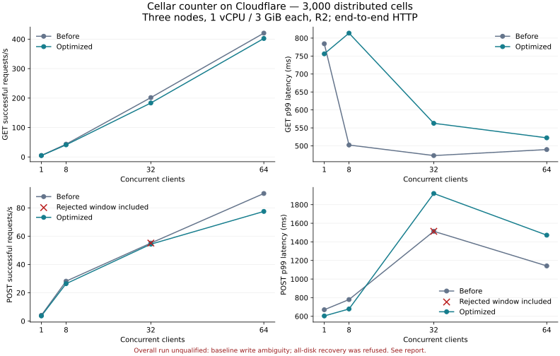

# Counter performance after SQLite optimization

**The rerun does not establish a consistent end-to-end improvement and is not fully qualified.** Some read medians improved, while throughput and tail latency were mixed. One baseline write window failed its strict audit after HTTP errors; it remains rejected.

Three Cloudflare Containers, each with **1 vCPU, 3 GiB memory and 6 GB disk**, backed by R2. The standalone executable registers `examples/counter/main.rs` from each revision. Both fleets have 3,000 resident counters, exactly 1,000 owned by each node.

Baseline: `7d3beb9`, before the counter and SQLite optimizations. Candidate: `cf1dca7`, identical source tree to merged `c8555ec` (PRs #86 and #87). This comparison measures their combined effect; it does not isolate PR #87.

## Results

Throughput counts successful HTTP 200 responses across both repetitions. Latency is the worse per-run percentile, not a pooled percentile. Positive throughput changes and positive latency reductions indicate improvement.

### 3,000 distributed counters

| Operation | Clients | Before req/s | After req/s | Throughput change | Before p50 ms | After p50 ms | Before p99 ms | After p99 ms |
| --- | ---: | ---: | ---: | ---: | ---: | ---: | ---: | ---: |
| GET | 1 | 5.0 | 4.8 | -3.6% | 221.23 | 224.28 | 784.27 | 756.20 |
| GET | 8 | 43.5 | 41.2 | -5.3% | 198.38 | 223.49 | 502.34 | 813.83 |
| GET | 32 | 201.6 | 183.3 | -9.1% | 181.46 | 190.03 | 472.96 | 562.79 |
| GET | 64 | 420.5 | 402.4 | -4.3% | 117.15 | 87.69 | 489.71 | 522.35 |
| POST | 1 | 4.1 | 3.6 | -10.9% | 268.02 | 288.73 | 670.46 | 603.83 |
| POST | 8 | 28.2 | 26.4 | -6.3% | 304.58 | 318.52 | 779.92 | 678.71 |
| POST † | 32 | 55.1 | 54.3 | -1.4% | 562.48 | 598.82 | 1513.53 | 1920.19 |
| POST | 64 | 90.2 | 77.5 | -14.1% | 711.84 | 802.36 | 1141.54 | 1472.17 |

### One hot counter

| Operation | Clients | Before req/s | After req/s | Throughput change | Before p50 ms | After p50 ms | Before p99 ms | After p99 ms |
| --- | ---: | ---: | ---: | ---: | ---: | ---: | ---: | ---: |
| GET | 1 | 12.7 | 13.2 | +3.7% | 84.20 | 70.72 | 410.06 | 541.46 |
| GET | 8 | 98.3 | 115.0 | +16.9% | 77.59 | 64.95 | 369.50 | 403.35 |
| GET | 32 | 377.7 | 429.7 | +13.8% | 77.24 | 64.86 | 373.09 | 445.83 |
| GET | 64 | 615.9 | 681.6 | +10.7% | 86.88 | 76.25 | 426.53 | 517.26 |
| POST | 1 | 7.3 | 7.4 | +1.4% | 128.34 | 119.28 | 596.77 | 548.92 |
| POST | 8 | 30.6 | 29.0 | -5.3% | 277.52 | 265.74 | 669.77 | 592.87 |
| POST | 32 | 109.9 | 109.8 | -0.1% | 303.23 | 276.03 | 587.21 | 606.76 |
| POST | 64 | 210.4 | 202.2 | -3.9% | 303.60 | 281.39 | 750.57 | 718.82 |

## Method and correctness

- 64 measured windows: two builds × GET/POST × hot/distributed × 1/8/32/64 clients × two repetitions.
- Each window has a separate 3-second warmup followed by 15 seconds of closed-loop HTTP/1.1 traffic. Oha 1.16.0 uses four client threads, keep-alive, a 30-second timeout and waits for outstanding requests. Each warmup and measurement starts fresh client connections.
- Block order: baseline, candidate, candidate, baseline. One three-node fleet runs during each timed block. Case order reverses in the second repetition. Separate R2 buckets isolate state. The returning baseline uses a fresh bucket and fleet identity after the failed restore described below.
- Same Rust 1.98.1 release profile, dependency lockfile, Node 24.22.0 transport adapter, fleet durability policy and runtime configuration. The build VM was stopped before timing.
- All 32 optimized windows and 31 of 32 baseline windows passed their strict state audits. The rejected baseline window is retained with its failed assertion and HTTP errors. Full vectors were monotonic. Every load boundary retained exactly 1,000 owners/residents per node and all 3,000 named identities.
- Durability-proof error counters stayed at zero. Both variants exercised fleet proofs. Proof counters describe host output barriers, not a one-to-one count of application commands.
- Optimized timed windows had no HTTP errors. One baseline window returned 11 HTTP 500 and 17 HTTP 503 responses. Neither build recorded client transport errors in timed windows.
- Timed load clients never retry. The gateway forwarding rule retries GET connection failures up to 60 attempts with 500 ms delay and does not retry POSTs. Those GET delays remain in client latency.
- Both measured variants completed preserving native shutdowns before their containers were stopped. A preserving local stop is not a proof that every local replica can then be discarded.

### Audit interruption

The first candidate block stopped on an HTTP 500 during a read-only verification after the 64-client distributed-read warmup, before its timed window. Node logs recorded at least three ambiguous peer closures. All nodes remained healthy with unchanged boot identities, 1,000 owners per node and zero durability-proof errors. Diagnostic rechecks and a full 3,000-counter vector verified the expected values. The exact initiating cause of the connection closure was not established.

The interrupted warmup, trace and node logs were retained. The run resumed at the unfinished case; completed measurement windows were retained. Only read-only verification gained up to three attempts for specific connection failures, with bounded waits and failed-attempt journals. Counter/ownership assertions, application code, timed traffic and POST retry rules stayed intact. Subsequent audit transport failures recorded in the journals: **1**. This is not a failure-free availability qualification.

### Returning baseline and recovery boundary

The attempted return to the first baseline bucket discarded all three ephemeral container filesystems. Recovery refused admission because predecessor witness proof was unavailable. The original bucket and refusal evidence were retained; no ownership, log or tombstone was erased and no proof check was bypassed. The second baseline repetition therefore uses a new bucket and fresh 3,000-counter fleet with the same executable and resource settings.

This failed restore is not a successful recovery drill. Fleet proof can acknowledge before bucket upload; the [recovery contract](../../../docs/18-recovery-backup.md) requires preserving the complete evidence set for the intended loss case. Full-fleet ephemeral-disk loss was an incorrect setup assumption for this fleet-durability comparison. Only warm performance and the recorded state/proof audits are evaluated here.

An operator-only gateway update added authenticated diagnostics/stop routes for the three fixed benchmark cohorts and prevents cleanup from starting stopped containers. Counter and peer forwarding paths were unchanged.

### Rejected baseline write window

† Baseline repetition 2 at 32 distributed write clients returned 792 HTTP 200 responses, 11 HTTP 500 and 17 HTTP 503 responses. The counter increased by 813, exceeding successful acknowledgments by 21. Native logs recorded ambiguous peer closures, follower append refusals and bucket fallback. All nodes remained healthy and balanced; proof-error counters stayed zero.

Those extra increments are compatible with mutations committing before an error response, but an aggregate counter cannot establish each operation's outcome. The strict assertion failed. No POST was retried, and the failed window was not rerun or overwritten. Remaining cases were measured as a separate continuation with the same per-window assertions. The rejected row and original trace remain in the evidence; their presence keeps the overall qualification false.

## Limits

Requests originate from the developer's Mac over the public Internet and include Cloudflare ingress, peer transport, routing and durability waits. Two short repetitions provide observed measurements, not a statistical guarantee or sustained-rate production SLO. Low-concurrency p99 values have limited samples. This run does not qualify arbitrary partitions, simultaneous disk loss or long soaks.

The client is a shared workstation. Both deployments use the same western North America placement hint, but exact container placements were not exposed. Health-only p50 changed from 58–61 ms for baseline to 39–40 ms for the candidate. That control difference limits attribution to the SQLite changes. All health controls are included in the structured results; throughput is not normalized by those controls.

The [structured comparison](2026-10-18-counter-cloudflare-comparison.json) includes every repetition, p50/p95/p99, response/error counts, proof observations, source revisions and immutable image digests. Complete oha output, telemetry, counter vectors, owner inventories, scripts and deployment logs remain in this checkout's private `counter-optimization-r2-20261018/` target directory. Credentials are excluded.
