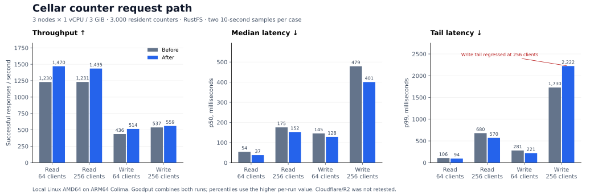

# Counter request-path improvements

The changes remove avoidable SQLite work from named requests and transaction
boundaries. This local comparison shows higher read throughput and better write
latency at moderate load. Write p99 at 256 clients remains an open performance
limit: it regressed in one candidate sample.

## Changes and regression checks

- Established cell names use cached reads instead of attempting an insert on
  every fetch or RPC. Identity conflicts and persisted-name checks remain intact.
- Framework transaction control keeps SQLite's authorizer installed. Replacing
  it expired prepared queries; a regression test measured ten recompilations
  across ten transactions before the fix and zero after it. Application SQL
  retains its transaction, reserved-table and unsafe-operation restrictions.
- The counter's GET uses one lookup instead of `BEGIN IMMEDIATE`. POST still
  updates the counter and optional duplicate receipt atomically. The real-handler
  regression test holds another connection's writer lock and checks that GET
  returns the value with its observed durability position.

Four regression checks failed before their respective fixes. A fifth checks SQL
authorization and privilege cleanup. Ownership, epochs, output gates, follower
fsync and bucket durability policies are unchanged.

## Test conditions

| Item | Configuration |
| --- | --- |
| Baseline | `7d3beb9e77f9491d5f581a8bbeae8c60d719b8ae` |
| Application | `examples/counter`, registered in a standalone native host |
| Fleet | Three containers per variant; 1 vCPU and 3 GiB each; 1,000 resident counters per node |
| Limits | One Tokio worker per node; 4,096 residents; 1,024 application requests; 512 requests per cell |
| Build | Rust 1.98.1; Linux AMD64; release profile with size optimization, fat LTO and one codegen unit |
| Infrastructure | ARM64 Colima VM, 6 vCPU and 10 GiB; private ext4 Docker volumes |
| Store | RustFS 1.0.3, 2 vCPU and 3 GiB; separate buckets on one private instance |
| Routing | All load enters node 1; one-third local and two-thirds owner-forwarded |
| Durability | Default fleet policy, including bucket fallback and possible reconfiguration to one follower |
| Client | oha 1.16.0; four threads; HTTP/1.1 keepalive; 30-second timeout; no retries; drain outstanding requests |
| Samples | Two repetitions, each with 2-second warmup and 10-second measurement; reverse case and variant order in repetition 2 |

Every counter was written and read before measurement. Both variants started
with the same complete value vector. Both fleets stayed ready; only one received
measured load at a time. Backend memory was raised before the paired runs.

These AMD64 binaries run on an ARM64 VM. The results include emulation and shared
host effects; they are comparative diagnostics. Cloudflare and R2 were not
retested, so these numbers do not replace the earlier Internet-path measurements.

## Closed-loop results

Goodput is total HTTP 200 responses divided by total elapsed time, including
response drain. Each latency is the higher of the two per-run percentiles,
not a pooled percentile. Values show **before → after**.

| Operation | Clients | Goodput/s | p50 ms | p99 ms |
| --- | ---: | ---: | ---: | ---: |
| GET | 64 | 1,230 → 1,470 (+19.5%) | 53.79 → 37.43 | 106.46 → 94.43 |
| GET | 256 | 1,231 → 1,435 (+16.5%) | 175.49 → 152.50 | 679.60 → 569.65 |
| POST | 64 | 436 → 514 (+18.0%) | 145.46 → 128.14 | 280.56 → 220.66 |
| POST | 256 | 537 → 559 (+4.1%) | 479.06 → 400.55 | 1,729.66 → 2,222.41 |

The 256-client write samples varied substantially. The candidate's p99 improved
in repetition 1 and worsened in repetition 2. This does not establish a write
capacity or tail-latency improvement at that concurrency.

## Rate-limited writes

An additional comparison targeted 300 POSTs/s with 64 connections and oha's
`--latency-correction`. The target rate and connection bound are the same for
both variants; this is not an unlimited-arrival load generator.

| Repetition | Achieved goodput/s | p50 ms | p99 ms |
| --- | ---: | ---: | ---: |
| 1 | 290.20 → 295.83 | 386.75 → 214.75 | 708.31 → 482.18 |
| 2 | 299.51 → 299.44 | 45.97 → 22.19 | 206.25 → 104.14 |

Both repetitions improved median and tail latency, with substantial variation
between repetitions. Longer steady-state runs and Cloudflare/R2 verification
remain necessary before choosing a production operating limit.

## Correctness and recovery

All 20 timed windows and their warmups returned only HTTP 200, with no transport
errors. Before/after audits read all 3,000 values, required nondecreasing counts,
and matched the aggregate delta to all **64,999 acknowledged POSTs**, including
warmup. Every before/load/after inventory retained exactly 1,000 unique resident
counters per node. Adapter barriers reported no proof errors; those counters
are observations, not business acknowledgement counts.

After load, each fleet's node 1 was killed. Reads through a survivor reproduced
the entire pre-crash value vector; restarting node 1 and reading through it
reproduced that vector again. Totals remained 37,604 for the baseline and 40,795
for the candidate.
Recovery reads encountered transient HTTP 500, timeout and disconnect outcomes
and used bounded read-only retries. No mutation was retried. The complete
survivor audits took about 60 and 57 seconds, including all 3,000 reads; these
are not isolated takeover latency measurements or a disk-loss drill.

The [structured results](2026-10-18-counter-hot-path.json) retain both repetitions,
executable digests and recovery outcomes. Raw oha output, full vectors, state
captures, scripts and failed exploratory runs remain in the checkout's private
target directory under `latency-20261018/`. The initial paired attempt stopped
on an incorrect benchmark assertion equating adapter barriers with write
acknowledgements; that evidence is retained separately from the completed run.

Validation passed 349 library tests, 12 focused integration tests and all 83 node
tests with four test threads. This includes the five new regressions and the
storage, SQL, runtime, call-order and replication checks. Clippy with all
targets/features, formatting, module layout, native dependency and documentation
guards also passed. An initial parallel node suite hit one cold-recovery
deadline; unmodified main and the candidate both passed that case in isolation,
and the complete node rerun passed. No assertion or deadline was relaxed.
