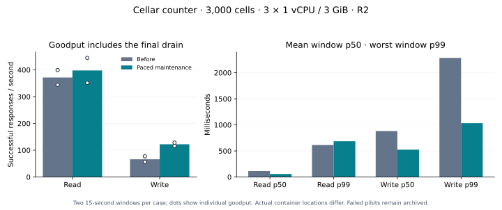

# Counter maintenance: Cloudflare/R2 validation

Age-triggered SQLite maintenance now runs in a paced, node-owned task. Foreground capture still enforces size thresholds, and both paths retain WAL sealing, complete LTX staging, epoch fencing and remote output proofs. This run measures the change without weakening those contracts.

**Status: draft.** The candidate missed the 240-second single-node recovery target, although all acknowledged values eventually recovered. Read results are mixed. This change is not production-qualified.

## Primary result

| Method | Before → after goodput/s | Change | p50 ms | p99 ms |
| --- | --- | --- | --- | --- |
| GET | 371.4 → 397.8 | +7.1% | 114.1 → 58.1 | 613.8 → 685.7 |
| POST | 66.0 → 122.1 | +84.9% | 881.1 → 524.4 | 2283.8 → 1032.4 |

Two 15-second windows per method at concurrency 64; successful responses divided by total drained time. p50 is the mean of window p50 values; p99 is the worse window p99. These are not pooled latency percentiles.

The distributed write result improves in this deployment. Read results are mixed across load shapes: the fixed 200/s read target regresses in latency even though both variants complete the schedule. Local hot-cell and read tests do not establish a universal win. Placement also differs, so the Cloudflare percentage cannot be attributed entirely to source code.

## Setup and identity

Each variant uses three Cloudflare Containers with 1 vCPU, 3 GiB RAM and 6,000 MB ephemeral disk per node; All timed windows retain 3,000 counters balanced at 1,000 per node. R2 uses Standard storage in WNAM. The application is the actual native Rust `examples/counter` implementation in the embedded host, with Rust 1.98.1 release, jemalloc, one Tokio worker and unchanged Cargo.lock. The same Node peer adapter runs inside each resource limit.

The primary URL list spreads requests across all ingress nodes, forwarding two thirds to another owner. Only one fleet receives timed load at a time. Case order is reversed for the returning concurrency-64 comparison. Timed mutations have no retries. The gateway may retry failed read-only counter GETs, identically for both variants.

| Variant | Reported container locations | Native executable SHA-256 |
| --- | --- | --- |
| baseline | sea01, sjc06, sea01 | 4636d6f39623b33095a2cf0494bac0444bcfc36649da83ca2750968d0ad0e7f1 |
| candidate | sea01, sea01, sea01 | d1c2ae72f647ed3421bfc5c4dc3a9b1d3876d3d3e77527276fe40efa4bfa9ac7 |

The Durable Object container policy rejected Wrangler regional constraints; the location hint is WNAM. Actual placement was collected from whitelisted runtime environment fields. See [Cloudflare placement](https://developers.cloudflare.com/containers/concepts/placement/) and [container environment variables](https://developers.cloudflare.com/containers/configuration/environment-variables/).

The candidate implements `5fa8388`. Both runtime source files match the compiled inputs exactly. Executable hashes were verified on all six deployed nodes. Each case alternates baseline/candidate order, and the returning cases reverse it. Both fresh seeds aged beyond 60 seconds before the paired matrix.

## Sustained and fixed-rate cases

| Variant | Method | Seconds | Nominal QPS | Goodput/s | p50 ms | p99 ms | HTTP 200 | Acceptance |
| --- | --- | --- | --- | --- | --- | --- | --- | --- |
| baseline | GET | 30 | 200 | 196.5 | 196.2 | 548.3 | 6000 | pass |
| baseline | POST | 30 | 40 | 39.6 | 409.3 | 959.6 | 1200 | pass |
| baseline | POST | 125 | saturated | 86.6 | 715.5 | 1546.7 | 10884 | pass |
| candidate | GET | 30 | 200 | 197.7 | 221.4 | 624.3 | 6000 | pass |
| candidate | POST | 30 | 40 | 39.4 | 302.4 | 726.2 | 1200 | pass |
| candidate | POST | 125 | saturated | 121.6 | 529.9 | 988.4 | 15248 | pass |

Fixed-rate cases use latency correction and at most 64 clients. The structured results retain the exact completion counts at each nominal rate; 1,200 writes are scheduled nominally at 40/s for 30 seconds. Both variants complete all 6,000 scheduled reads and 1,200 scheduled writes. Read p50 and p99 are worse on the candidate at the matched 200/s target.

## Owner-directed routing control

These additional windows select each counter’s observed owner as ingress. This is a routing preference; Cellar still validates ownership and proves writes. They are separate from the primary comparison.

| Variant | Method | Goodput/s | p50 ms | p99 ms |
| --- | --- | --- | --- | --- |
| baseline | GET | 1092.6 | 40.9 | 195.7 |
| baseline | POST | 100.4 | 612.6 | 992.2 |
| candidate | GET | 1312.7 | 41.4 | 163.2 |
| candidate | POST | 153.4 | 395.1 | 768.2 |

## Correctness and limits

Both variants passed all seven primary windows. Accepted windows passed full counter-vector, acknowledged-count, stable ownership/generation/resident, native boot and output-proof checks. GETs preserved every business counter; proof errors remained zero.

The earlier pilot baseline sustained window is rejected and retained unchanged: 9,479 HTTP 200s, 12 HTTP 500s, and five more increments than acknowledged successes across warmup plus measurement. Some failed responses have ambiguous commit outcomes. Logs show degraded follower ensembles and internal header timeouts. The aggregate data cannot reconcile individual failed commands or establish exactly-once effects for that window. No mutation was retried, no state was repaired, and subsequent controls begin from the observed state. It is retained in the pilot section of the structured results and excluded from the final-build comparison. The first candidate also exposed an idle-maintenance feedback bug, fixed and covered before this fresh final run. Its combined recovery probe failed the 1,000-per-node balance requirement even though every acknowledged value recovered; that result remains failed. The final fault probe checks data safety, availability and unique ownership separately and reports post-failure counts. One fresh baseline setup also aborted in object_store before measurement; its partial seed was not replayed. New cohorts validate the launch environment before starting native processes.

Separate per-cell ledgers verified 12,000 acknowledged increments in total: 3,000 on each variant before and after its single-node failure. Each reply equaled its cell’s previous value plus one, and each final value matched its reply. During each node3 loss, the other two nodes remained running. Every acknowledged counter value eventually recovered. The candidate missed the 240-second recovery target: this remains a failed availability probe, not a passed qualification. Baseline and candidate observations, recovery time and ownership distribution appear below.

| Variant | Within 240 s target | First full recovery observation s | Owned cells after recovery | All acknowledged values recovered |
| --- | --- | --- | --- | --- |
| baseline | True | 176.9 | 1334/1333/333 | True |
| candidate | False | 422.9 | 1334/1333/333 | True |

Recovery elapsed time includes readiness and bounded full-vector audit attempts; it is an observation of restoration plus verification, not a request-latency percentile. The original candidate failed result remains unchanged. The baseline had 23,649 total counter increments before its crash; the candidate had 31,630. These are different recovery histories, so the slower candidate observation is a concern that requires a matched-work follow-up, not an isolated causal estimate. Continued read-only observations and new post-recovery receipt checks do not turn it into a pass.

Outside the intentional failure interval, read-only audits recorded 0 baseline and 0 candidate transient failures, with bounded, journaled retries. No mutation was replayed. Retry attempts remain journaled separately from timed HTTP results. The earlier pilot read that took 10.419 seconds remains in the pilot archive; it is not relabeled as a final-build measurement.

Background checkpoint control-table writes can conservatively trigger a later read’s output proof through SQLite data-version observation. That observation remains intact because it also detects external database writes. This work does not bypass it to improve a benchmark.

Local checks passed: six LTX integration tests (also core feature coverage), six host replication tests, 15 domain tests, 86 node lifecycle/recovery/event tests, and the storage, transaction and log-protocol suites. The previously failing settlement race and predecessor recovery cases pass. A competing checkpoint before the maintenance barrier restores the complete LTX chain. Affected-crate Clippy, formatting, layout, dependency and documentation checks pass. A Rust incremental compiler ICE was avoided by rebuilding with `CARGO_INCREMENTAL=0`. The external internal-test harness was not enabled.

The local comparison uses three 1-vCPU/3-GiB containers and RustFS under x86 emulation on a shared ARM VM. A fresh local comparison covers distributed and hot reads/writes, with acknowledged-count checks and exit-zero preserving shutdowns. Distributed writes improve, while the hot-read window regresses. These single local windows and shared-VM/emulation effects do not establish a universal gain. Earlier local and Cloudflare attempts remain archived separately.

| Local case | Before → after goodput/s | p50 ms | p99 ms |
| --- | --- | --- | --- |
| POST many-ingress | 457.7 → 485.0 | 126.1 → 123.7 | 338.1 → 278.6 |
| GET many-ingress | 974.3 → 1120.1 | 64.4 → 61.3 | 215.5 → 198.0 |
| POST hot | 885.0 → 864.6 | 75.9 → 77.3 | 137.1 → 127.3 |
| GET hot | 1702.7 → 1259.4 | 25.9 → 32.3 | 76.3 → 221.6 |

Local windows are 85 seconds for distributed POST and 15 seconds otherwise; they are diagnostic and run under emulation.

**This is not full production qualification.** The missed recovery target, different placements, few repetitions, Internet-client variation and mixed local results prevent a production-readiness or universal latency claim. Simultaneous loss of all fleet disks, arbitrary partitions and storage corruption are not qualified here. All six final native processes completed preserving shutdown with exit zero before disposable test compute was stopped; buckets and diagnostic evidence remain.

## Evidence

The [structured results](2026-10-18-counter-maintenance.json) contain every primary and owner-directed window, local windows, proof counters, resource observations, source and executable identities, receipt summaries, recovery results and limitations. The checkout’s private `counter-maintenance-v2-20261018` archive retains deployment configuration, runners, unmodified oha output, per-cell ledgers, full snapshots, logs and rejected setup attempts. Credentials and live cell inventories are excluded from this report.

The [PR #87 investigation](2026-10-18-pr87-investigation.md) explains the checkpoint and transport hypotheses. Further work should isolate peer forwarding stalls and qualify ordered log transport independently; this change keeps the existing HTTP log transport.
