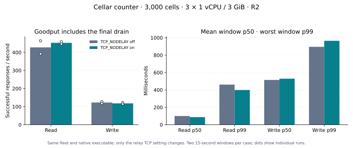

# Counter: recovery batching and peer latency

Two changes address measured work: Cellar merges more recovery rows within the existing byte budget, and the Cloudflare peer relay writes small TCP fragments eagerly. Ownership, epochs, witness validation and durable output proofs remain intact.

## Same-fleet relay result

| Method | TCP_NODELAY off → on goodput/s | p50 ms | p99 ms |
| --- | --- | --- | --- |
| GET | 427.4 → 452.4 | 100.2 → 87.1 | 461.0 → 399.2 |
| POST | 122.8 → 118.0 | 514.7 → 529.1 | 895.8 → 964.5 |

Both modes use the same three live containers, R2 bucket, Rust executable and 3,000 counters, balanced at 1,000 per node. Each container has 1 vCPU, 3 GiB RAM and 6,000 MB disk. Only accepted relay TCP sockets switch `TCP_NODELAY`. Two thirds of requests traverse a peer hop. Core Cellar sockets already disable Nagle; the missing setting was in the deployment sidecar.

The relay result is mixed: average short-window read goodput improves about 6%, with one pair improving and the reversed pair essentially flat. Short-window writes lose about 4% goodput. The single 125-second write pair improves about 5% goodput and p50, while fixed-rate reads are nearly flat with slightly worse p99. These results do not support a universal read or write latency claim.

Two 15-second windows per method at 64 clients, returning in reversed order. Goodput is successful responses divided by total drained time; p50 is the mean window p50, p99 the worse window p99. These are not pooled percentiles. Warmup uses a separate three-second client process.

| Mode | Method | Seconds | Nominal QPS | Goodput/s | p50 ms | p99 ms | HTTP 200 |
| --- | --- | --- | --- | --- | --- | --- | --- |
| off | GET | 30 | 200 | 197.6 | 183.9 | 386.2 | 6000 |
| on | GET | 30 | 200 | 198.2 | 181.9 | 396.2 | 6000 |
| on | POST | 125 | saturated | 120.5 | 530.4 | 950.8 | 15125 |
| off | POST | 125 | saturated | 114.6 | 558.9 | 966.4 | 14391 |

Fixed-rate reads use latency correction and at most 64 clients. Completion counts remain explicit. Each window reads the full counter vector and requires stable ownership/generation/residency/boot and zero proof errors. Timed POSTs require monotonic per-cell values and an aggregate delta equal to all warmup and timed HTTP 200s; oha does not retain individual mutation receipts. Separate per-cell rounds check each reply against its previous and final value before and after node loss. No application mutation is retried.

## Recovery work

The original 128-row scan cap split small contiguous cell histories into repeated object-store uploads and limited upload parallelism. Uploads now keep the existing 4 MiB byte budget, with a separate 4,096-row metadata ceiling. Ordinary spool visitors keep their 128-row cap. The existing oversized-single-record rule, 32-cell upload concurrency, cancellation guards, claim heartbeats and sealing checks remain unchanged. A regression test fails before the fix, then restores all committed counter state through real LTX after it.

| Build | Logical increments before loss | LTX rows folded | Upload phase s | Full value verification s | Within 240s drill budget |
| --- | --- | --- | --- | --- | --- |
| baseline | 9000 | 4877 | 50.2 | 125.8 | True |
| candidate | 9000 | 6000 | 159.2 | 267.0 | False |
| recovery-v3 | 9000 | 6000 | 30.4 | 102.8 | True |

`baseline` is `c8555ec`, `candidate` is paced maintenance at `5fa8388`, and `recovery-v3` adds byte-budgeted uploads at `5ecf5ce`. All cohorts verified 9,000 increments before loss and 3,000 new writes afterward. All acknowledged values recovered. The old candidate had a read-only `/logs` disconnection before its first crash; that failed attempt remains recorded, with a resumed observer and no application replay. Its longer pre-crash pause is in the structured data. Equal logical work does not make these single recovery cohorts identical.

The final performance fleet also lost node3 after its full acknowledgement audit. All acknowledged values recovered: **True**, first full verification **123.9 s**, within the 240-second drill budget **True**. Another 3,000 per-cell writes passed afterward. The other two nodes remained running; the exact recovered value vector was required.

## Identity, checks and limits

The native executable SHA-256 is `7b026b123d6045e8c3aee1b8b934b0ec30df0d3f067ec4ea22fe9a876829797e`. All six new-build comparison nodes verified this hash. The compiled runtime files match `5ecf5ce` exactly. Rust 1.98.1 release and Cargo.lock are unchanged. The host wrapper imports the actual `examples/counter` implementation and is unchanged between variants; it differs from the repository’s standalone host example. The relay helper is checked in at `446bc3d`. Actual placements and resource observations are recorded in the data.

The split-response relay diagnostic reproduced a roughly 47 ms p50 delay with the original socket setting and a few milliseconds with the fixed helper. This is a Linux transport experiment under emulation, not a Cloudflare counter result. The [relay guide](../cloudflare/README.md) includes runnable byte-flow tests and the diagnostic.

Local checks pass: 358 library tests, all 86 node lifecycle/recovery/event cases, domain/log/replication/storage/transaction suites, six LTX checkpoint tests, three relay tests, affected-crate Clippy, formatting, layout, dependency and documentation checks. The external internal-test harness was not enabled. The earlier CI cron lease-expiry failure remains recorded; twenty local repeats and the full node suite pass without changing its assertions or lease settings. The Python performance suite also passes (87 discovered, one opt-in Docker test skipped). Current CI status is on the PR.

Post-failure ownership counts are reported rather than forced to 1,000 per node; uniqueness, capacity and exact data recovery remain required. The [earlier failed recovery target](2026-10-18-counter-maintenance.md) remains failed. These quiescent single-node drills and short load windows do not establish a production SLO, crash-during-write behavior, arbitrary-partition safety or simultaneous fleet-disk-loss recovery.

The [structured results](2026-10-18-counter-relay-recovery.json) retain every timed window, recovery phases, receipt summaries, exact code/executable identities, resource observations, failed diagnostic attempt and limits. Private archive `counter-followup-20261018` retains raw oha output, configurations, full ledgers, snapshots and logs. Credentials and live cell inventories are excluded. All final native generations exited zero after preserving-shutdown requests before test compute stopped. Those exits alone do not establish complete graceful shutdown: structured phase reports were not enabled for the performance fleets. A separate fresh three-node fleet at the same resource limits verified 6,000 acknowledged mutations, then all three structured reports confirmed ingress, application work, cells, log and local-durability closure, clean reload preparation, no pending work and no timeout. Its unchanged native executable hash and complete reports are retained in the data. All qualification containers are stopped; R2 data remains.
