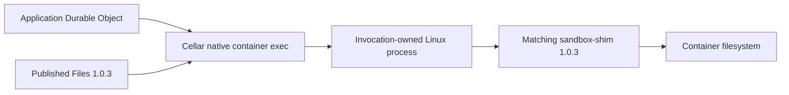

<!-- Copyright 2026 Cellar Project Authors. Licensed under Apache-2.0. -->

# Sandbox 1.0.3: native processes, files and directory backups

This separate, partial profile preserves the
[celld/Sandbox 0.12.9 baseline](../compat/README.md).



| Input | Pinned identity |
| --- | --- |
| SDK | `@cloudflare/sandbox@1.0.3`; lockfile integrity and imported source hash |
| Helper | `cloudflare/sandbox@sha256:fc1740c3cba26461f0ab1771287c84018ab2cca43a70ebb823087c85d780aaec` |
| Linux base | Node 24.13.1 bookworm-slim, immutable amd64 manifest in [Dockerfile](Dockerfile) |
| Exec signalling | The base provides `/bin/sh`; native exec captures its namespace PID before replacing it with the command and uses the shell's signal builtin |
| Fixture | Cellar application using the unmodified published `Files` implementation |
| Image admission | Native host configuration; application `start({ image })` is unsupported |

## Process API

```ts
const process = await container.exec(["node", "--version"]);
const output = await process.output();
console.log(new TextDecoder().decode(output.stdout), output.exitCode);
await container.setInactivityTimeout(60_000);
```

| Surface | Contract / limits |
| --- | --- |
| Admission | Wait for earlier queued startup; literal argv, nonempty executable without a leading hyphen |
| Environment / user | Explicit cwd/env; user requires numeric UID:GID |
| `pid` / `isPty` | Immutable allocation metadata; the PID is verified inside the container, never taken from Docker's daemon namespace. Shell-less images report unavailable PID |
| `pty` | `true` defaults to 80 columns / 24 rows; explicit dimensions are 1–65,535. stdin defaults to pipe and stderr must be combined; requires Docker API 1.42+ |
| `resize(cols, rows)` | Returns void; reserves event/callback lifetime before queueing an original-handle native control. Invalid sizes refuse synchronously; failed acknowledgements remain reported event work, with no replay |
| stdout / stderr | Node byte streams with backpressure; pipe, ignore, or combined stderr |
| stdin | Omitted sends EOF; `"pipe"` exposes a byte writer; `ReadableStream<Uint8Array>` pumps automatically in native body-sized chunks |
| `output()` | Collect once, with a combined native body-size limit; overflow fails without successful truncation |
| `exitCode` | Nonzero codes resolve normally |
| `kill(signal)` | Returns void and queues SIGTERM (15) by default. Reserves the original event/callback before effects; invalid signals refuse synchronously and failed acknowledgements remain event failures without replay. Observe completion through `exitCode` |
| Signal | Already aborted refuses allocation; live abort requests SIGKILL; detach listener after exit |
| Controls | Serialize per event; ordinary and cleanup queues each admit at most 64 pending controls |
| Cleanup | Completed streams/exit release native handles; cancellation joins native observation cleanup |

The native signal path requires `/bin/sh`, captures its container namespace PID
before `exec`, and uses the shell's builtin `kill`. Application arguments stay
separate from the static shell source. Images without `/bin/sh` retain direct
exec; signalling refuses an unverified PID. The private identity header is
removed before exposing stdout. Admission bounds pre-header stderr and creates
no background reader until identity is known.

Every handle retains its original invocation. Dropping streams or receiving an
unknown result does not prove termination or undo file writes. Kill or destroy
explicitly when the application requires termination.

## Use a terminal

```ts
const process = await container.exec(["sh"], {
  pty: { cols: 80, rows: 24 },
});
console.log(process.pid, process.isPty);
process.resize(132, 40);
const writer = process.stdin!.getWriter();
await writer.write(new TextEncoder().encode("exit\n"));
await writer.close();
writer.releaseLock();
const output = await process.output();
```

PTY output carries the kernel's terminal discipline, including CRLF and combined
stderr. Ordinary pipe mode preserves binary bytes. A process that exits retires
its native handle even if its default terminal input writer was never opened.
The portable SDK exposes the same controls through `exec_pty`, `info()` and an
acknowledged `resize()`; Cloudflare's resize surface remains void.

## Stream a command's input

```ts
const process = await container.exec(["sha256sum"], {
  stdin: new Blob(["hello"]).stream(),
});
const output = await process.output();
console.log(new TextDecoder().decode(output.stdout));
```

| Source boundary | Behavior |
| --- | --- |
| Admission | Reserve the reader and event/callback lifetime before allocation; locked, non-stream and pre-aborted input refuses before effects |
| Allocation failure | Release the source lock without consuming or cancelling it; never replay the command |
| Flow | Read one source chunk, split it to the existing native limit and await each write acknowledgement before pulling again |
| EOF | Acknowledge native stdin closure, join the pump and release its reader |
| Exit, abort or lost event | Cancel a pending read and join source cancellation; queued source writes recheck cancellation before dispatch |
| Source/write failure | Start native retirement before awaiting application source cancellation; request SIGKILL, join cancellation and preserve the initiating failure in `output()`, with no write replay |
| Callback lifetime | Input controls retain their accepted callback until input settles; admitted exec reads/waits and automatic ignored-output drains keep original event authority afterward. New ordinary reads from a closed callback still refuse |
| Concurrent storage | Existing-handle writes, closure, signals and retirement use native control serialization without occupying the SQLite mutation slot; effect classification and output proofs remain unchanged |
| Transactions | Refuse process creation before provider dispatch; release the unconsumed source |

Stream mode returns `stdin: null`. Its pump remains owned by the original event
after a response, under the existing runtime deadlines. An accepted command may
have effects before a source failure; cleanup is not rollback or remote fencing.

The published file API uses the same process surface:

```ts
import { Files } from "@cloudflare/sandbox";

const files = new Files(this.ctx.container);
await files.mkdir("/workspace/data", { recursive: true });
const response = await files.readFile("/workspace/data/example.bin");
// response.body streams helper output; it is not collected into one host body.
return response;
```

The [complete fixture](fixture.mjs) starts the host-configured image and writes,
renames, stats and reads a binary file across separate events.

## Run qualification

Use a private engine/socket and preloaded Cellar fence image:

```sh
npm ci --ignore-scripts --prefix tools/sandbox/cloudflare-v1
npm test --prefix tools/sandbox/cloudflare-v1
npm run build --prefix tools/sandbox/cloudflare-v1
docker --context YOUR_PRIVATE_CONTEXT build --platform linux/amd64 \
  -t cellar-sandbox-v1:1.0.3 tools/sandbox/cloudflare-v1
docker --context YOUR_PRIVATE_CONTEXT image inspect \
  cellar-sandbox-v1:1.0.3 --format '{{.Id}}'
```

Set the immutable local image ID below. Select Node 24+, the locked Rust
toolchain and this checkout's writable `CARGO_TARGET_DIR`.

```sh
CELLAR_SANDBOX_ENGINE_SOCKET=/path/to/private/docker.sock \
CELLAR_SANDBOX_V1_IMAGE=sha256:YOUR_BUILT_IMAGE_ID \
CELLAR_SANDBOX_FENCE_IMAGE=sha256:YOUR_PRELOADED_FENCE_ID \
cargo test --locked -p cellar-javascript --features node \
  --test sandbox_v1 -- --ignored --test-threads=1
```

| Acceptance | Boundary |
| --- | --- |
| Binary stdout/stderr, nonzero exit and missing executable | Native Linux exec and bounded output; shell-backed missing command exits 127 |
| Terminal identity / initial geometry | Compare the facade PID with the actual Node process PID, confirm tty input/output and read 80×24 from kernel `stty` |
| Resize / terminal channels | Resize to 132×40 before ordered stdin, inspect the new kernel geometry, require combined stderr/CRLF, and refuse malformed/foreign controls before provider dispatch |
| Void controls / transactions | Kill returns void and terminates a ready process through default SIGTERM; observe exit separately. Transaction-bound kill/resize refuse synchronously with proven non-commit before effects |
| Default terminal retirement | A fast terminal command with untouched default stdin still explicitly releases its native handle; no event-drop fallback |
| Source stdin, 2 MiB + 17 bytes | Exact length/SHA-256 through native chunked writes; callback returns before process exit |
| 130 sequential source processes | Byte-for-byte echo, unlocked source readers and reusable retention/handle capacity; existing limits stay unchanged |
| Early exit and invalid source chunks | Cancel pending input, release its reader and preserve the source `TypeError` over observation cancellation |
| Closed callback | New ordinary stdout read and a forged observation flag on a storage write refuse before dispatch; automatic ignored stdout/stderr drains still finish |
| Streamed or buffered process creation in a transaction | Typed `ValidationError` / `not_committed`, zero source pulls and zero provider allocation calls |
| 2 MiB + 17 bytes write/read, rename and stat | Published Files, matching helper and SHA-256 round trip across events; 64 KiB native chunks |
| 70 sequential and two parallel stats | Native handle retirement and mutation admission |
| Missing file | Published `SandboxFileError.is()` and `ENOENT` |
| Quota / live abort | No successful truncation; joined native observation cancellation and explicit container retirement |
| Saved process in later event | Original authority refuses before effects |
| Handle retirement and shutdown | Explicit native release of every allocated process after each route, independently of event-drop cleanup; native cell/application drain, zero bridge invocations/bytes after join, no owned containers, only empty labelled test networks removed |

Ordinary CI verifies inputs, builds the SDK fixture and tests the facade. The
opt-in image campaign uses a 120-second native handler budget, a 30-second JS
execution budget and 2,048 guest operations. Existing 250 ms module fixtures and
the 0.12.9 profile retain their original budgets.

## Repeated-host firewall qualification

The native fence stays within 64 MiB. A terminal own-table observation scopes
nft's cache while the isolation rules are replaced atomically. The
[cache probe](../fence-cache-probe.py) compares the production transaction with
its previous global-cache behavior using `nft --check`; it commits no firewall
changes and removes only its labelled probe containers.

```sh
python3 tools/sandbox/fence-cache-probe.py \
  --context YOUR_PRIVATE_CONTEXT \
  --image sha256:YOUR_PRELOADED_FENCE_ID \
  --require-oom-control
```

`--require-oom-control` requires the previous OOM to reproduce. On a clean
engine, omit it to check production admission and report both measurements.

## Native gateway entrypoints

The separately pinned [gateway fixture](gateways.mjs) imports the unmodified
`DirectoryBackupGateway` and `S3Gateway`. It routes their fetch and control RPC
through native Worker entrypoints, copies per-binding props, and verifies deny
grants and control rejection. It requires no Docker engine or cloud account:

```sh
cargo test -p cellar-javascript --features node --locked --test workers_entrypoints
```

The same test covers class/object entrypoints, configured bindings, public
properties, stateless construction, original-event background work, malformed
input refusal and unknown results after execution. It also exercises binary
`FixedLengthStream` output and inferred length on native routed requests. External
streaming replies retain Cellar's chunked framing policy. These checks do not
qualify R2 multipart storage, outbound interception, directory backup/restore or
S3 mounts. Those remain required delivery steps with the actual helper/image.

## Native R2 gateway storage

The separate [R2 fixture](r2.mjs) drives the same published
`DirectoryBackupGateway` against a real native SQLite Blob bucket:

| Path | Evidence |
| --- | --- |
| Control RPC | Create upload, complete actual current receipts, explicit abort/delete |
| HTTP | Upload/replace binary parts and stream exact ranged reads |
| Restart | Rebuild native node and bucket client between part upload and completion |
| Refusal | Stale receipt, short/oversized input, saved event resources and transaction I/O |
| Cleanup | Drained nodes/runtime and no remaining upload/part rows |

```sh
cargo test -p cellar-javascript --features node --locked --test workers_r2
```

The fixture declares a separate five-second storage handler budget for real
fsync/fleet bootstrap; existing 250 ms routing tests retain their bounds. See the
[R2 subset guide](../../../packages/cellar-cloudflare/r2.md) for binding setup,
byte ownership, supported operations and profile gaps. The following campaign
adds the matching helper's directory-backup path.

## Directory backups through native HTTP interception

The [backup fixture](backups.mjs) uses the unchanged published `DirectoryBackup`,
`DirectoryBackupGateway` and `Files` implementations. Configure an immutable
native network-helper image containing `cellar-egress` and nftables, as described
in the [host profile](../../../crates/cellar-container/README.md#optional-native-network-helper-lifecycle).


```sh
CELLAR_SANDBOX_ENGINE_SOCKET=/path/to/private/docker.sock \
CELLAR_SANDBOX_V1_IMAGE=sha256:YOUR_MATCHING_SANDBOX_IMAGE \
CELLAR_SANDBOX_FENCE_IMAGE=sha256:YOUR_FENCE_IMAGE \
CELLAR_SANDBOX_NETWORK_IMAGE=sha256:YOUR_NATIVE_HELPER_IMAGE \
cargo test --locked -p cellar-javascript --features node \
  --test sandbox_backups -- --ignored --test-threads=1 --nocapture
```

| Check | Acceptance |
| --- | --- |
| Installation | Register a copied export/props before startup; finish that event before using the route |
| Retained HTTP connection | One real container connection carries the pre-start handler from a later event, direct traffic, then two live handler versions |
| Binary streaming | Each request/reply preserves 2 MiB + 17 bytes and SHA-256; native reads remain at most 64 KiB |
| Published backup | Archive incompressible 2 MiB + 17-byte input through shim HTTP, gateway control RPC and native staged parts; require archive size above the 64 KiB frame limit and save its record in cell SQLite |
| Later-event restore | Change the file, restore the stored record with the actual shim, then verify original bytes/SHA-256 |
| Fresh-process recovery | Join the first native/Node processes, start new processes with an empty node directory, recover the identical record from native fleet storage and restore into a new container |
| Pre-aborted calls | Preserve the exact abort reason for backup and restore; no provider process allocation |
| Allocation-time cancellation | Invoke the real published gateway allocation, then abort; exactly one allocation, original reason, revoked read/write grants and no upload/part rows |
| Transfer cancellation | Interrupt the first native upload/range body chunk and abort; preserve the caller's reason, leave the restore destination unchanged and revoke both grants |
| Failed mutation acknowledgement | Complete/delete in real native storage, then throw from the gateway control call; observe the committed object or deletion and require exactly one mutation call |
| Missing/corrupt input | Published `ENOENT`, `BACKUP_NOT_FOUND` and `BACKUP_INTEGRITY` errors; failed restores preserve the changed destination and revoke grants |
| Deletion | Destroy the container, then delete the archive through the published API without starting new compute |
| Retirement | Explicit process-handle release after every route; join each native node and Node runtime, require zero retained bridge bytes/invocations and no owned containers; remove only empty owned networks |

The campaign runs two separately spawned native processes, each with its own
Node process and fresh node directory. Only the fleet/object-store database is
shared. The saved-record JSON is an expected-value check; recovery reads the
record from cell state. Each process has a 300-second outer bound and is joined;
the existing 120-second handler and 30-second JS execution budgets stay intact.

The [fault fixture](backup-failures.mjs) uses the published implementations.
Its allocation-abort gateway subclasses the published gateway solely to abort
after `super.createUpload()` has committed a real upload. The package's grant,
shim and abort exchange runs unchanged. The other gateway and helper paths use
the published classes directly. Valid ranged GET and part PUT requests check
revocation, so a wrong-method refusal cannot masquerade as grant cleanup.

The [boundary fixture](backup-boundaries.mjs) subclasses the published gateway
at two additional fault seams. Its body transform interrupts the first chunk
and triggers the caller's abort; this covers selected upload/download
cancellation before verification. Its control hooks await real completion or
deletion, then throw. The failed backup call does not return a usable record;
only the test's fault observer knows the committed key for explicit observation
and cleanup. It does not prove automatic reconciliation or transport-loss
recovery.

```mermaid
sequenceDiagram
    participant SDK as Published SDK
    participant Gateway as Fault gateway
    participant Store as Native storage
    SDK->>Gateway: completeUpload
    Gateway->>Store: Complete once
    Store-->>Gateway: Committed
    Gateway-->>SDK: Injected acknowledgement failure
    SDK->>Gateway: Abort upload (cannot undo completed object)
    Note over SDK,Store: Failure preserves an uncertain outcome; no completion replay
```

The host selects `Native.with_http_interception()`, the explicit `runc` network
helper and `Source::workers_http_streams()`. Incoming HTTP reads retain the
original invocation and cancellation authority. A reader holds one producer
chunk, returns bounded frames and pulls again after consuming it. The ordinary
SDK's buffered-body limit stays unchanged.

Known-length R2 parts now cross that bridge in acknowledged chunks and stage
in anonymous native files. `FixedLengthStream` bodies are not collected as whole
parts in the adapter's JS/native memory; caller-owned buffers retain their own size.
The host reserves the declared scratch length and file slot; short/error stages
cannot replace a prior receipt. See the [staging contract](../../../packages/cellar-cloudflare/r2.md#bounds-and-failure-behavior)
for defaults, unsupported backends and remaining memory qualification.

## Remaining compatibility

This does not qualify all Sandbox 1.x operations. Image selection, snapshots,
HTTPS interception, S3 mounts, abrupt crashes, larger/multi-part and
verified-swap cancellation, lost create/transport responses, orphan expiry and
complete directory-backup failure/restart behavior,
full cancellation/fault/persistence semantics and hosted
Cloudflare remain unsupported or unqualified. The web-stream process facade
requires Node; embedded V8 still lacks that web bootstrap. Shared-framework
[native supervision](../../../crates/cellar-container/supervision.md) has selected
protocol/fleet evidence; live remote accounts and provider-enforced fencing
remain unqualified.

Upstream contracts: [1.0 changes](https://developers.cloudflare.com/sandbox/sdk/migrate/changes-in-1-0/),
[Files](https://developers.cloudflare.com/sandbox/reference/files/),
[helper requirements](https://developers.cloudflare.com/sandbox/reference/) and
[container exec](https://developers.cloudflare.com/containers/api/durable-object-container/).
