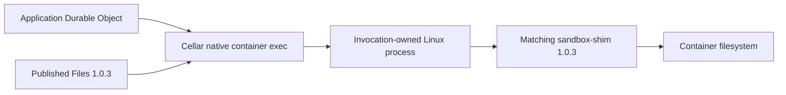

<!-- Copyright 2026 Cellar Project Authors. Licensed under Apache-2.0. -->

# Sandbox 1.0.3: native exec and Files profile

This separate, partial profile preserves the
[celld/Sandbox 0.12.9 baseline](../compat/README.md).



| Input | Pinned identity |
| --- | --- |
| SDK | `@cloudflare/sandbox@1.0.3`; lockfile integrity and imported source hash |
| Helper | `cloudflare/sandbox@sha256:fc1740c3cba26461f0ab1771287c84018ab2cca43a70ebb823087c85d780aaec` |
| Linux base | Node 24.13.1 bookworm-slim, immutable amd64 manifest in [Dockerfile](Dockerfile) |
| Exec signalling | The base provides `/bin/sh`; native exec captures its namespace PID before replacing it with the command and uses the shell's signal builtin |
| Fixture | Cellar application using the unmodified published `Files` implementation |
| Image admission | Native host configuration; application `start({ image })` is unsupported |

## Process API

```ts
const process = await container.exec(["node", "--version"]);
const output = await process.output();
console.log(new TextDecoder().decode(output.stdout), output.exitCode);
await container.setInactivityTimeout(60_000);
```

| Surface | Contract / limits |
| --- | --- |
| Admission | Wait for earlier queued startup; literal argv, nonempty executable without a leading hyphen |
| Environment / user | Explicit cwd/env; user requires numeric UID:GID |
| stdout / stderr | Node byte streams with backpressure; pipe, ignore, or combined stderr |
| stdin | Omitted sends EOF; pipe writes accept Uint8Array and split to the native body limit |
| `output()` | Collect once, with a combined native body-size limit; overflow fails without successful truncation |
| `exitCode` | Nonzero codes resolve normally |
| `kill(signal)` | Promise for native acknowledgement; differs from Cloudflare's void signature |
| Signal | Already aborted refuses allocation; live abort requests SIGKILL; detach listener after exit |
| Controls | Serialize per event; ordinary and cleanup queues each admit at most 64 pending controls |
| Cleanup | Completed streams/exit release native handles; cancellation joins native observation cleanup |

The native signal path requires `/bin/sh`, captures its container namespace PID
before `exec`, and uses the shell's builtin `kill`. Application arguments stay
separate from the static shell source. Images without `/bin/sh` retain direct
exec; signalling refuses an unverified PID. The private identity header is
removed before exposing stdout. Admission bounds pre-header stderr and creates
no background reader until identity is known.

Every handle retains its original invocation. Dropping streams or receiving an
unknown result does not prove termination or undo file writes. Kill or destroy
explicitly when the application requires termination.

The published file API uses the same process surface:

```ts
import { Files } from "@cloudflare/sandbox";

const files = new Files(this.ctx.container);
await files.mkdir("/workspace/data", { recursive: true });
const response = await files.readFile("/workspace/data/example.bin");
// response.body streams helper output; it is not collected into one host body.
return response;
```

The [complete fixture](fixture.mjs) starts the host-configured image and writes,
renames, stats and reads a binary file across separate events.

## Run qualification

Use a private engine/socket and preloaded Cellar fence image:

```sh
npm ci --ignore-scripts --prefix tools/sandbox/cloudflare-v1
npm test --prefix tools/sandbox/cloudflare-v1
npm run build --prefix tools/sandbox/cloudflare-v1
docker --context YOUR_PRIVATE_CONTEXT build --platform linux/amd64 \
  -t cellar-sandbox-v1:1.0.3 tools/sandbox/cloudflare-v1
docker --context YOUR_PRIVATE_CONTEXT image inspect \
  cellar-sandbox-v1:1.0.3 --format '{{.Id}}'
```

Set the immutable local image ID below. Select Node 24+, the locked Rust
toolchain and this checkout's writable `CARGO_TARGET_DIR`.

```sh
CELLAR_SANDBOX_ENGINE_SOCKET=/path/to/private/docker.sock \
CELLAR_SANDBOX_V1_IMAGE=sha256:YOUR_BUILT_IMAGE_ID \
CELLAR_SANDBOX_FENCE_IMAGE=sha256:YOUR_PRELOADED_FENCE_ID \
cargo test --locked -p cellar-javascript --features node \
  --test sandbox_v1 -- --ignored --test-threads=1
```

| Acceptance | Boundary |
| --- | --- |
| Binary stdout/stderr, nonzero exit and missing executable | Native Linux exec and bounded output; shell-backed missing command exits 127 |
| 2 MiB + 17 bytes write/read, rename and stat | Published Files, matching helper and SHA-256 round trip across events; 64 KiB native chunks |
| 70 sequential and two parallel stats | Native handle retirement and mutation admission |
| Missing file | Published `SandboxFileError.is()` and `ENOENT` |
| Quota / live abort | No successful truncation; joined native observation cancellation and explicit container retirement |
| Saved process in later event | Original authority refuses before effects |
| Shutdown | Native cell/application drain; joined Node bridge has zero active invocations and retained bytes; no owned containers; remove only empty labelled test networks |

Ordinary CI verifies inputs, builds the SDK fixture and tests the facade. The
opt-in image campaign uses a 120-second native handler budget, a 30-second JS
execution budget and 2,048 guest operations. Existing 250 ms module fixtures and
the 0.12.9 profile retain their original budgets.

## Repeated-host firewall qualification

The native fence stays within 64 MiB. A terminal own-table observation scopes
nft's cache while the isolation rules are replaced atomically. The
[cache probe](../fence-cache-probe.py) compares the production transaction with
its previous global-cache behavior using `nft --check`; it commits no firewall
changes and removes only its labelled probe containers.

```sh
python3 tools/sandbox/fence-cache-probe.py \
  --context YOUR_PRIVATE_CONTEXT \
  --image sha256:YOUR_PRELOADED_FENCE_ID \
  --require-oom-control
```

`--require-oom-control` requires the previous OOM to reproduce. On a clean
engine, omit it to check production admission and report both measurements.

## Remaining compatibility

This does not qualify all Sandbox 1.x operations. PID/PTY/resize, ReadableStream
input to exec, image selection, snapshots, outbound handlers, S3 mounts,
directory backups, full cancellation/fault/persistence semantics and hosted
Cloudflare remain unsupported or unqualified. The web-stream process facade
requires Node; embedded V8 still lacks that web bootstrap. Supervised remote
cleanup and ownership-transfer qualification remain separate framework work.

Upstream contracts: [1.0 changes](https://developers.cloudflare.com/sandbox/sdk/migrate/changes-in-1-0/),
[Files](https://developers.cloudflare.com/sandbox/reference/files/),
[helper requirements](https://developers.cloudflare.com/sandbox/reference/) and
[container exec](https://developers.cloudflare.com/containers/api/durable-object-container/).
