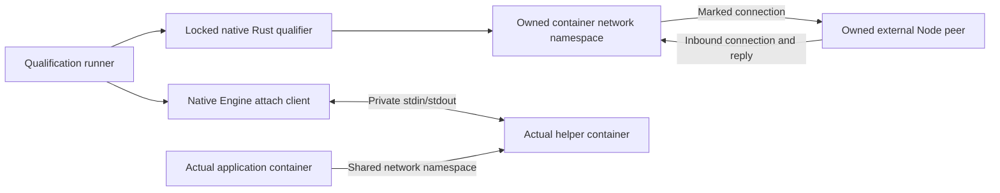

<!-- Copyright 2026 Cellar Project Authors. Licensed under Apache-2.0. -->

# Native outbound network qualification

These campaigns check real Linux nftables, sockets, the network-helper binary
and the native Engine attach client and production cell lifecycle for
[`cellar-egress`](../../../crates/cellar-egress/README.md). They do not run the
published Sandbox SDK or enable the application-facing interception API.



## Run

Use Python 3.11+, Cargo, Docker and an explicit Linux Docker context that permits
`NET_ADMIN` inside a `runc` container. The campaign selects `runc` explicitly;
gVisor, Kata and other runtime profiles require separate qualification.
Start a private VM first when using
Docker from macOS. The runner does not start or reconfigure the VM.

```sh
export CARGO_TARGET_DIR="$HOME/Workspace/crabbuild-target/cellar-9dea"
python3 tools/sandbox/egress/qualify.py \
  --context colima-cellar-sandbox-9dea \
  --output /tmp/cellar-egress-evidence
```

The builder uses `rust:1.98.1-bookworm`; the external peer uses
`node:24.13.1-bookworm-slim`. Override either with `--rust-image` or
`--node-image` when qualifying a separate environment. The native build remains
`--locked`, and its reduced workspace must select registry versions/checksums
from the repository lockfile.
Before building, the runner resolves the Rust base into the daemon image store
and captures its immutable identity and reported digests. The Dockerfile uses
a campaign-owned alias of that exact image with pulling disabled and an explicit
amd64/arm64 platform. Cleanup removes only that alias, preserving the original image.
Evidence uses this captured input even when BuildKit does not retain the source
tag in the daemon. `rust-input.json` records the selected build source.
The host also builds the native `cellar` Engine qualification target with
`--locked`; its target directory must belong to this checkout. No Python runtime
or JavaScript engine is embedded in that native host test.

## Acceptance checks

| Check | Actual boundary |
| --- | --- |
| HTTP redirects | Unmarked TCP to ports 80 and 8080 reaches the proxy listener; kernel original destination and exact bytes survive for IPv4/IPv6 |
| DNS redirects | UDP question/answer routing and reverse-NAT source identity; TCP port-53 redirect and original destination for IPv4/IPv6 |
| Marked bypass | Marked TCP/UDP reaches the intended upstream listener instead of re-entering the proxy |
| Offline fence | A verified live external peer remains unreachable through a new unmarked connection |
| Inbound replies | The peer can initiate a connection and receive the qualifier's reply while offline |
| Atomic replacement | Switching offline → online → offline permits then refuses a fresh unmarked peer connection |
| Non-loopback interception | An offline connection aimed at the external peer's port 80 reaches the local proxy with its original destination intact |
| Docker DNS isolation | A marked observer resolves the owned peer through Docker's actual private DNS socket; an unmarked query receives no DNS data (timeout or the specific kernel `EPERM` refusal) |
| Network helper process | Actual `cellar-egress` binary over nonblocking stdin/stdout; real acknowledged firewall updates and successful joined exit |
| Live rules and DNS | Route replacement over one connection; persistent TCP DNS observes later registrations; UDP forwards verified replies and drops an exercised foreign ID |
| Typed refusal | Offline, unsupported hostname and helper-listener destinations refuse before connecting; external peer counts verify no connection/request effect |
| Installer retirement | Fault-only wrapper stalls startup or an entered update; readiness/route success refuse; retirement kills and reaps the installer before process exit |
| Engine attach | Upgrade private stdin/stdout using the full immutable Engine ID before helper startup; incremental Docker framing carries the real native protocol |
| Helper-first startup | Start a separate Node application container in the exact helper's network namespace only after readiness and acknowledged route installation; actual DNS and HTTP round-trip |
| Failed startup | A missing firewall installer refuses readiness and prevents application allocation; join the failed helper and remove its recorded ID |
| In-flight retirement | Retire the private transport after a real request arrives; subsequent response writes refuse, the application receives no reply bytes and the helper joins |
| Production lifetime | Configure the actual native host, start the helper before its application, verify the immutable shared namespace, warm reconnect and joined removal |
| Production failures | Missing installer refuses before application allocation; killing the actual helper invalidates application routing, preserves its monitor failure and removes the owned pair |
| Capacity | Reserve the application's cap plus 256 MiB for its helper; release the helper reservation after confirmed removal |
| Resource cleanup | Remove recorded IDs, reconcile only this native campaign's owner label after a lost response/timeout, remove the uniquely named network/image and attempt every cleanup |

Each run writes a unique evidence directory containing build/runtime logs,
the peer snapshot and a JSON result grouped by kernel/helper/retirement/engine campaign,
with actual image IDs, kernel/Engine versions, selected runtime,
source revision and hashes of the source snapshot used by the build. Source
hashes distinguish uncommitted qualification from a later commit; native attach
inputs must remain unchanged throughout the campaign. The recorded
revision alone is not an assertion that the checkout was clean. The production
test publishes its node/host ownership before allocation. The outer runner
retains timeout output and reconciles only those validated container/network
identities and their exact nft tables if the native test fails or is killed.
Foreign ownership labels refuse before removal.

BuildKit caches are scoped to the checkout path, with locked sharing. Source
files are touched in the build context before compilation to force rebuilding
the crate; dependency artifacts may be reused. The runner copies the resulting
binaries out of the cache mount into the uniquely tagged qualification image.

## Limits and next integration

The kernel TCP DNS case checks forwarding and bytes; the helper campaign also
exercises the persistent DNS TCP server. Helper direct fallback currently accepts
IP addresses only. The route handler is a native protocol peer; actual
generation-bound Worker dispatch and HTTP body/header bounds remain to be
connected and qualified. The production profile covers native startup, warm
reconnect, installer/helper failure and removal; a native unit test also checks
immediate authority retirement while ownership release waits for SDK control.
Published SDK routing, fleet ownership-transfer failure campaigns and per-class
saturation remain open.

The campaigns use owned namespaces and private Docker networks.
The production profile installs and removes its own host bridge fence and
networks. It does not establish full request routing, published helper
backup/restore, TLS or cloud-provider compatibility. Connect those paths and
qualify them separately.
