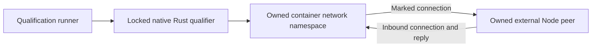

<!-- Copyright 2026 Cellar Project Authors. Licensed under Apache-2.0. -->

# Native outbound network qualification

This campaign checks real Linux nftables and socket behavior for
[`cellar-egress`](../../../crates/cellar-egress/README.md). It does not run the
published Sandbox SDK or claim that the engine supports interception yet.



## Run

Use Python 3.11+, Cargo, Docker and an explicit Linux Docker context that permits
`NET_ADMIN` inside an ordinary container. Start a private VM first when using
Docker from macOS. The runner does not start or reconfigure the VM.

```sh
python3 tools/sandbox/egress/qualify.py \
  --context colima-cellar-sandbox-9dea \
  --output /tmp/cellar-egress-evidence
```

The builder uses `rust:1.98.1-bookworm`; the external peer uses
`node:24.13.1-bookworm-slim`. Override either with `--rust-image` or
`--node-image` when qualifying a separate environment. The native build remains
`--locked`, and its reduced workspace must select registry versions/checksums
from the repository lockfile.

## Acceptance checks

| Check | Actual boundary |
| --- | --- |
| HTTP redirects | Unmarked TCP to ports 80 and 8080 reaches the proxy listener; kernel original destination and exact bytes survive for IPv4/IPv6 |
| DNS redirects | UDP question/answer routing and reverse-NAT source identity; TCP port-53 redirect and original destination for IPv4/IPv6 |
| Marked bypass | Marked TCP/UDP reaches the intended upstream listener instead of re-entering the proxy |
| Offline fence | A verified live external peer remains unreachable through a new unmarked connection |
| Inbound replies | The peer can initiate a connection and receive the qualifier's reply while offline |
| Atomic replacement | Switching offline → online → offline permits then refuses a fresh unmarked peer connection |
| Resource cleanup | Remove only recorded container IDs, the uniquely named network and the uniquely tagged image; attempt all cleanup even after a failure |

Each run writes a unique evidence directory containing build/runtime logs,
the peer snapshot and a JSON result with actual image IDs, kernel version,
source revision and hashes of the source snapshot used by the build. Source
hashes distinguish uncommitted qualification from a later commit; the recorded
revision alone is not an assertion that the checkout was clean.

## Limits and next integration

The TCP DNS case checks kernel forwarding and bytes; a complete persistent DNS
TCP server is still required in the network helper. The marked socket functions
also require their caller to enforce internet policy, reserved destinations,
connection limits and deadlines.

This test uses the qualifier's own namespace and private Docker network. It
does not modify the host's bridge fence or establish that engine startup,
ownership loss, full request routing, helper backup/restore, TLS or cloud
providers work. Connect those paths and qualify them separately.
