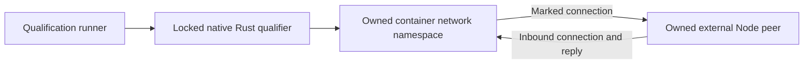

<!-- Copyright 2026 Cellar Project Authors. Licensed under Apache-2.0. -->

# Native outbound network qualification

These campaigns check real Linux nftables, sockets and the network-helper binary for
[`cellar-egress`](../../../crates/cellar-egress/README.md). It does not run the
published Sandbox SDK or claim that the engine supports interception yet.



## Run

Use Python 3.11+, Cargo, Docker and an explicit Linux Docker context that permits
`NET_ADMIN` inside an ordinary container. Start a private VM first when using
Docker from macOS. The runner does not start or reconfigure the VM.

```sh
python3 tools/sandbox/egress/qualify.py \
  --context colima-cellar-sandbox-9dea \
  --output /tmp/cellar-egress-evidence
```

The builder uses `rust:1.98.1-bookworm`; the external peer uses
`node:24.13.1-bookworm-slim`. Override either with `--rust-image` or
`--node-image` when qualifying a separate environment. The native build remains
`--locked`, and its reduced workspace must select registry versions/checksums
from the repository lockfile.

## Acceptance checks

| Check | Actual boundary |
| --- | --- |
| HTTP redirects | Unmarked TCP to ports 80 and 8080 reaches the proxy listener; kernel original destination and exact bytes survive for IPv4/IPv6 |
| DNS redirects | UDP question/answer routing and reverse-NAT source identity; TCP port-53 redirect and original destination for IPv4/IPv6 |
| Marked bypass | Marked TCP/UDP reaches the intended upstream listener instead of re-entering the proxy |
| Offline fence | A verified live external peer remains unreachable through a new unmarked connection |
| Inbound replies | The peer can initiate a connection and receive the qualifier's reply while offline |
| Atomic replacement | Switching offline → online → offline permits then refuses a fresh unmarked peer connection |
| Non-loopback interception | An offline connection aimed at the external peer's port 80 reaches the local proxy with its original destination intact |
| Docker DNS isolation | A marked observer resolves the owned peer through Docker's actual private DNS socket; an unmarked query receives no DNS data (timeout or the specific kernel `EPERM` refusal) |
| Network helper process | Actual `cellar-egress` binary over nonblocking stdin/stdout; real acknowledged firewall updates and successful joined exit |
| Live rules and DNS | Route replacement over one connection; persistent TCP DNS observes later registrations; UDP forwards verified replies and drops an exercised foreign ID |
| Typed refusal | Offline, unsupported hostname and helper-listener destinations refuse before connecting; external peer counts verify no connection/request effect |
| Installer retirement | Fault-only wrapper stalls startup or an entered update; readiness/route success refuse; retirement kills and reaps the installer before process exit |
| Resource cleanup | Remove only recorded container IDs, the uniquely named network and the uniquely tagged image; attempt all cleanup even after a failure |

Each run writes a unique evidence directory containing build/runtime logs,
the peer snapshot and a JSON result grouped by kernel/helper/retirement campaign,
with actual image IDs, kernel version,
source revision and hashes of the source snapshot used by the build. Source
hashes distinguish uncommitted qualification from a later commit; the recorded
revision alone is not an assertion that the checkout was clean.

BuildKit caches are scoped to the checkout path, with locked sharing. Source
files are touched in the build context before compilation to force rebuilding
the crate; dependency artifacts may be reused. The runner copies the resulting
binaries out of the cache mount into the uniquely tagged qualification image.

## Limits and next integration

The kernel TCP DNS case checks forwarding and bytes; the helper campaign also
exercises the persistent DNS TCP server. Helper direct fallback currently accepts
IP addresses only. The route handler is a native protocol peer; actual
generation-bound Worker dispatch, HTTP body/header bounds and engine lifecycle
remain to be connected and qualified. Per-class saturation remains open.

This test uses the qualifier's own namespace and private Docker network. It
does not modify the host's bridge fence or establish that engine startup,
ownership loss, full request routing, helper backup/restore, TLS or cloud
providers work. Connect those paths and qualify them separately.
